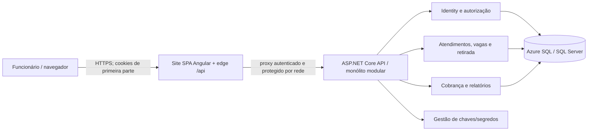
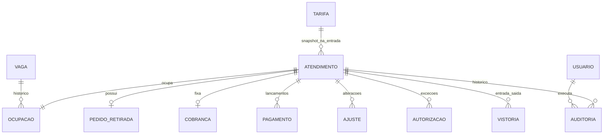
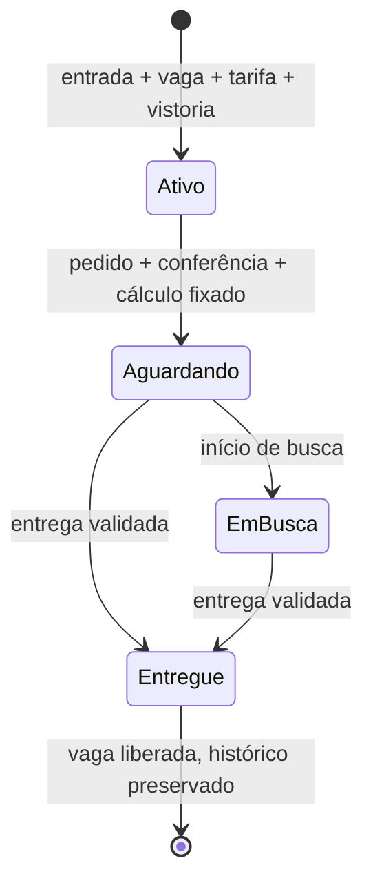

# TDD — Plataforma de Gestão de Estacionamento e Valet

**Status:** Aprovado para orientar o desenvolvimento do MVP; validações pré-produção pendentes

**Data:** 06/11/2026 (revisão do roadmap; versão original de 05/11/2026)

**Aprovação:** design original aprovado pelo solicitante em 05/11/2026; revisão do roadmap, com todo provisionamento e publicação Azure apenas na Fase 5, aprovada pelo solicitante em 06/11/2026. A aprovação do design não dispensa os bloqueios de produção e as verificações indicados neste documento e no PRD.

**Escopo:** MVP de uma unidade; documento de design técnico, não plano de test-driven development.  
**Decisor técnico:** solicitante (decisões registradas na entrevista desta conversa); responsáveis por operação, privacidade e negócio ainda não designados.  
**Fontes:** [`docs/prd.md`](prd.md), aprovado para planejamento; `docs/entrevista.md`, entrevista fictícia; `README.md`, contexto e badges sugestivos, **não** aprovação de stack.  
**Divergências a resolver:** nenhuma alteração pretendida nas regras aprovadas do PRD. Há uma nuance de implementação: o pagamento normal é integral (RF-08); entrega excepcional com saldo não significa habilitar pagamento parcial como fluxo normal. A definição comercial de estorno/ajuste e a retenção de dados seguem pendentes de validação. A mudança de sequência das fases não altera a arquitetura-alvo Azure, mas deixa sua verificação real pendente até a Fase 5.

## 1. Resumo, objetivos e limites

Digitalizar entrada, ocupação de vaga, busca, retirada, cálculo, registro manual de pagamento, entrega e histórico auditável. Priorizar invariantes transacionais (RF-02, RF-08, RF-09; RNF-03), autorização no servidor (RF-10; RNF-01), proteção do documento e das vistorias (RNF-02) e rastreabilidade (RF-11). P1: relatórios sem comprometer as operações P0 (RF-12). Sem gateway, fotos, múltiplas unidades, emissão fiscal, app de cliente ou modo offline no MVP. A unidade, demanda, horário local, tarifa inicial, SLA e políticas de retenção/backup não são fatos conhecidos: são condições de implantação, não valores arbitrados aqui.

## 2. Registro central de decisões

**Origem:** “solicitante/inicial” = pedido desta conversa; “solicitante/entrevista” = respostas às perguntas técnicas; “PRD” = requisito aprovado. Versões não explicitamente confirmadas serão fixadas e verificadas antes da implementação, sem inferir aprovação dos badges do README.

| ID | Tema | Decisão e estado | Origem/decisor | Justificativa, alternativas e consequências |
| --- | --- | --- | --- | --- |
| DT-01 | Frontend | **Confirmada:** Angular **22**, TypeScript, componentes standalone, Zoneless, Signals e Signal Forms. | Solicitante/inicial e entrevista | Estado reativo sem ZoneJS; alternativa Reactive Forms. Verificar compatibilidade de cada dependência e testes com Angular 22; manter validação autoritativa no servidor. Zoneless é o padrão documentado desde Angular 21. |
| DT-02 | UI | **Confirmada:** Tailwind CSS e Lucide Icons; componentes e controles Angular nativos, sem Angular Material no MVP. | Solicitante/entrevista | Flexibilidade e menos dependências de componentes; exige cuidado explícito com teclado, foco, contraste e rótulos. Versões compatíveis a fixar. |
| DT-03 | Backend | **Confirmada:** C#/.NET **10**, ASP.NET Core Web API com controllers, solução `.slnx`, Clean Architecture e DDD pragmático. | Solicitante/inicial e entrevista | Casos de uso independentes de HTTP e EF; alternativa Minimal APIs. Evitar agregados artificiais e abstrações genéricas desnecessárias. |
| DT-04 | Topologia | **Confirmada:** monólito modular, uma API de negócio, módulos internos de Atendimento/Retirada, Vagas, Cobrança, Identidade e Relatórios. | Solicitante/entrevista | Uma transação relacional para invariantes; alternativa microsserviços exigiria coordenação distribuída. Módulos não significam deploys separados. |
| DT-05 | Persistência | **Confirmada:** SQL Server com Entity Framework Core, migrações versionadas; hospedagem alvo Azure SQL. | Solicitante/entrevista | Integridade e consultas transacionais; alternativa PostgreSQL. Escolher versões de EF Core/provider compatíveis com .NET 10 ao iniciar; não inferir versão do badge do README. |
| DT-06 | Autenticação | **Confirmada:** ASP.NET Core Identity com sessão em cookie seguro, HttpOnly, de primeira parte; papéis fixos manobrista, caixa, administrador. | Solicitante/entrevista; RF-10 | Alternativas OIDC/tokens. Provisionamento administrativo, sem autorregistro; autorização por operação e projeção de leitura. |
| DT-07 | Publicação web | **Confirmada como arquitetura-alvo da Fase 5:** SPA e API hospedadas em **sites distintos** na Azure, mas navegador usa exclusivamente `/api` no site da SPA por meio de proxy reverso/BFF; API não recebe cookies cross-site diretamente do browser. Nas Fases 1–4, validar esse contrato com edge e API locais separados, sem declarar a fronteira de rede Azure testada. | Solicitante/entrevista, inclusive ajuste após identificar bloqueio de cookies de terceiros; faseamento confirmado em 06/11/2026 | Alternativas: mesma origem de hospedagem ou OIDC/tokens. O edge deve encaminhar cookies/headers e respostas de autenticação sem expor API pública ao navegador; controlar acesso direto à API, cabeçalhos e confiança entre edge/API. Não adicionar um segundo backend de domínio. |
| DT-08 | Atualização de operação | **Confirmada:** polling curto e configurável da fila/vagas, refetch após comando e ao recuperar foco; sem SignalR no MVP. | Solicitante/entrevista | Menos infraestrutura; atraso controlado, mas tela nunca é fonte de verdade para disponibilidade. Medir intervalo/carga no piloto (RNF-05). |
| DT-09 | Proteção sensível | **Confirmada como desenho inicial:** criptografia de campo para número de documento e textos de vistoria, menor privilégio e trilha de acessos relevantes. **Pendente para produção:** política de acesso, chaves, retenção e descarte aprovada por negócio/privacidade. | Solicitante/entrevista; RNF-02 | Complementa TLS e criptografia do banco; busca por placa/ID não requer decifrar documento. Evitar indexar texto confidencial; mascarar campos na UI e nos logs. |
| DT-10 | Testes | **Confirmada:** MSTest (.NET) para unidade/integração, SQL Server real nos testes de integração; Vitest (frontend), Playwright (E2E). | Solicitante/inicial e entrevista | SQLite/InMemory não reproduzem restrições SQL Server; E2E cobre fronteiras de perfil/sessão. Fixar versões e runner compatíveis ao configurar o projeto. |
| DT-11 | Entrega | **Confirmada com faseamento revisado:** testes locais nas Fases 1–4; CI no GitHub Actions será detalhada em change própria, fora do escopo desta fundação; **somente na Fase 5**, provisionar recursos Azure, implantar pela primeira vez em homologação, executar validações reais e, após aprovações, publicar em produção com migração controlada/deploy. Sem fornecedor de pagamentos. | Solicitante/entrevista; PRD; adiamento confirmado em 06/11/2026 | Serviços gerenciados reduzem operação própria; escolha de SKU, rede, custos e serviços exatos condicionada à validação de operação e segurança. Testes locais não substituem gates de homologação Azure. |
| DT-12 | Consistência | **Definida neste TDD para cumprir PRD:** comandos atômicos com constraints SQL, `rowversion` quando há mutação concorrente, idempotência em comandos críticos e auditoria na mesma transação. | Derivada de RF-02, RF-08, RF-09, RF-11; RNF-03 | Alternativa bloqueios distribuídos é excessiva no monólito; conflitos resultam em resposta explícita e recarga, nunca sobreposição silenciosa. |
| DT-13 | Relatórios | **Definida neste TDD:** consultas somente leitura sobre dados operacionais e eventos imutáveis, sem banco analítico no MVP. | Derivada de RF-12 e DT-04 | Simples para uma unidade; agregar/materializar apenas se medições do piloto demonstrarem necessidade. |
| DT-14 | Tempo e valores | **Definida neste TDD:** instante UTC persistido, conversão para fuso configurado da unidade em exibição/agrupamento; dinheiro em decimal com precisão explícita no SQL; relógio do servidor é fonte de eventos. | Derivada de RF-06, RF-07, RF-12 | Evita depender do relógio do navegador e de horário de verão para períodos de 24 h. Fuso e moeda/regra de arredondamento final são dados de implantação a confirmar. |

## 3. Arquitetura e organização



**Fronteira de confiança (DT-06/07):** este diagrama representa a **topologia-alvo para publicação na Fase 5**. Os sites de hospedagem são distintos, mas todas as requisições do browser, inclusive login, antiforgery e logout, atingem o edge na origem da SPA. A API é protegida contra bypass do proxy por restrição de ingress/rede e autenticação entre serviços; não aceitar cabeçalhos de identidade do cliente como prova de autenticação. O proxy preserva sem adulterar `Set-Cookie`/`Cookie`, caminho `/api`, cabeçalhos de CSRF e IP de origem por cadeia de proxies confiáveis. Cookies host-only do site da SPA; não configurar domínio de cookie no site da API. HTTPS obrigatório ponta a ponta. Nas Fases 1–4, usar SPA/edge e API locais separados e testes em navegador com origem local segura; isto verifica o comportamento lógico, **não** prova ingress restrito, proteção do tráfego entre sites nem cookies no domínio Azure. Na Fase 5, validar o fluxo em homologação Azure **antes da publicação em produção**: um proxy mal configurado inviabiliza a sessão. O edge encaminha, não executa regras de negócio.

Estrutura proposta (DT-01–05, DT-10):

```text
frontend/                         Angular 22
  src/app/core/                   sessão, transporte HTTP, erros, guards
  src/app/features/               check-in, vagas, retirada, cobrança, admin, relatórios
  src/app/shared/                 componentes acessíveis, formatação, estados
backend/
  Estacionamento.slnx
  src/Estacionamento.Api/         controllers, DTOs, políticas, middleware, composição
  src/Estacionamento.Application/ casos de uso, portas, projeções, autorizações de ação
  src/Estacionamento.Domain/      entidades, valores, regras e eventos de domínio
  src/Estacionamento.Infrastructure/ EF Core, Identity, criptografia, auditoria, consultas
  tests/Estacionamento.UnitTests/
  tests/Estacionamento.IntegrationTests/
tests/e2e/                        Playwright
```

Dependências: Api → Application e Infrastructure (composição); Infrastructure → Application/Domain; Application → Domain; Domain → nenhuma camada externa. Separar funcionalidades internamente por módulo/caso de uso, não por controllers inchados nem repositório genérico. DTOs nunca expõem entidades EF ou número de documento por padrão. Frontend por funcionalidade, com Signals para estado local/derivado e Signal Forms para entrada/validação; chamadas HTTP na camada de serviços; rotas/guards apenas complementam a autorização da API. Polling pausa em aba inativa, usa cancelamento e evita requisições sobrepostas; mutation sempre força releitura (DT-08).

## 4. Modelo de dados, estados e concorrência



**Entidades e invariantes (DT-05/12/14):** `Atendimento` tem ID interno e identificador público único, placa normalizada (não única historicamente), modelo, titular, documento criptografado, tarifa capturada na entrada, operador, horários e estado; `Vaga` tem código único e status derivável da ocupação aberta; `Ocupacao` guarda início/fim e responsável. `Vistoria` textual, tipo entrada/saída e autor; `PedidoRetirada` tem verificação presencial (resultado, operador, horário), hora fixadora de cobrança e estados; `Cobranca` preserva base original (tempo em segundos, diárias, tarifa e total); `Ajuste`/`Pagamento`/`Autorizacao` são lançamentos não apagáveis; `Auditoria` referencia ator, ação, atendimento, horário e metadados mínimos. `Tarifa` é versionada; editar tarifa cria nova vigência e não altera snapshots. Usuários Identity e perfis são separados dos registros históricos; desativar funcionário não apaga autoria.

Restrições SQL: identificador único; código de vaga único; índice único **filtrado** em `Ocupacao(vaga_id)` onde `fim IS NULL`; índice único de pedido por atendimento (um pedido no ciclo do MVP); referências obrigatórias; índices em placa normalizada+horário, identificador, estado/horário de pedido e eventos de ocupação/horários. Índice filtrado e/ou constraint impedem dupla ocupação mesmo quando duas leituras veem a vaga livre; erro vira conflito HTTP, não erro genérico. Marcar entidades mutáveis de atendimento/vaga com `rowversion`; entregar somente se a ocupação aberta referenciar o atendimento correto. Eventos financeiros e trilha não sofrem `UPDATE`/`DELETE` por operações normais. Criptografia de campo deve preservar acesso ao documento para conferência autorizada; não registrar documento puro em auditoria, telemetria ou índices. Chaves versionadas permitem rotação sem perda de leitura do histórico; procedimentos de recuperação dessas chaves acompanham backup.



Fila: `aguardando → em busca → entregue`; a passagem direta de aguardando para entregue permite operação rápida sem inventar etapa obrigatória de busca, mas sempre exige pedido prévio. Conferência divergente é registrada no pedido e bloqueia **entrega normal** até autorização de administrador; não apaga o pedido nem refaz o cálculo. No instante transacional do pedido, `diárias = max(1, teto((pedido_utc - entrada_utc)/24h))`; exatas 24 h = 1, 24 h + 1 segundo = 2. Total inicial = diárias × tarifa snapshot; tempo e valor ficam imutáveis. Aplicar ajustes posteriores como lançamentos justificados de administrador, preservando base e histórico. Pagamento normal deve ser integral do saldo exigível; tentativa parcial é recusada. Estorno compensatório reabre saldo se cabível; entrega com saldo somente mediante autorização específica, nunca por pagamento parcial implícito. Cobrado, pago e saldo são calculados com ajustes/lancamentos, inclusive depois de atendimento encerrado, sem editar lançamentos anteriores. Detalhes comerciais de desconto/estorno e efeitos de eventual pagamento posterior são pendência de negócio antes da implementação financeira final.

**Transações:** check-in insere atendimento, snapshot de tarifa, vistoria, ocupação e auditoria atomicamente; pedido cria verificação, cobrança e evento; pagamento cria lançamento/quitação; entrega valida autorização vigente, vistoria, cobrança, ocupação, encerra pedido/atendimento/ocupação e grava auditoria na **mesma transação**. Em conflito de `rowversion` ou unicidade, rollback e `409` com estado recarregável. Para erro transitório de Azure SQL na Fase 5, retry só da unidade transacional inteira e com idempotência; não repetir cegamente operações de escrita após timeout de resultado desconhecido. Migrações EF Core versionadas e exercitadas em SQL Server local/CI nas Fases 1–4; revisar/aprovar sua aplicação em homologação e produção na Fase 5 antes de liberar tráfego; migrations destrutivas exigem estratégia compatível/backup e janela de mudança.

## 5. Interfaces, autorização e sequências

API HTTP JSON versionada em `/api/v1`, contrato OpenAPI gerado dos endpoints e exemplos de erros versionados. Endpoints **propostos para revisão de contrato**, sem impor nomes de DTOs: login/logout/estado da sessão e antiforgery; usuários/perfis; vagas; tarifas; atendimentos (criar, buscar, detalhar); pedidos de retirada (criar, listar, iniciar busca); cobrança, ajustes, pagamentos, autorizações; entrega; auditoria; relatórios. Busca por placa retorna lista paginada e distingue visitas por identificador/entrada; lista de vagas/fila é paginável/filtrável. Servidor valida formato, tamanho, transições, direitos e invariantes; hora e valores enviados pelo cliente não prevalecem sobre cálculo do servidor. Não expor dados financeiros nas projeções do manobrista nem número de documento em listagens; caixa/admin recebem apenas dados necessários à conferência presencial, com leitura auditável. Autenticar e autorizar cada operação no servidor; matriz base:

| Operação | Manobrista | Caixa | Admin |
| --- | --- | --- | --- |
| Consultar veículo/vaga/fila; vistoria e início de busca | Sim, sem finanças/documento completo | Sim | Sim |
| Check-in, pedido, cobrança e pagamento, entrega normal | Não | Sim | Sim |
| Tarifa, acessos, ajustes, exceções, relatórios financeiros | Não | Não | Sim |
| Consultar histórico financeiro/documento para conferência | Não | Somente se necessário à operação | Sim, com trilha |

**Sessão/CSRF (DT-06/07):** Identity autentica funcionários previamente provisionados. Cookie de sessão HttpOnly, Secure, SameSite adequado à navegação de primeira parte, duração/expiração e bloqueio de login configuráveis antes da produção. Endpoint de emissão de token antiforgery pela origem `/api`; token de requisição apresentado pela SPA em cabeçalho para **todas** as operações mutáveis (inclusive login/logout); servidor valida token e origem esperada. Não confiar somente em SameSite ou em guard Angular. Proxy não deve cachear respostas privadas nem encaminhar cookies a destinos arbitrários; controles de rate limit em login, política de senhas, rotação de segredos e proteção contra enumeração. APIs externas diretas não recebem sessão do browser; restringir ingress da API ao proxy/rede autorizada **na Fase 5**. Testar `Set-Cookie`, expiração, CSRF e logout com navegador real localmente desde a Fase 1 e repetir em homologação Azure na Fase 5.

**Erros e idempotência:** `400` dados inválidos, `401` sem sessão, `403` sem permissão, `404` recurso inexistente ou não revelável, `409` conflito de estado/ocupação/pedido repetido, `422` regra de domínio não satisfeita (p.ex. entrega sem vistoria); `5xx` falha inesperada com ID de correlação, nunca stack trace/dados sensíveis. Comandos de check-in, pedido, pagamento e entrega levam chave de idempotência gerada por ação do cliente; persistir chave+ator+operação+hash canônico do pedido+resultado em transação, com restrição única. Mesma chave/mesmo conteúdo retorna resultado original; mesma chave/conteúdo diferente é conflito. Não liberar vaga duas vezes nem lançar pagamento duas vezes se navegador repetir/timeout. TTL de chaves a definir conforme janela operacional e retenção; registros de negócio não são apagados pelo TTL. Sem token ou chave, um retry automático de escrita não é seguro. Leituras GET podem ser repetidas; políticas de cache evitam dados pessoais persistidos em proxies.

```mermaid
sequenceDiagram
  actor Caixa
  participant UI as SPA / proxy
  participant API as API / casos de uso
  participant SQL as SQL Server
  Caixa->>UI: solicita retirada e informa conferência presencial
  UI->>API: POST pedido (cookie, CSRF, chave idempotente)
  API->>SQL: transação: verificar ativo/sem pedido, fixar hora/diárias/total, auditar
  SQL-->>API: commit ou conflito
  API-->>UI: identificador, estado, cobrança ou erro
  UI->>API: GET fila (polling)
  Caixa->>UI: registra pagamento integral e entrega
  UI->>API: comandos com novas chaves e CSRF
  API->>SQL: validar saldo/conferência ou autorização; gravar vistoria/entrega/liberação/auditoria
  SQL-->>API: commit único ou rollback
  API-->>UI: estado final ou conflito com recarga
```

Falha de rede antes de saber se houve commit: repetir **a mesma chave** e consultar estado, nunca iniciar novo pagamento com outra chave sem verificar o lançamento anterior. Divergência documental exige exceção registrada e autorizada pelo admin; saldo pendente exige autorização independente, vinculada ao atendimento, tipo de exceção, justificativa, autor e horário. Resposta de autorização não substitui pagamento ou conferência; vale apenas para a entrega correspondente. Sem integrações externas de pagamento, tickets ou fiscal no MVP (PRD §10).

## 6. Segurança, operação e implantação

**Ameaças e controles (DT-06/07/09/12):** acesso indevido de manobrista a finanças/documento; CSRF e roubo de sessão; tentativa de entrega fraudulenta; dupla ocupação/cobrança; logs vazando PII; backup sem chaves. Aplicar autorização por ação e por campo no servidor, conferência presencial com número/documento de foto, justificativa para exceção, TLS, criptografia do banco e campos sensíveis, segregação de contas de serviço, armazenamento gerenciado de segredos/chaves, rotação testada, proteção da cadeia proxy/API e auditoria append-only protegida contra edição por perfis comuns. Política de leitura do número completo e retenção/descarte depende de responsável de privacidade; **não lançar produção com essa política indefinida**. Vistorias são somente texto (PRD), sem anexos.

**Observabilidade (RNF-05–07):** logs estruturados com correlation ID, ator interno pseudonimizado quando possível, ação, resultado, latência e conflito; métricas de logins falhos, erros HTTP, fila/polling, indisponibilidade SQL, colisões de vaga, pagamentos e exceções; trilha de negócio na transação, separada de logs técnicos. Não incluir documento, vistoria, cookie nem payload financeiro sensível em logs/traces. Alertas e retenção operacional a aprovar com administrador. UTC para eventos; fuso da unidade para períodos de relatório. Receita por período = pagamentos registrados no período; cobrado = cobranças/ajustes com recorte definido em relatório; saldos pendentes incluem entregas excepcionais. Documentar definição de cada métrica para evitar somas de bases temporais diferentes; validar com financeiro no piloto.

**Desenvolvimento local da Fase 1 (DT-10/11):** SQL Server real isolado, SPA/edge e API em processos separados, origem segura de teste, segredos fora do repositório e key ring de teste persistente entre reinícios locais. CI não integra esta change; sua especificação e implementação ficam para change própria. Nas fases locais, não criar nem provisionar recursos Azure, não publicar em homologação/produção e não executar CD ou migrations em banco Azure. A infraestrutura local é equivalente apenas para testar comportamento, nunca prova restrição de rede entre sites publicados ou recuperação gerenciada.

**Bootstrap local revisado em 06/11/2026 (solicitante):** exclusivamente quando o ambiente da API for `Development`, criar escopo de DI no `Program.cs`, executar `Database.MigrateAsync()` do `IdentityDbContext` e em seguida `SyntheticAccountProvisioner.ProvisionAsync(...)` antes de `Run()`. Falha de conexão, migração ou ausência de qualquer senha sintética impede que a API aceite tráfego; reinícios não duplicam dados nem redefinem senhas. Configuração vem de User Secrets/ambiente, sem senha versionada. O comando de provisionamento legado pode permanecer para uso explícito apenas local. Testes de integração usam ambiente `Testing` e banco dedicado, sem carregar User Secrets locais nem executar bootstrap da API; scripts E2E locais em `Development` precisam fornecer as três senhas ao processo. Este atalho é estritamente local: homologação e produção preservam revisão e aplicação separadas de migrações, sem seed automático.

**Azure e publicação na Fase 5 (DT-07/11):** definir com operação/infra serviços/SKUs, domínios, rede e custos; provisionar primeiro o ambiente de homologação, com edge HTTPS no site da SPA e proxy `/api`, API hospedada separadamente com ingress restrito e autenticação entre serviços, Azure SQL gerenciado, segredos/chaves gerenciados e armazenamento durável do key ring Data Protection. Implantar **primeiro em homologação**, com dados sintéticos e migrações revisadas/aprovadas; validar no navegador real cookies, CSRF, logout, headers, origens, acesso direto à API negado, jornadas completas, métricas e backups. Somente após esses testes e as aprovações de negócio, privacidade e operação, provisionar produção isolada e configurar CD com credenciais de curta duração, aprovação e migração controlada para publicar; smoke tests de login/check-in/pedido/entrega e monitoramento após o deploy. Rollback do aplicativo para versão compatível com esquema anterior; migrações preferencialmente aditivas/expand-contract. Restore do SQL **e** das chaves de campo/Data Protection deve ser exercitado antes de produção; RPO/RTO, retenção, disponibilidade e contingência para rede indisponível são bloqueios de produção a validar com operação. Sem prometer operação offline ou ausência absoluta de perda em falhas de infraestrutura; transações confirmadas devem sobreviver ao processo e restore deve cumprir metas aprovadas.

## 7. Qualidade e verificação

| Nível | Verificações mínimas e rastreabilidade |
| --- | --- |
| Unidade — MSTest | Máquina de estados, tarifação em 0/24/24h+1s/48h, snapshot de tarifa, saldo e autorização, permissões de caso de uso (RF-04–10). |
| Integração — MSTest + SQL Server real | Migrações, índices filtrados, EF `rowversion`, transações/auditoria, criptografia/rotação e múltiplos escritores concorrentes sobre a mesma vaga, pedido, pagamento e entrega; retry/idempotência após timeout (RF-01/02/08/09/11; RNF-03). |
| Contrato/API | OpenAPI e testes HTTP de projeções por perfil, erros, paginação, sessão, CSRF, autenticação e negação mesmo com cabeçalhos de identidade falsificados em testes locais; bloqueio de ingress direto verificado adicionalmente na Azure somente na Fase 5 (RF-03/10; RNF-01/02). |
| UI — Vitest | Signal Forms, validações e estados textuais, polling sem requisição sobreposta, expiração de sessão e feedback de conflitos; testes com configuração Zoneless coerente (RNF-04/05). |
| E2E — Playwright | Jornadas de check-in até entrega, ticket extraviado, documentos divergentes, exceções, tarifa alterada, relatórios restritos, cookies/CSRF via edge local nas Fases 1–4 e repetição no domínio publicado em homologação na Fase 5, repetição de comando e teclado (RF-01–12; RNF-01/04). |
| Não funcionais | Auditoria de vazamento de PII em logs/respostas e revisão local de acesso desde as fases de construção; testes de carga/piloto, isolamento Azure, restore de SQL/chaves, rollback e verificação de acessibilidade com equipe antes de publicar em produção na Fase 5 (RNF-02/04/05/06/07). |

Critérios técnicos de gate: nenhuma dupla ocupação ou liberação/pagamento duplicado em testes concorrentes; nenhum fluxo não autorizado alcança dados financeiros/documentais; snapshot e valores originais preservados; relatórios reconciliam lançamentos, inclusive saldo após entrega. Testes locais autorizam avanço entre as Fases 1–4, **não** publicação. Na Fase 5, resultado de restore e métricas de latência devem ser confrontados com metas **a aprovar** antes de produção; validar também a fronteira real edge/API. Critério normativo/nível de acessibilidade ainda depende de produto/design; navegação por teclado e rótulos textuais são obrigatórios desde o MVP.

## 8. Roadmap de implementação (sem implementação neste documento)

Fases sequenciais por dependência, **sem prazos ou estimativas assumidos**. As Fases 1–4 executam localmente; CI será introduzida por change própria, sem provisionamento Azure, publicação em homologação/produção ou CD. Cada fase entrega uma fatia verificável e só libera a próxima quando seu critério de saída local for atendido. A Fase 5 concentra provisionamento Azure, primeira publicação em homologação, piloto e, apenas com gates cumpridos, publicação em produção. A conclusão do P0 não implica autorização para publicar.

| Fase | Escopo e entregáveis | Dependência / critério de saída |
| --- | --- | --- |
| **1 — Fundação e infraestrutura local** | Registrar fuso, moeda, volumes, topologia-alvo edge/API e política de dados como decisões/pendências, sem inventar valores; criar solução `.slnx`, Angular, SQL Server de teste, configuração de segredos locais e proxy `/api`; estabelecer sessão, autorização básica e antiforgery. CI, Azure, IaC e CD ficam fora desta change. | **Início do projeto.** Navegador real em origem local segura demonstra login/logout, cookie de primeira parte e CSRF; testes automatizados locais e migração Identity em SQL Server local passam, versões são fixadas e verificadas (DT-01/05–07/10/11; RF-10; RNF-01/02). Ingress restrito na Azure e pendências de privacidade permanecem explicitamente **não validados**. |
| **2 — Preparação e entrada (P0)** | Identity e perfis, cadastro de vagas e tarifa versionada, migrações/constraints, check-in com snapshot, vistoria de entrada e busca por placa/ID; auditoria e idempotência do check-in, sempre com SQL Server local/CI e edge local. | **Após fase 1.** Testes de integração com SQL Server real comprovam autorização por perfil, entrada atômica e impossibilidade de dupla ocupação sob concorrência; jornada de entrada demonstrável **localmente**, sem publicação (RF-01–03/07/10/11; RNF-03). |
| **3 — Retirada e caixa (P0)** | Pedido e conferência presencial, fila/polling, cobrança fixada em diárias, pagamento integral, ajustes/estornos compensatórios e autorizações de exceção auditadas, com testes locais/CI. | **Após fase 2.** Negócio/financeiro aprova regras ainda pendentes de ajustes/estornos e acerto de saldo **antes da implementação financeira final**. Testes locais cobrem limites de 24 h, snapshot, perfis, pedido/pagamento repetidos e timeout com mesma chave idempotente (RF-04–08/10/11). |
| **4 — Entrega e operação completa (P0)** | Vistoria de saída, entrega e liberação transacionais, histórico, logs e alertas sem PII; jornadas E2E locais de perfis, divergências e saldo excepcional. | **Após fase 3.** Entrega normal só conclui com conferência e quitação; exceções exigem autorização específica. Testes concorrentes e E2E locais provam ausência de liberação/pagamento duplicado, preservação da auditoria e reconciliação de saldos (RF-09–11; RNF-01–03/07). **P0 funcional concluído localmente, não homologado na Azure nem autorizado para produção.** |
| **5 — Relatórios (P1), Azure, piloto e liberação** | Concluir relatórios por período, receita e saldos e verificar recortes no CI local; definir com operação/infra topologia/SKUs/domínios/rede; **provisionar pela primeira vez** o ambiente Azure de homologação (edge, API, SQL, segredos e chaves). Implantar **primeiro em homologação** com dados sintéticos e migrações controladas; repetir E2E de P0/P1 no domínio real, validar ingress restrito, cookies/CSRF, desempenho, acessibilidade, monitoramento, restore e rollback. Depois das aprovações e gates, provisionar produção isolada e publicar com CD controlado, smoke e acompanhamento do piloto. | **Após fase 4.** Financeiro valida recortes e reconciliação (RF-12); infra/segurança validam edge/API e isolamento real (DT-07/11); operação/privacidade aprovam acesso, retenção/descarte, chaves, SLAs, RPO/RTO e contingência (RNF-02/04–07). Exercitar restore de SQL **e** chaves, rollback e gates do PRD §12 em homologação **antes** de autorizar produção. Falha em qualquer gate impede publicação em produção, sem presumir aprovação pela conclusão local. |

Migração inicial cria esquema vazio em SQL Server local na Fase 1; não há importação automática no MVP. **Somente na Fase 5**, aplicar migrações revisadas em Azure SQL: rollout primeiro em homologação com dados sintéticos, validar operações e infraestrutura, depois cadastrar vagas/usuários/tarifa reais em produção antes do primeiro check-in. Rollback de release conserva registros e usa versão anterior compatível; jamais apagar lançamentos confirmados para reverter deploy. Não há piloto operacional com dados reais antes da publicação autorizada na Fase 5. Bloqueios de negócio e privacidade não podem ser contornados antecipando uma fase.

## 9. Riscos, alternativas e pendências

| Item | Situação/risco e encaminhamento |
| --- | --- |
| Edge em site diferente da API | **Decisão confirmada para a Fase 5**, porém risco de cookie/CSRF/proxy incorretos não se encerra com testes locais das Fases 1–4. Repetir E2E no domínio Azure real e verificar ingress restrito e autenticação entre serviços em homologação antes de publicar em produção; alternativa se inviável: rever sites e autenticação com solicitante (DT-06/07). |
| Publicação concentrada na última fase | Integração de infraestrutura e risco de implantação são descobertos tardiamente. Mitigar com edge/API locais separados e testes de navegador desde a Fase 1; planejar CI em change própria e reservar tempo de revisão infra/segurança, homologação Azure e correções na Fase 5, sem encurtar seus gates (DT-07/11). |
| Concorrência/latência | Polling e snapshots podem ficar defasados; constraints e transações são autoridade. Medir pico/rede, ajustar intervalo e índices com operação (DT-08/12). |
| Políticas comerciais | **Pendente:** regras exatas de desconto/estorno, acerto de saldo após entrega e definição de fechamento/recortes financeiros. Negócio/financeiro aprova exemplos e reconciliação antes do fluxo financeiro final; não criar estorno silencioso. |
| Privacidade | **Bloqueio de produção:** acesso autorizado ao documento, retenção/descarte, rotação/recuperação de chaves e retirada por terceiro. Administrador/privacidade valida procedimento (DT-09). |
| Disponibilidade e backup | **Bloqueio de produção:** RPO/RTO, política de backup/restore, plano de falha de rede e escala. Administrador/operação define após piloto e ensaio (RNF-05/06). |
| Implantação | **Pendente para a Fase 5:** tarifa inicial, mapa de vagas, usuários, fuso, moeda, volumes, domínios, serviço/SKU Azure e metas. Negócio/operação/infra confirmam antes do provisionamento/publicação conforme aplicável; stack geral já está decidida. |
| Bibliotecas e versões | Angular 22 e .NET 10 confirmados; EF Core/provider, Tailwind, Lucide, Identity, Vitest, Playwright e MSTest têm **produtos confirmados, versões a fixar e verificar** no início da implementação. Signal Forms deve ser validado contra a documentação de Angular 22 no momento de fixar dependências. |

### Mapa de rastreabilidade

| Requisitos PRD | Componentes | Decisões | Verificação |
| --- | --- | --- | --- |
| RF-01–03, RNF-03 | Atendimento, Vagas, SQL, UI | DT-01/03/05/12/14 | Unitários, integração concorrente, E2E entrada/busca |
| RF-04–06 | Retirada, Cobrança, fila | DT-04/08/12/14 | Limites de 24 h, pedido duplicado, transições, polling |
| RF-07–09 | Tarifa, Pagamento, Autorização, Entrega | DT-05/12/14 | Snapshot, transação, idempotência, exceções e saldo |
| RF-10, RNF-01/02 | Identity, edge, API, projeções | DT-06/07/09 | Matriz HTTP de perfis, CSRF, dados mascarados, E2E |
| RF-11, RNF-07 | Auditoria, logs | DT-09/12 | Autoria/timestamp em toda ação crítica; sem PII em logs |
| RF-12, RNF-05 | Relatórios, SQL | DT-08/13/14 | Reconciliação por período, pendência pós-entrega, piloto de carga |
| RNF-04/06 | UI, pipeline, infraestrutura | DT-01/02/10/11 | Teclado, revisão de acessibilidade, restore e rollback |
| RNF-01/02/06/07 | Edge, API e Azure SQL na publicação | DT-07/09/11 | Fase 1: testes locais; CI será detalhada separadamente; Fases 2–4: CI/E2E locais; Fase 5: homologação real, ingress restrito, sessão/CSRF no domínio publicado, restore e aprovação antes de produção |

**Referências técnicas consultadas:** [Angular Signal Forms](https://angular.dev/guide/forms/signals/overview), [Angular Zoneless](https://angular.dev/guide/zoneless), [ASP.NET Core antiforgery](https://learn.microsoft.com/aspnet/core/security/anti-request-forgery), [EF Core concurrency](https://learn.microsoft.com/ef/core/saving/concurrency), [EF Core connection resiliency](https://learn.microsoft.com/ef/core/miscellaneous/connection-resiliency) e [MSTest](https://github.com/microsoft/testfx). As versões de dependências não confirmadas aqui não são inferidas dessas referências.
