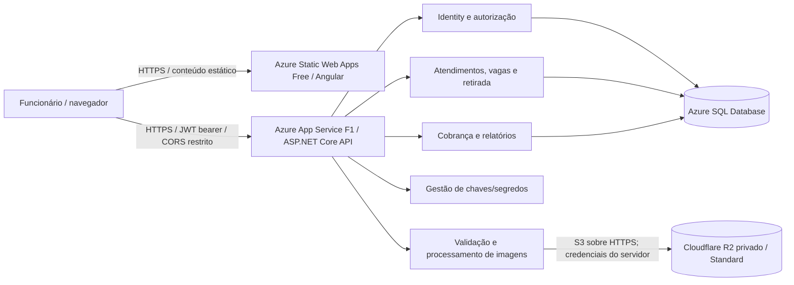
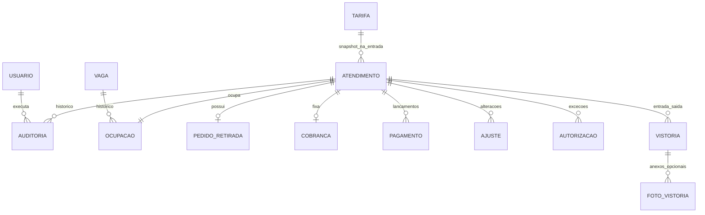
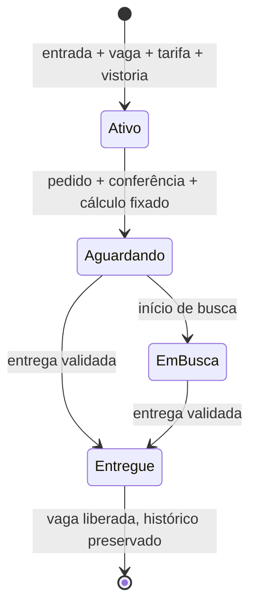
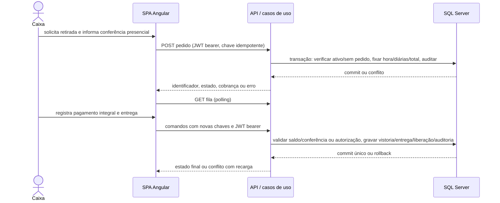

# TDD — Plataforma de Gestão de Estacionamento e Valet

**Status:** Base documental consolidada de design técnico do MVP

**Data:** 06/11/2026 (revisão do roadmap; versão original de 05/11/2026)

**Revisão documental:** 16/11/2026

**Contexto documental:** este TDD compõe a base documental do projeto, elaborada fora do fluxo de desenvolvimento. Registra o desenho proposto de arquitetura, contratos, dados, segurança, testes e roadmap para implementação futura; não registra código existente, versões instaladas ou testes executados. As validações técnicas e pré-produção permanecem necessárias.

**Roadmap:** Fases 1–4 para o P0 textual; Fase 5 para fotos opcionais de vistoria com Cloudflare R2, antes da publicação; Fase 6 para relatórios, provisionamento Azure, homologação, piloto e produção. A integração R2 de teste na Fase 5 não antecipa a publicação da aplicação.

**Planejamento da Fase 3:** regras F3-R01–04 do PRD §5.4 definidas para a demonstração acadêmica. O detalhamento abaixo orienta especificação futura; não presume validação por operação/financeiro reais.

**Planejamento da Fase 4 (16/11/2026):** a seção 4.3 registra o desenho técnico para vistoria de saída, validação/consumo de exceções, entrega e liberação de vaga, derivado do PRD §5.5 e dos requisitos RF-05/09/10/11. Resultados e limitações deverão ser registrados quando houver implementação; o desenho documental não conclui P0 em produção, homologação ou publicação.

**Escopo:** MVP de uma unidade; documento de design técnico, não plano de test-driven development.  
**Decisor técnico:** Tiago Santini, responsável por produto, engenharia e operação da demonstração acadêmica; somente dados sintéticos. Uso real exigirá revisão independente.  
**Fontes:** [`docs/prd.md`](prd.md), base de requisitos; `docs/entrevista.md`, entrevista fictícia; `README.md`, contexto e badges sugestivos, **não** definição de stack.  
**Condições de execução:** os testes da seção 7, a verificação de oferta gratuita e os exercícios de recuperação ainda deverão gerar evidências. Não são decisões de design em aberto nem resultados concluídos. Revisão legal/comercial real está fora do MVP sintético.

## 1. Resumo, objetivos e limites

Digitalizar entrada, ocupação, retirada, cálculo, registro manual de pagamento, entrega e histórico. Priorizar consistência, autorização no servidor, proteção e rastreabilidade. P1: relatórios (RF-12) e fotos opcionais das vistorias (RF-13). Sem gateway, múltiplas unidades, emissão fiscal, cliente autenticado ou offline. Perfil acadêmico: **20 vagas, 5 funcionários, 3 usuários simultâneos e 1.000 atendimentos históricos**, apenas dados sintéticos; BRL/pt-BR e America/Sao_Paulo. Publicação gratuita sem SLA; retenção, recuperação e metas de teste definidas em DT-21–23, sem resultados presumidos.

## 2. Registro central de decisões

**Origem:** “solicitante/inicial” = pedido desta conversa; “solicitante/entrevista” = respostas às perguntas técnicas; “PRD” = requisito definido no documento de produto. As versões-alvo abaixo são decisões de planejamento; sua disponibilidade e compatibilidade deverão ser verificadas antes da implementação (§2.1), sem inferi-las dos badges do README.

| ID | Tema | Decisão e estado | Origem/decisor | Justificativa, alternativas e consequências |
| --- | --- | --- | --- | --- |
| DT-01 | Frontend | **Confirmada:** Angular **22**, TypeScript, componentes standalone, Zoneless, Signals e Signal Forms. | Solicitante/inicial e entrevista | Estado reativo sem ZoneJS; alternativa Reactive Forms. Verificar compatibilidade de cada dependência e testes com Angular 22; manter validação autoritativa no servidor. Zoneless é o padrão documentado desde Angular 21. |
| DT-02 | UI | **Confirmada:** Tailwind CSS e Lucide Icons; componentes e controles Angular nativos, sem Angular Material no MVP. | Solicitante/entrevista | Flexibilidade e menos dependências de componentes; exige cuidado explícito com teclado, foco, contraste e rótulos. Versões exatas a selecionar conforme §2.1. |
| DT-03 | Backend | **Confirmada:** C#/.NET **10**, ASP.NET Core Web API com controllers, solução `.slnx`, Clean Architecture e DDD pragmático. | Solicitante/inicial e entrevista | Casos de uso independentes de HTTP e EF; alternativa Minimal APIs. Evitar agregados artificiais e abstrações genéricas desnecessárias. |
| DT-04 | Topologia | **Confirmada:** monólito modular, uma API de negócio, módulos internos de Atendimento/Retirada, Vagas, Cobrança, Identidade e Relatórios. | Solicitante/entrevista | Uma transação relacional para invariantes; alternativa microsserviços exigiria coordenação distribuída. Módulos não significam deploys separados. |
| DT-05 | Persistência | **Confirmada:** SQL Server com Entity Framework Core, migrações versionadas; hospedagem alvo Azure SQL. | Solicitante/entrevista | Integridade e consultas transacionais; alternativa PostgreSQL. Verificar compatibilidade do EF Core/provider com .NET 10 antes de implementar; não inferir versão do badge do README. |
| DT-06 | Autenticação | **Definida nesta revisão:** ASP.NET Core Identity para usuários/senhas/perfis, com **JWT bearer e sessão revogável no SQL**; tokens somente em memória da SPA. Sem cookie de autenticação do browser. | Solicitante, adoção da proposta gratuita/JWT; RF-10; RNF-01 | Substitui o desenho anterior de cookie de primeira parte. Evita dependência de cookies entre sites; exige proteção contra XSS e consulta de revogação em cada requisição. Não é autenticação totalmente stateless (§6.2). |
| DT-07 | Publicação web | **Arquitetura-alvo da Fase 6:** Angular em **SWA Free** chama diretamente a API HTTPS no **App Service F1**, com CORS restrito à origem exata da SPA. Testar duas origens também localmente. | Solicitante, prioridade de gratuidade e adoção da topologia direta | Sem backend vinculado/proxy `/api` no SWA, BFF, cookies cross-site ou infraestrutura paga adicional. A API será publicamente endereçável, mas operações de domínio exigirão JWT válido, sessão ativa e autorização; CORS não é autenticação (§6.1). |
| DT-08 | Atualização de operação | **Definida:** polling padrão **30 s**, configurável, refetch após comando/foco e pausa em aba oculta; sem SignalR. | Solicitante, entrevista desta revisão; RNF-05 | Reduz consumo gratuito; tela não é autoridade de disponibilidade. Medir carga no perfil acadêmico, sem keep-alive artificial. |
| DT-09 | Proteção sensível | **Definida:** AES-256-GCM via `AesGcm` do .NET para documento, vistorias e justificativas, em envelopes com versão e identificador de chave. Chaves simétricas externas versionadas, uma ativa para escrita e anteriores para leitura; sem Data Protection, key ring SQL ou certificado PFX para esses campos. Menor privilégio, mascaramento e trilha de leitura permanecem. | Solicitante, revisão do escopo de segurança; RNF-02 | Reduz configuração e elimina gestão de certificados, não os segredos nem sua recuperação. A aplicação assume envelopes, nonce, vínculo autenticado e rotação (§6). Preservar chaves pelo prazo dos dados/backups; não reutilizar material JWT/backup. Dados sintéticos não dispensam testes de segurança. |
| DT-10 | Testes | **Confirmada:** MSTest (.NET) para unidade/integração, SQL Server real nos testes de integração; Vitest (frontend), Playwright (E2E). | Solicitante/inicial e entrevista | SQLite/InMemory não reproduzem restrições SQL Server; E2E deverá cobrir fronteiras de perfil/sessão. Selecionar versões conforme §2.1 e verificar os cenários da seção 7. |
| DT-11 | Entrega | **Faseamento definido:** aplicação local nas Fases 1–5, com R2 isolado de teste na Fase 5; CI detalhada separadamente. Na Fase 6, validar oferta gratuita e publicar primeiro em homologação sintética, depois ambiente acadêmico final, com migração/deploy controlados. | Solicitante/entrevista; PRD; prioridade de gratuidade nesta revisão | Sem slots, Always On, monitoramento, armazenamento auxiliar ou serviços pagos presumidos. Homologação deve caber nas cotas gratuitas; não usar créditos temporários como garantia de gratuidade permanente. |
| DT-12 | Consistência | **Definida:** comandos atômicos com constraints SQL, `rowversion` quando há mutação concorrente, idempotência em comandos críticos e auditoria na mesma transação. Comparar SHA-256 do conteúdo canônico versionado, sem segredo HMAC. | Derivada de RF-02/08/09/11 e RNF-03; simplificação de segurança autorizada pelo solicitante | Hash identifica conteúdo, não autentica nem anonimiza; risco de descoberta por tentativa aceito somente para dados sintéticos (§4.1). Bloqueios distribuídos são excessivos no monólito; conflitos resultam em resposta explícita e recarga, nunca sobreposição silenciosa. |
| DT-13 | Relatórios | **Definida neste TDD:** consultas somente leitura sobre dados operacionais e eventos imutáveis, sem banco analítico no MVP. | Derivada de RF-12 e DT-04 | Simples para uma unidade; agregar/materializar apenas se medições do piloto demonstrarem necessidade. |
| DT-14 | Tempo e valores | **Definida:** UTC persistido; exibição/agrupamento **America/Sao_Paulo**, locale **pt-BR**, moeda **BRL**. Dinheiro `decimal(18,2)`, sem arredondamento silencioso de entrada; rejeitar precisão excedente. | Solicitante, entrevista; RF-06/07/12 | Relógio do servidor e diárias de 24 h exatas. Tarifa sem padrão comercial; R$ 20,00 só em fixtures/exemplos. Relatórios por evento conforme PRD §10 e §5.3 abaixo. |
| DT-15 | Fotos de vistoria | **Definida:** fotos opcionais nas duas vistorias na Fase 5; texto obrigatório. Até 5 imagens de 5 MiB por vistoria, JPEG/PNG/WebP estáticos; inclusão após salvar o texto, até pedido de retirada para entrada e até entrega para saída. | Solicitante, entrevista desta revisão; RF-13, PRD §5.6 | Complementa a evidência sem tornar armazenamento externo dependência do P0. Fotos confirmadas não serão substituídas; registros anteriores permanecerão textuais. |
| DT-16 | Objetos e integração | **Definida:** Cloudflare R2 **Standard**, API compatível com S3; envio e leitura pela API .NET, bucket privado, credenciais no servidor. Adaptador com `AWSSDK.S3`, versão exata a verificar antes da implementação. | Solicitante: provedor, fluxo via API e cota gratuita; documentação oficial R2 | Alternativa: envio direto com URL assinada, descartado neste recorte para simplificar validação e autorização. Evita CORS no R2 para navegador, mas consome banda/CPU da API. Compatibilidade S3 é parcial, não equivalência irrestrita ao AWS S3. |
| DT-17 | Processamento de imagens | **Definida:** SkiaSharp no backend para decodificar, normalizar orientação e regravar pixels sem metadados EXIF/GPS; não persistir originais. Versão e pacotes nativos Linux a verificar antes da fase. | Solicitante, entrevista desta revisão | Biblioteca de licença permissiva; exige teste de dependências nativas e controle de memória/CPU. Alternativa ImageSharp demandaria avaliação de licença; processamento apenas no browser não seria controle confiável. |
| DT-18 | Cotas de fotos | **Definida:** orçamento recorrente zero; aviso aos **70%** e recusa de operações que ultrapassariam **80%** da franquia correspondente de bytes/Classes A/B, somando ambientes e cópias em nuvem. Retenção DT-21. | Solicitante, entrevista; RNF-02/06/07 | Margem de 20% não é trava de cobrança do R2. Medir/reconciliar conta, inclusive retries e leituras; suspender fotos antes de cobrar, sem apagar evidências fora da política. |
| DT-19 | Serviços e custo de publicação | **Definida:** SWA **Free**, App Service **F1**, Azure SQL Database na **oferta gratuita com AutoPause por limite**, R2 **Standard dentro da franquia**; domínios HTTPS gratuitos dos provedores. Elegibilidade/região/runtime deverão ser verificados antes da Fase 6. | Solicitante, prioridade de manter o MVP gratuito e confirmação no harness | Aceita interrupções/cold starts e ausência de SLA; sem upgrade, excedente pago, domínio comprado ou dependência de crédito promocional. A vinculação nativa SWA→App Service exige Standard e fica **fora do MVP gratuito**. Se a oferta não for viável, parar e rever, não provisionar plano pago. |
| DT-20 | JWT e sessão revogável | **Definida:** JWT **15 min**, sessão absoluta **8 h**, refresh opaco rotativo só em memória/hash no SQL; **HS256 com chave aleatória de 32 bytes por versão**, tolerância **30 s**, rotação de assinatura **90 dias**. Validar conta/sessão/versão no SQL em cada requisição. | Solicitante, revisão da chave JWT; RNF-01 | Elimina RSA pré-configurada; a mesma chave secreta assina/valida e nunca sai do servidor. Separar de AES/backups. Logout e alterações de acesso invalidam a próxima requisição; refresh não estende 8 h e reúso revoga família. Sem cache permissivo, Redis ou provedor pago. Recarga exige login (§6.2). |
| DT-21 | Retenção acadêmica | **Definida:** fotos/textos/identificadores **90 dias** após encerramento e quitação; histórico/auditoria/idempotência **365 dias**, sem dados pessoais após 90; logs até **30 dias** e limitados por espaço. Sem descarte automático de atendimento ativo/com saldo. | Solicitante; PRD §10 | Descarte auditado, retomável ao iniciar/reativar; conteúdo vencido não será exposto mesmo antes da limpeza física. Sem TTL independente das chaves idempotentes; não é afirmação de prazo legal. |
| DT-22 | Qualidade e processamento | **Definida:** p95 de consultas aquecidas **≤ 2 s** no perfil de 20 vagas/5 contas/3 simultâneos/1.000 históricos; alvo **WCAG 2.2 AA**. Fotos: 20 MP, 10.000 px/lado na entrada; saída WebP até 2.560 px no lado maior, qualidade 85, 1 processamento por instância, timeout inicial 30 s. | Solicitante, entrevista; RNF-04/05; RF-13 | São critérios a medir, não capacidade/SLA garantido nem conformidade já demonstrada. Imagem normalizada não preserva original pericial; memória/CPU do F1 serão testadas. |
| DT-23 | Operação gratuita e recuperação | **Definida:** preferência **East US**, App Service **Linux F1** elegível, SQL via identidade gerenciada; segredos em configurações protegidas. Backup lógico diário cifrado, **7 cópias locais** sob Tiago; exercício **RPO 24 h/RTO 4 h**. | Solicitante, entrevista; RNF-06/07 | Sem slots/serviços pagos. Revisão manual diária de consumo/falhas/backups; logs e métricas incluídos, avisos na interface. Pausas podem adiar execução; sem operação offline ou SLA real. |
| DT-24 | Senhas e limitação de login | **Definida:** senha mínima de **8 caracteres**, conforme ajuste expresso do solicitante; bloqueio de conta **15 min após 5 falhas** e limite **5 requisições/min por IP**, sem fila. | Solicitante, última rodada da entrevista | Limite por IP e bloqueio por conta têm escopos distintos. Retornar erro genérico para não enumerar contas e `429` por excesso de requisições; validar IP apenas por cadeia de proxy confiável. Não adicionar exigência de composição de senha não decidida. |
| DT-25 | Configuração e segredos | **Definida:** preferir `appsettings.json`/`appsettings.{Environment}.json` para parâmetros não sensíveis e **User Secrets em Development**; na publicação, segredos por variáveis de ambiente/**App Settings do App Service**. Consumir pela configuração padrão e opções tipadas do .NET. | Solicitante, preferência explícita nesta revisão | Sem Azure App Configuration, Key Vault ou outro serviço adicional obrigatório. User Secrets não é cofre cifrado nem mecanismo de produção. Arquivos versionados jamais conterão senhas, tokens, chaves ou certificados privados (§6.4). |
| DT-26 | Docker Compose local | **Definida:** `compose.yml` na raiz para **infraestrutura somente**, inicialmente SQL Server Developer com healthcheck e volume nomeado. API/Angular executados no host; testes em instância/projeto Compose e catálogos isolados. | Solicitante, escolha explícita após comparação de escopos | Preserva debug/hot reload e User Secrets; evita Dockerfiles, certificados e montagens de código desnecessários. Sem proxy/Redis/emulador S3 obrigatório, sem Compose de publicação ou equivalência presumida ao Azure (§6.5). |
| DT-27 | Migrations e contas no bootstrap | **Definida:** exclusivamente em **Development**, validar a configuração de contas sintéticas, aplicar automaticamente migrations pendentes com escopo DI e `Database.MigrateAsync()` e, **imediatamente após o sucesso das migrations**, provisionar contas ausentes usando e-mails/senhas de User Secrets; só então aceitar tráfego. Nunca alterar contas existentes durante esse seed. | Solicitante, requisito explícito nesta revisão | Falha de configuração, migration ou provisionamento interrompe inicialização; sem `EnsureCreated`, geração automática de migrations ou perda de dados para corrigir divergência. Testing prepara banco por fixture; publicação aplica migrações e provisiona contas em etapas controladas separadas, sem seed no startup (§6.5). |

### 2.1. Seleção de versões e reprodutibilidade

Antes de implementar, verificar a disponibilidade e a compatibilidade das versões-alvo de Angular e .NET, selecionar versões exatas das dependências e registrar SDKs, manifests e lockfiles. A combinação deverá passar por restore, build e testes locais. Atualizações futuras deverão repetir essas verificações; badges e intervalos de versões não demonstram compatibilidade nem reprodutibilidade.

## 3. Arquitetura e organização



**Fronteira de confiança (DT-06/07/16/19/20):** o diagrama representa a **topologia-alvo gratuita**, não recursos existentes. A SPA será carregada do SWA Free e fará chamadas diretas à URL HTTPS do App Service F1; `/api/v1` será caminho da API, não proxy na origem da SPA. O backend será publicamente endereçável: assinatura/sessão/perfis serão verificados no servidor em todas as operações protegidas. CORS deverá permitir somente origens exatas configuradas, sem wildcard de previews ou confiança em `Origin` como prova de identidade. Não usar autenticação integrada SWA como identidade de funcionário nem enviar cookies. API→SQL/R2 usará TLS e segredos/identidade exclusivamente no servidor. Testar duas origens localmente e repetir no domínio real na Fase 6.

Estrutura proposta (DT-01–05, DT-10):

```text
compose.yml                       infraestrutura local proposta, não publicação
app/
  frontend/                       Angular 22
    src/app/core/                 sessão, transporte HTTP, erros, guards
    src/app/features/             check-in, vagas, retirada, cobrança, admin, relatórios
    src/app/shared/               componentes acessíveis, formatação, estados
    e2e/                         Playwright
  backend/
    Estacionamento.slnx
    src/Estacionamento.Api/       controllers, DTOs, políticas, middleware, composição
    src/Estacionamento.Application/ casos de uso, portas, projeções, autorizações de ação
    src/Estacionamento.Domain/    entidades, valores, regras e eventos de domínio
    src/Estacionamento.Infrastructure/ EF Core, Identity, criptografia, auditoria, consultas
    tests/Estacionamento.UnitTests/
    tests/Estacionamento.IntegrationTests/
```

Dependências: Api → Application e Infrastructure (composição); Infrastructure → Application/Domain; Application → Domain; Domain → nenhuma camada externa. Separar funcionalidades internamente por módulo/caso de uso, não por controllers inchados nem repositório genérico. DTOs nunca expõem entidades EF ou número de documento por padrão. Frontend por funcionalidade, com Signals para estado local/derivado e Signal Forms para entrada/validação; chamadas HTTP na camada de serviços; rotas/guards apenas complementam a autorização da API. Polling pausa em aba inativa, usa cancelamento e evita requisições sobrepostas; mutation sempre força releitura (DT-08).

**Organização prevista para a Fase 2:** Domain deverá conter valores e regras de vagas, atendimento e cobrança; Application, casos de uso, portas específicas e autorização por ação; Infrastructure, persistência, Identity e proteção; API, controllers finos. Identity e operações deverão compartilhar a fronteira relacional/transacional, com mapeamentos separados e sem segundo banco de domínio. No frontend, organizar telas e serviços por funcionalidade conforme a estrutura proposta.

## 4. Modelo de dados, estados e concorrência



**Entidades e invariantes (DT-05/12/14/21):** `Atendimento` terá ID interno/identificador público único, placa normalizada não única historicamente, modelo, titular, documento cifrado, snapshot de tarifa, operador, horários e estado; `Vaga`, código único; `Ocupacao`, início/fim e responsável. `Vistoria` terá texto/tipo/autor; `PedidoRetirada`, conferência/ator/horário e estados; `Cobranca`, duração exata na precisão persistida, diárias, tarifa e base original. Ajustes, pagamentos, autorizações e auditoria serão append-only durante sua retenção; descarte explícito seguirá DT-21, não edição normal. Versões de tarifa não alteram snapshots. Desativar funcionário preservará referências opacas de autoria.

Restrições SQL: identificador único; código de vaga único; índice único **filtrado** em `Ocupacao(vaga_id)` onde `fim IS NULL`; índice único de pedido por atendimento (um pedido no ciclo do MVP); referências obrigatórias; índices em placa normalizada+horário, identificador, estado/horário de pedido e eventos de ocupação/horários. Índice filtrado e/ou constraint impedem dupla ocupação mesmo quando duas leituras veem a vaga livre; erro vira conflito HTTP, não erro genérico. Marcar entidades mutáveis de atendimento/vaga com `rowversion`; entregar somente se a ocupação aberta referenciar o atendimento correto. Eventos financeiros e trilha não sofrem `UPDATE`/`DELETE` por operações normais. Criptografia de campo deve preservar acesso ao documento para conferência autorizada; não registrar documento puro em auditoria, telemetria ou índices. Chaves versionadas permitem rotação sem perda de leitura do histórico; procedimentos de recuperação dessas chaves acompanham backup.



Fila: `aguardando → em busca → entregue`, admitindo aguardando→entregue com pedido prévio. Divergência bloqueará entrega normal até exceção do administrador, sem apagar pedido/cálculo e sem permitir terceiro. No pedido: `diárias = max(1, teto((pedido_utc - entrada_utc)/24h))`; 24 h exatas = 1 e fração persistida excedente = 2. Total inicial = diárias × snapshot, imutável. Ajustes conforme PRD §5.4; pagamento normal integral do saldo, sem parcial. Estorno reabre saldo; exceção financeira não representa quitação. Lançamentos deverão permitir recalcular cobrado/pago/saldo, inclusive após entrega. Recortes em §5.3; conciliação manual diária, sem módulo de fechamento.

**Transações:** check-in, pedido, cobrança, pagamento e entrega deverão manter seus dados e auditoria na mesma transação SQL, com rollback e `409` em conflitos de versão/unicidade. A Fase 5 não adicionará chamada ao R2 dentro dessas transações: anexos terão consistência compensada (§4.4). Para erro transitório de Azure SQL na Fase 6, repetir somente a unidade transacional completa e com idempotência; nunca repetir escrita cegamente após timeout de resultado desconhecido. Exercitar migrações versionadas localmente nas Fases 1–5 e revisar/testar aplicação em homologação/produção na Fase 6 antes de liberar tráfego. Migrações destrutivas exigirão backup, compatibilidade e janela de mudança.

### 4.1. Persistência proposta para preparação e entrada

Na Fase 2, planejar migrações aditivas sobre a fundação de identidade da Fase 1: vagas com código único e `rowversion`; versões de tarifa `decimal(18,2)`; configuração singleton da tarifa com versão-base e sem valor comercial inicial; atendimento ativo com documento cifrado, versão/valor snapshot e `rowversion`; vistoria de entrada cifrada; ocupação; eventos append-only; resultados idempotentes e controle técnico de acessos. Retirada, cobrança final, pagamentos e entrega pertencem às fases seguintes. FKs não devem apagar histórico em cascata; ocupação aberta deverá ter índice único filtrado por vaga e unicidade por atendimento.

No check-in, o caso de uso deverá reautorizar o ator, normalizar a entrada e consultar repetição antes de reavaliar vaga/tarifa. Reservar a chave na mesma transação; coordenar leitura da tarifa vigente e publicação com bloqueio transacional; disputar a vaga por `rowversion` e índice filtrado; gravar entrada, vistoria, ocupação, eventos e resultado mínimo. Conflitos conhecidos devem causar rollback; disputa da mesma chave pode reler resultado confirmado em contexto novo. Não prever retry cego de escrita nem liberação manual de vaga nesta fase.

`Idempotency-Key` deverá ser UUID por ação, único por ator/operação/chave, com **SHA-256 do conteúdo canônico versionado, sem segredo HMAC e sem corpo persistido** (DT-12). A representação determinística inclui operação, ator, alvo, valores normalizados e versões-base pertinentes, com serialização não ambígua e versão de formato persistida junto ao hash. Replay deverá usar a versão de canonicalização do registro, reautorizar e devolver resultado mínimo original com ID, vaga, estado/horário, sem conteúdo sensível; conteúdo diferente conflitará. Preservar hashes e versões do formato/algoritmo até o descarte do registro: sem TTL autônomo, **365 dias após encerramento/quitação**, sem limpar ativo/com saldo (DT-21). Após o prazo, não prometer replay de atendimento já descartado nem recriá-lo por comando antigo.

**Limite do hash:** SHA-256 serve à comparação de conteúdo, não à autenticação, anonimização ou proteção contra alteração por DBA. Conteúdo previsível pode ser descoberto por tentativa mesmo sem corpo persistido; manter o hash por 365 dias não prova eliminação desse risco após o descarte dos campos em 90 dias. Esse risco residual é aceito exclusivamente para o MVP sintético; introduzir dados reais exige revisar o desenho e a retenção dos hashes. Não adicionar segredo de idempotência nem reutilizar a chave AES para essa finalidade. A cifragem dos campos (DT-09), a autorização no replay e a unicidade/transação SQL permanecem independentes.

Limites técnicos propostos: código de vaga de 1–32 caracteres após trim/maiúsculas; placa de 1–16 alfanuméricos após remover espaços/hífens e converter caixa, sem exigir padrão brasileiro; modelo/nome até 120/200, documento até 80 e vistoria até 4000 caracteres, obrigatórios após trim. Paginação inicia em 1, padrão 20 e máximo 100. Valores com precisão excedente devem ser rejeitados, não arredondados silenciosamente. Não prever unicidade de placa ativa/histórica nem edição/exclusão de vaga, atendimento ou vistoria nesta fatia.

**Apresentação de tempo e valores (DT-14):** API persistirá/retornará UTC; UI usará pt-BR, America/Sao_Paulo e BRL, identificando fuso nos relatórios. Dois decimais sem arredondamento silencioso de entradas. Servidor aplicará limites independentemente da UI. Tarifa comercial deverá ser publicada explicitamente; R$ 20,00 somente em teste. Identificador público aparecerá em confirmação/detalhe com ação de copiar, sem emissão/impressão/envio obrigatório.

### 4.2. Desenho técnico da Fase 3 — retirada e caixa

- **D3-T01 — extensão modular:** seguir a stack-alvo .NET 10/Angular 22 e a fronteira transacional planejada para a Fase 2, com migrações aditivas, portas específicas em Application e regras puras em Domain. Criar retirada/cobrança/pagamento/ajustes/autorizações sem reorganização global de diretórios ou atualização de stack.
- **D3-T02 — cálculo e razão:** diferença UTC em ticks, teto inteiro de períodos de 24 h sem ponto flutuante/truncamento; duração, diárias, snapshot e base imutáveis. `decimal(18,2)`, rejeitando excesso/overflow; `cobrado = base − descontos`, `pagoLiquido = pagamentos − estornos`, `saldo = cobrado − pagoLiquido`, não negativos por atendimento. Descontos positivos só com pago líquido zero; estorno integral único por pagamento e novo acerto integral permitido após entrega excepcional. Exibir BRL/pt-BR/São Paulo; recortes de eventos poderão ter líquido negativo sem violar saldo não negativo por atendimento (§5.3).
- **D3-T03 — persistência/concorrência:** pedido único por atendimento, cobrança única por pedido, pagamento e lançamentos append-only com FKs restritas e índice único de estorno por pagamento. Cabeçalho financeiro com `rowversion` e revisão de razão participa de todo pagamento/desconto/estorno/autorização financeira, mesmo em inserções; assim duas leituras do mesmo saldo não podem confirmar duas quitações. Pedido e início de busca usam concorrência do atendimento/pedido. Toda alteração, auditoria e resultado idempotente confirmam juntos; falhas conhecidas resultam em conflito/rollback, sem retry cego.
- **D3-T04 — protocolo seguro:** seguir §4.1 e DT-21, preservando SHA-256 e versões de canonicalização entre fases, sem segredo de idempotência. Escopo por ator/operação/chave, alvo e versão esperada; replay reautoriza e consulta resultado antes de revalidar estado/versão. Resultados mínimos sem documento/justificativa. Tratar unicidade SQL distintamente de conflito de versão e reler resultado em contexto novo após rollback, sem TTL independente do histórico.
- **D3-T05 — exceções:** tipos documental/financeiro separados, eventos de concessão/revogação preservados e estado de vigência derivado da versão pertinente; financeiro vinculado à revisão da razão, documental à conferência imutável do pedido. Pagamento/desconto/estorno invalidam autorização financeira anterior; outra autorização do mesmo tipo substitui a anterior de forma auditada. Não expirar por tempo arbitrado nem consumir na Fase 3. A Fase 4 deverá validar/consumir atomicamente na entrega e respeitar a mesma fronteira de concorrência.
- **Limite transversal das exceções:** exigir declaração do conferente de que o titular está presente; recusar retirada por terceiro/titular ausente inclusive para administrador, sem coletar documento de terceiro. A exceção documental não contornará esse requisito. A identificação continua sendo conferência humana, não reconhecimento automático por fotos; testar bloqueio e orientação textual.
- **D3-T06 — contratos/UI:** planejar controllers finos em `/api/v1`, DTOs por perfil, idempotência e versão esperada; seguir JWT/revogação/CORS/não-cache/Problem Details/OpenAPI (§5.1–5.2/§6.2). Criar transporte de retirada/caixa por funcionalidade, com polling sem sobreposição, pausa ao ocultar/sair e refetch no foco/comando; tentativa incerta em memória, com mesma chave/conteúdo, sem storage. Histórico deverá usar allowlist de eventos/metadados por perfil.
- **D3-T07 — proteção:** seguir a leitura documental explícita/auditada prevista na Fase 2 para conferência presencial; registrar apenas resultado, não foto/novo documento. Justificativas administrativas protegidas em campo com propósito próprio; auditoria guarda IDs/tipo, não texto. Manobrista não recebe saldo, quitação, valores, formas, justificativas de caixa ou autorização financeira. Autoria e UTC são do servidor.
- **D3-T08 — verificação e gate:** planejar MSTest, SQL Server real com escritores independentes, contratos HTTP/OpenAPI, Vitest controlado e Playwright com SPA/API em origens HTTPS locais distintas. Cobrir cálculo/snapshot, rollback, concorrência, replay, perfis, CORS e JWT inválido/revogado, sem vazamento no histórico. Testar acerto pós-entrega por fixture SQL isolada, sem entrega demonstrativa. Registrar resultados somente após execução; Fase 4, CI e Azure ficam fora.

Migrações entre fases deverão preservar dados, envelopes AES-GCM com seus identificadores de chave e hashes SHA-256 com suas versões de canonicalização, sem gerar cobranças retroativas. A proteção append-only da aplicação não deverá ser apresentada como proteção contra acesso privilegiado de DBA. Testes com escritores independentes deverão verificar bloqueios, versões e rollback.

Rotas de interface propostas: `/withdrawals` (três perfis) e `/cashier/:attendanceId` (caixa/admin), com transporte próprio por funcionalidade, versões reativas de contexto/seleção e limpeza de dados sensíveis. Um coordenador em memória deverá cobrir as mutações desde o POST inicial, bloquear rota/logout em pendência/incerteza e permitir reautenticação após `401`; replay exige o mesmo ator e conteúdo. Um `403` no replay incerto não prova rollback anterior; rejeições definitivas deverão liberar correção sem reenvio automático. Polling não deverá sobrepor consultas nem retirar foco dos controles durante carga.

### 4.3. Desenho técnico da Fase 4 — entrega e liberação

- **D4-T01 — extensão modular e persistência aditiva:** seguir a stack-alvo e a fronteira transacional das fases anteriores, com portas específicas e migração aditiva após a Fase 3; nenhum novo serviço, banco ou reorganização global. Planejar registros de vistoria de saída (um por atendimento, texto cifrado, ator/UTC), entrega (um por atendimento/pedido, ator/UTC, vaga/ocupação encerrada; imutável) e consumo de autorização (um por entrega/tipo, concessão/revisão referenciadas, sem justificativa no consumo). FKs restritas, unicidades por atendimento/pedido/tipo e índices para consulta/histórico; entrega e consumos deverão ser append-only, enquanto estado do atendimento/pedido/ocupação permanecerá mutável sob versão.
- **D4-T02 — vistoria de saída:** comando explícito dos três perfis, permitido somente com atendimento e pedido existentes e ainda não entregues. Exige texto de 1–4000 caracteres após trim e `expectedAttendanceVersion`; captura ator/UTC do servidor e cifra com propósito próprio `exit-inspection` vinculado ao atendimento. Um único registro textual por atendimento, imutável e sem alteração após entrega; nova tentativa conflita e falha de auditoria/resultado desfaz tudo. A leitura é explícita, auditada antes do retorno, disponível aos três perfis e nunca incluída em listas/detalhe genérico. Fotos complementares pertencem à Fase 5 (§4.4); não haverá novo documento pessoal ou vistoria textual substitutiva.
- **D4-T03 — entrega transacional e liberação única:** caixa/administrador deverá executar a entrega com confirmação explícita e versões-base do atendimento, pedido, cabeçalho financeiro e controles de autorização. Ordem de bloqueio: atendimento → pedido → cabeçalho financeiro → controles documental/financeiro. A transação deverá reautorizar, procurar replay, reservar a chave, adquirir os bloqueios e validar estado ativo/aguardando/em busca, pedido aguardando/em busca, vistoria de saída, conferência/quitação ou autorizações vigentes e ocupação aberta pertencente ao atendimento. Confirmar na mesma transação: entrega, consumos, estados entregues, fim da ocupação igual ao instante da entrega, eventos e resultado idempotente. A liberação deverá usar atualização condicional da ocupação aberta e não fechar ocupação de outro atendimento; conflito de versão/unicidade deverá gerar `409` com estado recarregável, sem retry cego.
- **D4-T04 — consumo de exceções na entrega:** condição documental normal é conferência `approved`; condição financeira normal é saldo `0`. Se a condição normal falha, exige grant corrente, não revogado, não substituído e com revisão correspondente (documental: revisão 1; financeira: `ledgerRevision` corrente e saldo `> 0`). Grant obsoleto/revogado não é consumido e bloqueia a entrega. Cada entrega grava no máximo um consumo por tipo, referenciando o grant usado e a revisão; grants não usados permanecem históricos. Após `delivered`, novas concessões/revogações/consumos são recusadas; consultas derivam estado `consumed`/`stale` sem editar o evento original. Justificativas continuam cifradas, preservadas e de leitura explícita somente admin.
- **D4-T05 — protocolo, concorrência e replay:** novas operações idempotentes `attendance.exit-inspection` e `withdrawal.delivery`, com SHA-256 do conteúdo canônico versionado e separação de domínio, sem segredo; o conteúdo canônico inclui alvo, texto normalizado da vistoria quando aplicável e todas as versões-base, sem persistir vistoria ou justificativa no resultado. Replay reautoriza e retorna recibo mínimo original mesmo após a entrega; conteúdo diferente conflita. Chave nova sobre pedido já entregue retorna conflito/regra sem produzir segunda entrega. Distinguir violação de índice único de `DbUpdateConcurrencyException`; após rollback/disputa da mesma chave, reler resultado confirmado em contexto novo. GETs de prontidão são informativos e não reservam entrega.
- **D4-T06 — contratos e projeções:** planejar endpoints em `/api/v1` com DTOs estritos, `Idempotency-Key`, JWT/sessão revogável e Problem Details/OpenAPI (§5.1–5.2/§6.2). Rotas propostas: `POST/GET /attendances/{id}/exit-inspection` (três perfis; leitura auditada), `GET /withdrawals/{id}/delivery-readiness` (caixa/admin; estados, saldo, conferência, presença de vistoria, versões e bloqueios, sem texto sensível) e `POST /withdrawals/{id}/delivery` (caixa/admin; versões e confirmação). Fila/detalhe deverão incluir ID/horário/autor de entrega e horário de liberação, sem finanças ao manobrista. Códigos propostos: `exit_inspection_already_exists`, `delivery_requires_exit_inspection`, `delivery_requires_withdrawal`, `delivery_document_not_approved`, `delivery_balance_outstanding`, `delivery_already_completed`, `delivery_requires_open_occupancy`, `delivery_authorization_stale`, `concurrency_conflict` e `idempotency_key_reused`.
- **D4-T07 — UI incremental e tentativa incerta:** planejar rota `/delivery/:withdrawalId` acessível aos três perfis, ligada à fila e ao caixa, com dados operacionais, vistoria de saída e prontidão. Manobrista registra/consulta vistoria sem finanças; caixa/admin veem bloqueios e confirmam a entrega. Aplicar o protocolo de mutações das fases anteriores para chave/conteúdo/ator, bloqueio de navegação/logout, `beforeunload`, `401` e replay explícito; não criar storage nem repetição automática. Após sucesso, consultar estado atual e não exibir recibo antigo como saldo/estado atual. Rótulos textuais, resumo focado, associação de erros, teclado e anúncio de mudança sem roubar foco; a tela não calcula autorização, saldo ou liberação.
- **D4-T08 — histórico, logs e verificação:** planejar allowlists com eventos de vistoria, entrega, liberação e consumo de autorização, filtrados por perfil antes de paginar. Logs somente com correlação, ação, resultado, latência e conflito, sem dados pessoais/financeiros ou tokens. Testes deverão cobrir regras/consumo, concorrência SQL, rollback, replay, pós-entrega, perfis, JWT/revogação/CORS e projeções; Vitest de prontidão/incerteza e Playwright entre origens locais distintas, com jornadas e regressões das Fases 1–3. Registrar resultados somente após execução. Observabilidade publicada fica para a Fase 6, sem promessa de SLA; CI/Azure/publicação ficam fora desta fase.

### 4.4. Fase 5 pré-publicação — fotos das vistorias de check-in/checkout

**Escopo e dependências (DT-15–18; RF-13):** após concluir o P0 textual da Fase 4, adicionar fotos opcionais às vistorias já salvas, sem alterar seu texto ou as condições de entrada/entrega. Entrada: envio por caixa/admin até criar pedido de retirada. Saída: envio pelos três perfis até confirmar entrega. Consulta explícita pelos três perfis, com auditoria e autorização por atendimento. Não permitir substituição/remoção manual de fotos confirmadas; descarte será procedimento de privacidade. Registros antigos não terão fotos retroativas obrigatórias.

**F5-T01 — responsabilidade e bibliotecas:** criar porta `IArmazenamentoFotos` em Application e adaptador S3/R2 em Infrastructure; regras de limites, vínculo e janela no domínio/aplicação. Usar `AWSSDK.S3` e SkiaSharp, sem SDK no frontend. Validar versão, licença, binários nativos Linux e compatibilidade R2 em prova técnica antes de implementar o fluxo. Endpoint S3 configurável `https://<ACCOUNT_ID>.r2.cloudflarestorage.com`, região de assinatura `auto` ou alias documentado pelo SDK. Rever diferenças de checksum/Streaming SigV4 da versão escolhida conforme documentação R2; não copiar configuração padrão do AWS S3 presumindo equivalência.

**F5-T02 — modelo e concorrência:** `FotoVistoria` deverá conter ID opaco, vistoria/atendimento, tipo entrada/saída, chave de objeto opaca e única, estado, MIME validado, tamanho final, dimensões, hash SHA-256 do conteúdo tratado, ator/UTC, versão e referência idempotente. Persistir somente metadados no SQL, nunca binário/base64 nem nome original. Estados propostos: `pendente → disponivel` ou `pendente → limpeza_pendente → descartada`; retenção poderá levar `disponivel → limpeza_pendente → descartada`, preservando evento de descarte sem conteúdo. Contar reservas pendentes e fotos disponíveis no limite de cinco por vistoria, sob bloqueio/versão da mesma fronteira usada pelo pedido/entrega. A finalização deverá revalidar ator, janela e vínculo; uma retirada/entrega concorrente impedirá novo vínculo, sem invalidar a operação textual.

**F5-T03 — validação e armazenamento:** um arquivo por requisição, até **5 MiB** recebido e tratado, máximo **20 MP** e **10.000 px por lado** na entrada, verificados antes de alocar memória. Decodificar apenas JPEG/PNG/WebP estáticos; rejeitar SVG, animação, corrupção e MIME incompatível. Aplicar orientação, reduzir proporcionalmente sem ampliar até **2.560 px no lado maior** e regravar **WebP estático, qualidade 85**, sem EXIF/GPS ou metadados copiados. **Um processamento por instância** e timeout inicial **30 s**; excedentes terão recusa temporária controlada, sem fila ilimitada. Comprovar memória/CPU/timeout no F1. Não persistir original; temporários restritos e descartados após uso/falha. Chaves opacas/imutáveis e armazenamento Standard. A foto normalizada não é preservação pericial do original.

**F5-T04 — protocolo sem transação distribuída:**

1. Autenticar JWT/sessão, autorizar o ator, validar limites e decodificar/sanitizar o arquivo. Reservar no SQL uma tentativa idempotente por ator/operação/chave, vinculada à vistoria e ao hash, com cota de anexos e orçamento local de bytes/operações; confirmar a reserva antes de chamar o R2.
2. Enviar o conteúdo tratado ao R2 pela API, com chave opaca estável da tentativa e sem manter transação SQL aberta durante I/O externo. Preservar a mesma chave em repetição; usar criação condicional se suportada pela combinação SDK/R2 verificada.
3. Em nova transação SQL, reautorizar, revalidar janela/limites/versão e confirmar metadados, estado disponível, auditoria e resultado idempotente juntos. Apenas fotos disponíveis poderão ser listadas/lidas. Resposta perdida deverá permitir consultar/repetir a mesma tentativa sem duplicar foto.
4. Falha após escrita no R2 ou janela encerrada deverá deixar tarefa SQL durável de reconciliação/limpeza. Em incerteza, reconciliar chave/hash/estado, sem interpretar `404` isolado como prova de falha de escrita em voo. Executar lotes retomáveis ao iniciar/reativar aplicação; limpar órfão somente após **24 h**, lease encerrado e confirmação de ausência de upload ativo. Repetir verificação de vínculo/estado antes de excluir; nunca tratar foto disponível como órfã para liberar cota.
5. Falha de armazenamento, timeout, formato recusado ou limite deverá gerar mensagem específica e opção de continuar no fluxo textual. Não reverter check-in/entrega nem repetir upload automaticamente com chave nova.

**F5-T05 — contratos propostos:** prefixo `/api/v1`; sem aceitar bucket/chave ou URL arbitrária do cliente.

| Contrato | Acesso e resultado |
| --- | --- |
| `POST /attendances/{id}/inspections/{tipo}/photos` | `multipart/form-data`, um arquivo, `Idempotency-Key` e versão-base; entrada caixa/admin, saída três perfis. Exige vistoria textual salva e janela aberta. Retorna ID/estado/metadados mínimos, nunca credencial ou URL pública. |
| `GET /attendances/{id}/inspections/{tipo}/photos` | Três perfis; somente metadados de fotos disponíveis daquela vistoria, sem chaves S3. |
| `GET /attendances/{id}/inspections/{tipo}/photos/{fotoId}/content` | Três perfis; resolver foto pelo vínculo, autorizar e confirmar auditoria antes de transmitir conteúdo via API; falha de auditoria impede exposição. `private, no-store` e `nosniff`, MIME determinado pelo servidor. |

Prever `413` para excesso de tamanho, `415` para formato não aceito, `409` para limite/janela/versão ou chave reutilizada com conteúdo diferente e `503` para indisponibilidade temporária. A resposta deve distinguir resultado confirmado de tentativa ainda incerta, permitindo recuperação com a mesma chave. Documentar os contratos no OpenAPI; não adicionar exclusão manual neste recorte.

**F5-T06 — segurança, custo e ciclo de vida:** bucket privado sem `r2.dev`/domínio público; credenciais S3 restritas e separadas por ambiente no servidor. Browser fará upload/download pela API bearer/CORS, não R2; leitura em blob temporário na memória, revogado ao fechar, sem token em URL. Logs sem conteúdo/chaves sensíveis/tokens. **Avisar aos 70%** e recusar operação que ultrapassaria **80%** da franquia de bytes/Classes A/B, somando ambientes, reservas, retries, reconciliação e cópias em nuvem. Aplicar o limite correspondente também a leituras, com mensagem e sem chamadas repetidas que consumam franquia; erro de consumo desconhecido deve suspender fotos até reconciliar. P0 textual só continuará se F1/SQL disponíveis.

A documentação oficial consultada nesta revisão informa cota mensal gratuita de **10 GB-mês**, **1 milhão de operações Classe A** e **10 milhões Classe B**, com egress do R2 sem cobrança; a cota se aplica apenas a **Standard**. É compartilhada na conta e pode mudar: conferir preços e consumo antes de habilitar cada ambiente. Até dez fotos de 5 MiB por atendimento podem consumir **50 MiB**, sem contar reservas/temporários ou outras aplicações. Retries, reconciliação e testes também consomem operações; banda e computação da API/Azure têm custos próprios. Monitoramento da aplicação não é trava de cobrança do provedor e não garante custo zero.

Somente imagens sintéticas, sem pessoas, documentos ou veículos reais identificáveis. Retenção DT-21/PRD §10: **90 dias** para fotos/textos/identificadores após encerramento e quitação, sem descartar ativo/com saldo; histórico sem conteúdo pessoal por **365 dias**. Limpeza de órfãos e retenção serão rotinas distintas. Não configurar expiração genérica que antecipe descarte; negar leitura de item vencido mesmo se remoção física estiver adiada. Backup SQL não contém imagens: incluir objetos e chaves no backup local cifrado de DT-23. Localização/transferência e base legal para dados reais exigiriam revisão futura, não são justificativa para coletá-los na demonstração.

**F5-T07 — verificação, rollout e rollback:** migração aditiva para metadados/tentativas, mantendo vistorias antigas sem fotos. Desenvolver com armazenamento isolado de teste; executar contrato real com R2 Standard privado e imagens sintéticas antes da saída da fase, sem provisionar/publicar Azure. Cobrir formatos, limites, remoção de EXIF/GPS, orientação, cinco anexos sob concorrência, replay, queda após `PutObject`, reconciliação, limpeza, revogação de sessão e corrida com pedido/entrega. E2E deverá mostrar entrada/saída com e sem fotos, consulta por perfil e contingência com R2 indisponível. Habilitar envio por configuração após gates; rollback poderá desabilitar novos uploads, preservando metadados, objetos confirmados e consulta compatível, sem apagar evidências.

## 5. Interfaces, autorização e sequências

API HTTP JSON versionada em `/api/v1`, na URL HTTPS configurada do backend, com OpenAPI e exemplos de erros versionados. Endpoints propostos: login/logout/estado da sessão, usuários/perfis, vagas, tarifas, atendimentos, retirada, cobrança/ajustes/pagamentos/exceções, entrega, auditoria, relatórios e fotos. Busca por placa deverá distinguir visitas e ser paginada. Servidor deverá validar formato, limites, transições, direitos e invariantes; hora/valores do cliente não prevalecerão sobre cálculo autoritativo. Não expor finanças ao manobrista nem documento em listagens; leituras sensíveis explícitas e auditadas. Autenticar JWT/sessão e autorizar cada operação no servidor; matriz base:

O inventário acima é arquitetura-alvo. Os contratos propostos da Fase 2 estão na seção 5.1; retirada/caixa e entrega são detalhados nas seções 4.2–4.3. Todos dependem de implementação futura e deverão ser refletidos no OpenAPI quando os endpoints forem criados.

| Operação | Manobrista | Caixa | Admin |
| --- | --- | --- | --- |
| Consultar veículo/vaga/fila; vistoria e início de busca | Sim, sem finanças/documento completo | Sim | Sim |
| Check-in, pedido, cobrança e pagamento, entrega normal | Não | Sim | Sim |
| Tarifa, acessos, ajustes, exceções, relatórios financeiros | Não | Não | Sim |
| Consultar histórico financeiro/documento para conferência | Não | Somente se necessário à operação | Sim, com trilha |

**JWT, sessão e CORS (DT-06/07/20):** Identity deverá validar as credenciais de funcionários provisionados; o backend emitirá JWT associado a sessão SQL (§6.2), recebido pela SPA e enviado somente em `Authorization: Bearer`. Não aceitar autenticação por cookie, query string ou cabeçalho arbitrário de identidade. Restringir CORS a origens exatas, métodos e headers necessários (`Authorization`, `Content-Type`, `Idempotency-Key` e versões usadas); permitir preflight `OPTIONS` sem expor dados. Sem cookies/credenciais automáticas do browser, não haverá endpoint antiforgery neste desenho. CORS não substitui autenticação nem proteção contra XSS; qualquer introdução futura de cookie/refresh cookie exigirá rever CSRF. Testar autenticação/revogação e acesso cross-origin em navegador real desde a Fase 1 e repetir em homologação na Fase 6.

**Erros e idempotência:** `400` dados inválidos, `401` sem sessão, `403` sem permissão, `404` recurso inexistente/não revelável, `409` conflito e `422` regra não satisfeita; `5xx` com correlação e sem stack trace/dados sensíveis. Comandos críticos deverão persistir chave/ator/operação/hash/resultado na transação, com unicidade: mesmo conteúdo retorna original após reautorização; diferente conflita. Sem duplicar liberação/pagamento por retry. Retenção de chaves acompanha o histórico por **365 dias após encerramento/quitação**, sem TTL separado ou limpeza de ativo/com saldo (DT-21). GET pode ser repetido, sem cache de dados privados; escrita incerta requer a mesma chave e conteúdo.



Falha de rede antes de saber se houve commit: repetir **a mesma chave** e consultar estado, nunca iniciar novo pagamento com outra chave sem verificar o lançamento anterior. Divergência documental exige exceção registrada e autorizada pelo admin; saldo pendente exige autorização independente, vinculada ao atendimento, tipo de exceção, justificativa, autor e horário. Resposta de autorização não substitui pagamento ou conferência; vale apenas para a entrega correspondente. Sem integrações externas de pagamento, tickets ou fiscal no MVP (PRD §10).

### 5.1. Contratos e projeções propostos para a Fase 2

Todos os caminhos propostos abaixo têm prefixo `/api/v1`; planejar a sessão em `/session`.

| Endpoints propostos | Autorização e contrato |
| --- | --- |
| `GET/POST /employees` | Admin; listagem paginada e criação com e-mail, senha inicial e conjunto não vazio de perfis fixos; senha não é retornada. |
| `PUT /employees/{id}/access` | Admin; estado ativo, perfis e token de concorrência da conta; preserva autoria e impede remover o último administrador ativo. |
| `GET /spaces?code=&status=&page=&pageSize=`; `POST /spaces` | Consulta pelos três perfis, cadastro apenas admin; disponibilidade derivada de ocupação, código único e versão. |
| `GET /daily-rates`; `GET /daily-rates/current`; `POST /daily-rates` | Admin; histórico, configuração corrente com versão-base (inclusive sem tarifa) e publicação de nova versão. |
| `POST /attendances` | Caixa/admin; campos de entrada e vaga, `Idempotency-Key` obrigatório; `201` com `Location` e resultado mínimo, inclusive replay. Propriedades inesperadas como tarifa, horário e operador são rejeitadas. |
| `GET /attendances?plate=&identifier=&page=&pageSize=` | Três perfis; exige exatamente um filtro, busca exata normalizada, não lista tudo por omissão. Retorna visitas distintas em ordem estável por entrada e ID. |
| `GET /attendances/{id}`; `GET /attendances/{id}/history` | Três perfis; DTOs projetados, histórico paginado/filtrado por perfil; sem serializar entidades ou metadados internos irrestritos. |
| `GET /attendances/{id}/document` | Caixa/admin; leitura explícita com auditoria confirmada antes da resposta. |
| `GET /attendances/{id}/entry-inspection` | Três perfis; leitura explícita com a mesma exigência de auditoria. |

Listas usam `{items,page,pageSize,total}` e omitem documento e vistoria. Detalhe comum também não os inclui; `DailyRateId`/`DailyRateSnapshot` são omitidos do JSON do manobrista, não apenas escondidos na tela. Histórico exclui eventos/campos financeiros proibidos ao perfil. Leituras sensíveis decifram pelo propósito correto e registram ator, alvo e UTC, sem conteúdo sensível; falha de decifragem/auditoria impede retorno do conteúdo. Não há endpoints de escrita da trilha.

Os controllers deverão declarar respostas e gerar OpenAPI com versões compatíveis das bibliotecas selecionadas conforme §2.1. A geração em build não deverá executar bootstrap, migração ou provisionamento operacional. A exposição HTTP deverá ser restrita a desenvolvimento e exigir administrador, sem Swagger UI público por padrão.

**Erros operacionais e contrato OpenAPI:** planejar `application/problem+json` com `status`, `title`, `type`, `instance`, `code` e `correlationId`; erros de validação deverão preservar `errors` como mapa de arrays de strings. Não serializar corpos arbitrários de erro nem refletir PII. Documentar as respostas de sessão e de operações no OpenAPI e verificar correspondência com o comportamento HTTP, incluindo erros de validação e limitação de login.

Login conforme DT-24: senha mínima **8 caracteres**, limite fixo de **5 requisições/min por IP**, sem fila, e bloqueio de conta por **15 min após 5 falhas**. Responder `429` por rate limit com correlação, sem expor existência de conta; retornar erro genérico de credenciais/bloqueio. Testar ataques e efeito de funcionários no mesmo IP. Tratar login/refresh/logout como operações não cacheáveis, sem senha/token nos logs.

### 5.2. Sessão e shell Angular propostos para a Fase 2

A administração deverá compartilhar transação com Identity/auditoria, atualizar a versão de acesso e revogar sessões em alterações de perfis, senha ou estado, serializando a proteção do último administrador ativo. O validador JWT deverá consultar conta/sessão/versão a cada requisição protegida; revogação valerá para a próxima requisição após commit, sem prometer cancelar uma já autenticada. Bootstrap sintético exclusivamente em Development e somente para contas ausentes, sem restaurar nem atualizar e-mail, senha, perfis ou estado de contas existentes.

Planejar shell com Router, Signals e guards de sessão/perfil. Rotas propostas: `/dashboard` (qualquer sessão autenticada), `/employees` e `/daily-rates` (admin), `/spaces` e `/attendances` (três perfis), `/check-in` (caixa/admin), além de `/login` e `/forbidden`. `/dashboard` será área de trabalho, não relatório financeiro. O guard de sessão deverá resolver o estado antes da navegação e encaminhar não autenticados a login; o guard de perfil deverá encaminhar à área de acesso negado. API e casos de uso serão autoritativos.

O interceptor deverá anexar bearer apenas às URLs da API explicitamente configurada, nunca a destinos arbitrários, sem `withCredentials`. Manter tokens e sessão somente em memória, sem `localStorage`, `sessionStorage` ou IndexedDB; recarga exigirá novo login. `401` deverá conduzir à recuperação de sessão/reautenticação definida em §6.2; `403` deverá indicar acesso negado sem implicar logout nem prova de rollback de comando anterior. Logout deverá revogar no servidor antes de limpar a memória; se a rede falhar, informar que a revogação remota não foi confirmada. Prever testes de escopo do interceptor, expiração, revogação e ausência de persistência.

**Administração:** planejar funcionários, vagas e tarifas com Signal Forms, serviços HTTP e guards. A conta deverá expor token opaco de concorrência, distinto do security stamp de autenticação. Formulários inválidos deverão apresentar mensagem textual e resumo focado; inputs inválidos deverão receber `aria-invalid` e associação ao resumo. Testar mensagens/foco e ausência de chamada inválida, além de avaliar manualmente teclado e tecnologia assistiva.

**Disponibilidade:** a consulta de vagas deverá fazer polling configurável, pausar com aba oculta, consultar ao recuperar foco e após cadastro, evitar sobreposição e encerrar consultas ao sair. Filtros/paginação serão informativos e não reservarão vaga. O seletor do check-in deverá permitir paginação e atualização explícita, preservando o formulário; a decisão final caberá à transação do servidor. O histórico de tarifas deverá permitir paginação e recuperação de falhas de carga. Tamanhos de página serão parâmetros técnicos, não limites comerciais.

**Check-in:** o formulário deverá coletar dados, enviar UUID em `Idempotency-Key`, bloquear submissão duplicada, apresentar resposta mínima e limpar dados após sucesso. Planejar estados de comando pendente e resultado incerto apenas em memória, com bloqueio de rota/logout e aviso antes de sair do navegador. Replay deverá ser explícito, com mesma chave/conteúdo. Erros de negócio definitivos deverão permitir correção sem nova chave ou reenvio automático; falhas de rede e respostas inconclusivas deverão preservar a tentativa para repetição segura. Ao destruir a tela, limpar dados locais e impedir que callbacks tardios restaurem PII. A saída confirmada do navegador poderá perder o conteúdo mantido em memória.

**Busca/detalhe:** planejar busca exata por um critério, paginação, detalhe e histórico. Documento/vistoria deverão ser requisitados por ação explícita; finanças deverão ser omitidas do DTO do manobrista e a leitura documental negada também no servidor. Usar versões de contexto/seleção para descartar respostas atrasadas ao trocar/fechar detalhe ou destruir a tela, inclusive leituras sensíveis. Testar respostas fora de ordem sem associar conteúdo à seleção errada.

**Acessibilidade prevista:** controles nativos com labels/fieldsets, foco visível e estados textuais; resumo com foco e `aria-invalid` nos formulários. Prever testes automatizados de mensagens/foco e jornadas por teclado, complementados por avaliação manual com registro de navegador, dispositivo e tecnologia assistiva. Testes automatizados não deverão ser apresentados como conformidade normativa ou testes com usuários.

### 5.3. Relatórios, moeda e recortes financeiros

Seguir PRD §10/DT-14: BRL, pt-BR, America/Sao_Paulo; dia civil, semana segunda–domingo e mês civil. Converter limites locais para UTC no servidor e consultar intervalo **[início, fim)**, sem depender do fuso do navegador. A API deverá devolver período, fuso e definição dos componentes.

- **Recebido bruto:** soma dos pagamentos registrados no período; **estornado:** soma dos estornos no próprio horário do estorno; **recebido líquido:** diferença desses componentes.
- **Cobrado bruto:** bases fixadas nos pedidos do período; **descontado:** descontos concedidos no próprio período; **cobrado líquido do período:** diferença. Ajuste de pedido antigo pode tornar esse líquido negativo, sem alterar base histórica ou saldo não negativo por atendimento.
- **Pendências:** saldo por atendimento no instante de corte, reconstruído com lançamentos até esse instante; incluir entrega excepcional com dívida. Não subtrair totais de períodos diferentes para inferir saldo acumulado.
- **Operação:** distinguir entradas e atendimentos entregues pelo horário de cada evento; distribuição de entradas por horário local; ocupação calculada dos intervalos de ocupação/liberação, não somente do estado atual.

Relatórios exclusivamente administrativos, com componentes/recortes explícitos, sem dados de titular desnecessários. Restringir consultas à janela de histórico retida e indicar descarte/ausência de dados, sem apresentar histórico purgado como zero observado. Conciliação será manual e diária; sem módulo de fechamento, integração fiscal ou recibo obrigatório.

## 6. Segurança, operação e implantação

**Ameaças e controles (DT-06/07/09/12/15–20):** XSS/roubo de bearer, acesso indevido a finanças/documento/fotos, entrega fraudulenta, dupla ocupação/cobrança, PII em logs, imagens maliciosas, bucket público e backup incompleto. Aplicar autorização por ação/campo/vínculo, sessão revogável, validação/sanitização de entradas, política CSP compatível com Angular, TLS, criptografia e proteção de objetos em repouso, segredos externos, rotação testada e auditoria append-only. Não confiar em CORS para impedir clientes externos nem flexibilizar autenticação por conta do plano gratuito. **Não publicar com política indefinida de leitura, retenção/descarte e recuperação dos dados.**

**Cifragem de campos (DT-09):** usar **AES-256-GCM** pela API nativa `System.Security.Cryptography.AesGcm`, sem algoritmo próprio. Aplicar a documento do titular, textos de entrada/saída e justificativas administrativas em Development, Testing e publicação. Não usar Data Protection, key ring SQL ou certificado PFX para essa cifragem. Fotos mantêm a proteção própria do armazenamento privado, sem cifragem adicional na aplicação neste recorte; senhas continuam com hash do Identity, nunca com AES.

- **Chaves:** cada versão conterá **32 bytes** gerados com `RandomNumberGenerator`, representados em Base64 na configuração externa sensível. Uma versão ativa cifra novas escritas; versões anteriores servem somente à leitura de envelopes existentes. Não derivar chaves de senhas, identificadores ou valores de exemplo; separar ambientes e não reutilizar material de JWT ou backup. O identificador de versão não é segredo e nunca será reassociado a outra chave.
- **Envelope:** persistir versão do formato, identificador da chave, nonce, conteúdo cifrado e tag. Fixar AES-256-GCM e tag de **16 bytes** na implementação; não aceitar algoritmo ou tamanho de tag arbitrários do envelope. Usar nonce de **12 bytes**, novo e aleatório por cifragem com gerador criptográfico; nunca reutilizar um nonce com a mesma chave, inclusive em retries ou eventual recifragem. Nonce e tag não são segredos e acompanham o conteúdo cifrado.
- **Vínculo autenticado:** fornecer dados associados (AAD) com representação determinística e não ambígua da versão do envelope, identificador de chave, ambiente/aplicação, propósito do campo e IDs imutáveis do atendimento/registro. Na leitura, reconstruir o vínculo esperado a partir do contexto autorizado, não confiar apenas no envelope. Propósitos distintos incluem documento, vistoria de entrada, `exit-inspection` e justificativas vinculadas ao evento; troca entre campos/registros ou adulteração deverá falhar. Não incluir valores mutáveis, como saldo/estado, no vínculo.
- **Falhas:** chave ausente, formato desconhecido, Base64/tamanhos inválidos ou falha da tag impedem leitura/escrita pertinente, com erro controlado e sem conteúdo sensível em resposta/log. Nunca substituir por vazio, tentar outra chave indiscriminadamente, retornar texto puro ou gerar chave nova automaticamente para contornar perda de material.
- **Rotação e recuperação:** preparar nova chave/versionamento externo e backup protegido antes de ativar a nova versão, mantendo leitura das anteriores após reinício. Rotação não recifra automaticamente dados existentes. Preservar as versões enquanto houver campos ou backups dependentes; eventual recifragem será procedimento controlado, não edição de vistoria/histórico. Rollback deverá manter código compatível com os envelopes gravados e todas as chaves necessárias, não apenas restaurar configuração antiga. A rotação JWT de 90 dias não determina descarte ou periodicidade das chaves AES.

**Auditoria e exposição:** auditoria administrativa e de entrada deverá ser append-only na aplicação e transacional; leituras sensíveis deverão gerar evento antes da resposta. Respostas `/api` deverão impedir armazenamento em cache, inclusive negações/erros; falhas genéricas não deverão expor stack trace. Logs não deverão guardar corpos, placa, nome, documento, vistoria, justificativa, chaves, senha ou tokens. Cifragem de campo protege o conteúdo contra leitura isolada do banco sem as chaves, mas não contra comprometimento do processo/configuração ou administradores com acesso a ambos; não autentica toda a base nem substitui controles de acesso, TLS e backup.

**Observabilidade (RNF-05–07; DT-18/21/23):** logs estruturados de correlação, ator opaco, ação, resultado, latência e conflito; métricas de login, erros, polling, SQL, fotos/órfãos e consumo. Auditoria de negócio durável no SQL, separada de logs técnicos. Sem documento, texto/foto, senha, token ou payload sensível em logs. Retenção técnica **máxima de 30 dias**, com rotação por espaço para não exceder a cota; não prometer durabilidade desses logs como auditoria. Tiago revisará manualmente consumo/falhas/backups diariamente e a interface mostrará avisos de cota de 70%/80%. Sem App Insights, Log Analytics ou alertas pagos obrigatórios. Métricas financeiras seguem §5.3.

**Desenvolvimento local da Fase 1 (DT-09/10/11/26/27):** SQL Server isolado via `compose.yml`; SPA/API no host, em processos/origens HTTPS distintos para testar bearer/CORS sem proxy. Segredos fora do repositório e chaves AES versionadas persistentes em configuração externa sensível, sem geração efêmera no startup. O backend aplicará migrations pendentes automaticamente apenas em Development antes de servir, conforme §6.5. CI separada; sem provisionamento/publicação Azure nas fases locais. R2 isolado de teste permitido na Fase 5. Compose local não prova disponibilidade/cotas Azure.

**Bootstrap local:** a aplicação da API deverá verificar o ambiente; somente `Development` executará `Database.MigrateAsync()` para migrations pendentes e depois provisionamento sintético idempotente, antes de `Run`/`RunAsync` e do aceite de requisições. Não depender de execução manual de `dotnet ef database update` para o fluxo local normal. Falha de conexão/migração/credencial encerrará inicialização; não ignorar erro, servir esquema antigo ou redefinir contas. User Secrets e JSON não sensível conforme §6.4. Testing usa fixture/banco dedicado sem bootstrap/User Secrets pessoal; E2E em Development recebe credenciais explicitamente. Publicação sem migração/seed automáticos; sequência e testes em §6.5.

**Publicação acadêmica gratuita na Fase 6 (DT-07/11/16/18–20):** verificar elegibilidade e cotas de SWA Free, App Service F1 e Azure SQL gratuito antes de criar recursos, com R2 dentro da franquia. Publicar primeiro homologação sintética e depois ambiente final separado logicamente, sem slots pagos ou duplicação de custos presumida. Validar chamadas diretas HTTPS, CORS/preflight, JWT/revogação, imagens privadas, cold start, pausa/retomada do banco e limitação por cotas. Configurar Azure SQL com `useFreeLimit=true` e `freeLimitExhaustionBehavior=AutoPause`; nunca mudar para `BillOverUsage` como fallback. Migrações controladas, segredos persistentes fora do repositório e recuperação de SQL/chaves/objetos são obrigatórios. Rollback poderá desabilitar novos uploads sem apagar fotos confirmadas. Não prometer SLA, operação contínua, offline ou ausência absoluta de perda em desastre; eventual operação real exigirá reavaliação.

### 6.1. Arquitetura de publicação gratuita — SWA Free, App Service F1 e Azure SQL

**Recursos definidos (DT-19):**

- **Frontend:** Angular como SPA estática no **Static Web Apps Free**, usando domínio HTTPS gratuito atribuído pelo serviço. Fallback de rotas somente para a SPA; a URL-base da API será configuração pública de ambiente, sem segredos.
- **Backend:** monólito ASP.NET Core no **App Service Linux F1**, preferencialmente **East US**, acessado diretamente pelo domínio HTTPS `*.azurewebsites.net` atribuído ao app, com `/api/v1/...`. Verificar oferta F1, região, runtime .NET, memória e binários SkiaSharp antes de criar. Se incompatível, parar e revisar, sem plano pago automático.
- **Banco:** nova base na **oferta gratuita do Azure SQL Database**, não SQL Server em VM ou instância paga. A documentação consultada informa, por banco/mês, **100.000 vCore-segundos**, **32 GB de dados** e **32 GB de backup**, sem SLA, com limitações de elegibilidade, restauração e configuração. Confirmar oferta na conta e selecionar **pausa até o mês seguinte ao esgotar a cota**. Não habilitar excedente pago; a base ficará indisponível enquanto pausada pelo limite.
- **Fotos:** **R2 Standard privado** dentro das franquias de armazenamento/operações, incluindo testes e backups de objetos. O App Service fará acesso S3; o navegador não acessará R2 diretamente. A franquia R2 não é garantia de bloqueio automático de cobrança.

**Fluxo gratuito escolhido:** navegador carrega a SPA do SWA e chama a API diretamente, com `Authorization: Bearer`, sem cookies. Configurar CORS na aplicação para as origens exatas habilitadas, com `OPTIONS`, métodos/headers necessários e exposição explícita de headers de resposta usados. Não usar `AllowAnyOrigin`, curingas de previews ou `AllowCredentials` para este fluxo. Homologação/previews terão URLs da API e origens autorizadas próprias, sem expor dados do ambiente final.

**Alternativa descartada por custo:** vincular App Service ao SWA para proxy `/api` na mesma origem exige **SWA Standard**. Não faz parte do MVP gratuito, assim como BFF, Front Door, API Management ou outro proxy pago. O limite de 45 segundos do proxy vinculado não é o contrato desta topologia direta; limites reais do App Service/API e arquivos deverão ser medidos/testados sem presumir timeout ilimitado.

**Operação dentro de cotas:** F1 usa CPU/memória/banda compartilhadas e não oferece capacidade de produção dedicada; pode suspender/reiniciar por limites ou inatividade. Azure SQL gratuito pausa após inatividade e pode permanecer pausado por esgotamento mensal; polling, sessões SQL abertas, validação de JWT e processamento de imagens aumentam consumo. Evitar keep-alive artificial, consultas/health checks contínuos e jobs em loop para manter serviços ativos; pausar polling em aba inativa e prever reentrada manual após indisponibilidade. Reconciliação de fotos será durável no SQL e retomável após reinício; não dependerá de worker sempre ativo.

**Custo como gate:** orçamento de serviços recorrentes do MVP é zero, sujeito à elegibilidade e ao uso dentro das cotas. Antes de qualquer publicação, revisar plano de recursos e itens auxiliares: telemetria, retenção de logs, segredos, recuperação de chaves versionadas, backup/restore, rede, CI e transferência. Não exigir serviços cobrados como dependência silenciosa; usar apenas recursos incluídos/gratuitos após verificação. Alertas de orçamento não são teto de cobrança; se não houver forma verificável de manter o plano gratuito, não publicar. Não autoriza compra de domínio, plano pago ou uso de crédito promocional como solução permanente.

**Acesso e segredos definidos (DT-09/20/23):** identidade gerenciada do App Service para Azure SQL, com permissões de execução mínimas e identidade/procedimento de migração separado. Não conceder DDL ao runtime por conveniência. Provisionar usuário da identidade no banco e regras de firewall mínimas necessárias, sem exposição indiscriminada ou promessa de rede privada no F1. Credenciais R2 e chaves simétricas JWT/AES versionadas virão de configurações protegidas do App Service, não da SPA/repositório/logs. O SQL guardará envelopes cifrados e identificadores de versão, nunca os valores das chaves AES/JWT; não haverá key ring SQL/certificado de proteção de campos. Preservar versões AES históricas enquanto dados/backups dependerem delas, com recuperação externa protegida; versões JWT seguem a janela própria de validação (§6.2).

**Verificações de implantação, não decisões abertas:** testar oferta Linux F1/East US, disponibilidade do SQL gratuito na subscrição e runtime/dependências nativas. Se região da oferta já estiver fixada na conta ou outra restrição impedir o plano sem custo, parar e revisar com Tiago, não substituir silenciosamente. URLs/nome de recurso/valores de segredos e versões patch são materializações futuras. Nenhum recurso foi provisionado/testado nesta revisão.

### 6.2. JWTs revogáveis e sessão no servidor

**Emissão e validação (DT-06/20/24):** Identity cuidará de senha/bloqueio/perfis; emissão JWT será contrato explícito, sem confundir bearer proprietário Identity com JWT. Usar bibliotecas oficiais, incluindo `Microsoft.AspNetCore.Authentication.JwtBearer`, com versão compatível; assinatura **HS256 (HMAC-SHA-256)**, acesso **15 min**, tolerância **30 s**, emissor/audiência fixados por ambiente e claims mínimos `sub`, `sid`, `jti`, `iat`, `exp` e versão de acesso. Não colocar PII/finanças no token. Fixar exclusivamente HS256 na validação; rejeitar `none`, algoritmos alternativos, assinatura/emissor/audiência/tempo inválidos e `kid` ausente/desconhecido. Resolver `kid` somente no mapa local autorizado, nunca por URL ou chave fornecida pelo cliente. JWT é assinado, não cifrado.

**Chaves JWT:** cada versão conterá **32 bytes aleatórios** gerados com `RandomNumberGenerator`, representados em Base64 na configuração externa e decodificados para bytes antes de usar `SymmetricSecurityKey`. Não usar os bytes UTF-8 da representação Base64 como chave, senha textual ou material AES/backup. Uma versão ativa assina novos tokens; anteriores apenas validam os já emitidos. Rotacionar a cada **90 dias**, com `kid` correspondente ao identificador de versão, sem reutilizar identificador com outra chave e sem geração efêmera a cada startup. Na rotação normal, preservar o segredo anterior até expirar o último JWT correspondente mais a tolerância de 30 s, considerando todos os emissores/processos durante a troca. Comprometimento exige retirada da chave e revogação das sessões afetadas, sem manter aceitação apenas pela janela de rotação.

**Limite de confiança:** HS256 dispensa RSA/certificados, mas quem possui o segredo pode tanto validar quanto emitir tokens. É adequado ao monólito com emissão/validação no servidor; não distribuir a chave à SPA, publicar em JWKS ou compartilhá-la com terceiros só para validação. A retirada do HMAC de idempotência (§4.1) não elimina esse segredo JWT. O prazo curto de validação de versões JWT não autoriza apagar versões AES exigidas pelos dados/backups.

**Revogação efetiva:** manter `SessaoAutenticacao` no SQL com ID, usuário, versão de acesso, criação, expiração e revogação/causa. Após validar JWT, consultar sessão/conta/versão em **cada requisição protegida**, sem cache permissivo entre requisições. Logout revogará a sessão; desativação, troca de senha ou mudança de perfis invalidará sessões daquele usuário atomicamente com auditoria. O JWT será recusado na próxima requisição após commit, não apenas ao expirar; uma requisição já autorizada não será cancelada retroativamente. SQL indisponível implicará falha fechada, sem aceitar apenas a assinatura como fallback.

**Renovação e limite absoluto:** sessão/família válida por **8 h a partir do login**, sem extensão deslizante. Refresh token opaco de alta entropia, apenas em memória no cliente e como hash no SQL, vinculado à sessão/família, validade e estado de uso. Renovação deverá conferir conta/sessão/versão, consumir refresh e emitir outro atomicamente; cada JWT terminará no menor prazo entre 15 min e o fim das 8 h. Reúso de refresh consumido deverá revogar a família. Serializar renovação no cliente para evitar corrida; se resposta se perder, reautenticar em vez de repetir cegamente refresh ou comando de negócio. Logout e mudança de acesso revogarão também os refreshes.

**Contratos propostos:** prefixo `/api/v1/session`; `POST /login` retorna JWT, refresh e dados mínimos; `POST /refresh` recebe refresh no corpo JSON, nunca em URL/cookie, e rotaciona; `GET /` consulta sessão por bearer; `POST /logout` revoga. Respostas `no-store`; erros sem enumeração, token ou senha refletidos. Refresh exige prova pelo segredo opaco e sessão válida, não depende de JWT ainda não expirado; limitar abuso sem introduzir fila ou recuperação automática insegura. Sem `localStorage`, `sessionStorage`, IndexedDB ou compartilhamento entre abas; recarga exige novo login. Guard/coordenador deve preservar tentativa de negócio incerta em memória durante reautenticação e exigir mesmo ator no replay.

**Segurança e testes:** CORS não impede chamada por outros clientes, logo a API deverá aplicar JWT/perfis independentemente de origem. Prever CSP, controle de dependências, ausência de HTML não confiável e escopo estrito do interceptor; bearer em memória reduz persistência, mas não elimina risco de XSS. Testar assinatura/emissor/audiência/expiração inválidos, revogação de sessão e usuário, perfis alterados, replay de comandos com sessão revogada, preflight entre domínios e indisponibilidade SQL. Revalidar esses cenários na superfície gratuita real antes de publicar.

### 6.3. Retenção, backup e contingência da demonstração

**Descarte (DT-21):** usar o marco mais recente de encerramento/quitação. Após 90 dias, expurgar identificadores do titular/veículo, texto de vistoria, justificativas que possam conter esse conteúdo e fotos; eventos de autoria financeira permanecerão apenas com referências opacas. Após 365 dias, descartar histórico/auditoria/idempotência pelas dependências, sem apagar atendimento ativo/com saldo ou cascata indiscriminada. Dados já descartados não serão reconstruídos se houver ajuste posterior. Procedimento administrativo auditado é exceção explícita à imutabilidade operacional, não edição de caixa. Leituras deverão aplicar expiração antes de retornar conteúdo, mesmo que a limpeza física aguarde retomada do serviço.

**Execução retomável:** reservas, reconciliação e descarte deverão ter estado/checkpoint SQL e exclusão idempotente, com lotes limitados ao iniciar/reativar a aplicação. Nada de worker/cron sempre ativo para impedir pausa do F1/SQL. Respeitar leases e janela de 24 h para órfãos; não usar falha de conexão como autorização para excluir. Indisponibilidade poderá adiar limpeza, com registro de pendências operacionais, não exposição de conteúdo vencido.

**Backup (DT-23):** Tiago fará checklist **diário** de exportação lógica consistente do SQL, manifesto das fotos referenciadas, cópia dos objetos e material de recuperação de chaves/configurações, incluindo todas as versões AES exigidas pelos envelopes, tudo cifrado localmente. Manter **7 cópias diárias** em equipamento sob seu controle, sem credenciais no repositório ou cópia em nuvem paga obrigatória. Verificar integridade do manifesto/hashes e ausência de objetos/chaves omitidos; coordenar com limpeza para não apagar foto necessária durante captura. Só retirar uma versão AES após verificar ausência de dependências nos dados e em todas as cópias retidas. A senha/chave do arquivo de backup deverá ficar protegida separadamente e ser distinta de AES/JWT; não depender de um segredo perdido junto com o servidor.

**Recuperação:** exercitar **RPO 24 h/RTO 4 h** em ambiente isolado com dados sintéticos, restaurando esquema/dados logicamente, objetos e chaves e reaplicando expiração antes de liberar consultas. Preservar o contexto criptográfico de origem usado no AAD para decifrar os envelopes restaurados, sem passar a aceitar contextos arbitrários fornecidos pelo cliente; isolar o exercício da operação e não reativar sessões antigas como efeito da restauração. Conferir compatibilidade com restrições da oferta SQL gratuita: não presumir que restore/import direto cria outra base elegível gratuitamente. Se o exercício não couber nos recursos incluídos, registrar limitação e revisar antes de publicar, sem contratar backup/plano pago. Metas de exercício não são SLA nem promessa de recuperar enquanto a cota continuar suspensa.

**Contingência:** sem conexão/API/SQL disponível, informar indisponibilidade e bloquear novas mutações; não alegar funcionamento offline ou importar planilha/papel depois. Na retomada, consultar estado e repetir mesma chave/conteúdo quando necessário; não criar novo pagamento para resolver resposta perdida. Se somente R2 falhar/atingir limite, suspender fotos e manter o fluxo textual conforme disponibilidade do F1/SQL. Nunca liberar autorização porque o banco de revogação está inacessível.

### 6.4. Configuração padrão .NET — User Secrets e AppSettings

**Preferência (DT-25):** usar a infraestrutura de configuração do .NET e opções fortemente tipadas por responsabilidade. Não introduzir serviço cloud especializado de configuração/segredos quando arquivos de parâmetros e configuração externa do processo atenderem ao MVP. A preferência não permite guardar credenciais em arquivos públicos ou versionados.

| Superfície | Mecanismo preferido | Conteúdo permitido e restrições |
| --- | --- | --- |
| Parâmetros comuns do backend | `appsettings.json` | Fuso, moeda, intervalos, limites de imagem, retenção, políticas JWT/login, `ProtecaoDados:VersaoAtiva`, `Autenticacao:Jwt:VersaoAtiva` e flags não sensíveis. Sem senha, valores de chaves AES/JWT ou segredo R2. |
| Parâmetros por ambiente | `appsettings.Development.json`, `appsettings.Testing.json`, `appsettings.Production.json` e equivalentes necessários | Somente parâmetros não sensíveis, como URLs públicas, emissor/audiência e logging. `Production` identifica o ambiente final acadêmico, não uso real. Nome do ambiente não protege segredos. |
| Desenvolvimento local | **User Secrets**, associados ao projeto da API | Conexão local com credencial, e-mails e senhas das três contas sintéticas, além de valores `Autenticacao:Jwt:Chaves:<versao>` / `ProtecaoDados:Chaves:<versao>` em Base64, gerados independentemente. Fora do repositório, no perfil do desenvolvedor; não copiar `secrets.json` para build/deploy. `ContasSinteticas` não será configurada em `appsettings.Development.json`. |
| Testes/CI | Configuração de teste explícita e variáveis do processo/job | Destinos isolados e credenciais de teste. Não carregar User Secrets pessoais em `Testing`; exemplos versionados terão apenas placeholders. |
| Publicação no App Service | **App Settings** do serviço/variáveis de ambiente | Segredos externos ao pacote; sobrescrevem JSON pelo provider .NET. Limitar acesso administrativo, não imprimir/exportar em logs e incluir recuperação segura no backup. |
| Frontend Angular/SWA | Configuração pública da SPA | URL-base HTTPS da API e flags públicas. Tudo que chega ao browser é público; nunca incluir segredos SQL/R2 ou chaves AES/JWT. |

**Precedência:** do menor para o maior valor de sobrescrita, seguir o padrão .NET: `appsettings.json` → `appsettings.{Environment}.json` → User Secrets **somente em Development** → variáveis de ambiente/App Settings do App Service → argumentos de linha de comando. Não passar segredos por argumentos, histórico de shell ou comandos registrados, mesmo que o provider tenha prioridade. Chaves hierárquicas usarão `:` na configuração .NET e `__` no ambiente, por exemplo `Autenticacao:Emissor` e `Autenticacao__Emissor`; o exemplo é estrutural e não contém segredo.

**Contrato de proteção de dados:** `ProtecaoDados:VersaoAtiva` identifica uma entrada existente em `ProtecaoDados:Chaves:<versao>`. Só o identificador é parâmetro não sensível; cada valor de chave será Base64 que decodifica exatamente 32 bytes. Por exemplo, no ambiente, `ProtecaoDados__Chaves__v1` transporta o segredo, sem valor de exemplo reutilizável. Não há `Idempotencia:Segredos`, certificado PFX ou senha de certificado obrigatórios. O [exemplo do README](../README.md#configurações-e-secrets-necessários) contém somente placeholders; uma versão basta inicialmente, acrescentando anteriores conforme rotação.

**Contrato JWT:** `Autenticacao:Jwt:VersaoAtiva` identifica uma entrada existente em `Autenticacao:Jwt:Chaves:<versao>`. O identificador pode ficar em JSON não sensível; cada valor secreto deve decodificar de Base64 para exatamente 32 bytes. No ambiente, usar a hierarquia equivalente, como `Autenticacao__Jwt__Chaves__v1`. Não há PEM, chave RSA ou certificado JWT obrigatório. Validar o mapa e a versão ativa antes de servir, sem fallback para chave pública/padrão, segredo AES ou geração automática; testes/CI fornecem material próprio explícito e isolado.

**Contas sintéticas locais:** a seção inteira `ContasSinteticas` — tanto e-mails quanto senhas — será configurada em User Secrets, nunca em `appsettings.Development.json`, `appsettings.json`, variáveis públicas ou frontend. Exemplo de hierarquia, com valores apenas em User Secrets:

```json
{
  "ContasSinteticas": {
    "Administrador": {
      "Email": "<EMAIL_SINTETICO_ADMIN>",
      "Senha": "<SENHA_EXCLUSIVA_ADMIN>"
    },
    "Caixa": {
      "Email": "<EMAIL_SINTETICO_CAIXA>",
      "Senha": "<SENHA_EXCLUSIVA_CAIXA>"
    },
    "Manobrista": {
      "Email": "<EMAIL_SINTETICO_MANOBRISTA>",
      "Senha": "<SENHA_EXCLUSIVA_MANOBRISTA>"
    }
  }
}
```

Os nomes dos três perfis são fixos; e-mails e senhas são obrigatórios por conta, sem fallback padrão. Validar presença de todas as entradas, formato aceito pelo Identity e unicidade dos e-mails após a normalização definida para a aplicação **antes** de tocar no banco. Os e-mails não são segredo criptográfico, mas permanecem em User Secrets junto às senhas para que nenhuma configuração das contas seja versionada e para evitar divergência entre fontes. User Secrets fica fora do repositório, mas não é cofre cifrado.

**Ordem exata do bootstrap local (DT-27):** 1) validar ambiente `Development`, conexão e configuração completa das contas, sem imprimir valores; 2) aplicar migrations pendentes com `Database.MigrateAsync()`; 3) **imediatamente após o retorno bem-sucedido de `MigrateAsync()`**, provisionar contas sintéticas ausentes usando Identity; 4) somente após sucesso do provisionamento, iniciar/aceitar tráfego HTTP. Não inserir seed, chamadas externas ou outra etapa de inicialização entre migration e provisionamento. Falha em migration não inicia seed; falha de seed interrompe startup e não atende requisições. Fora de Development, não executar esse fluxo.

O provisionamento será idempotente por identidade configurada: cria somente conta ausente; não redefine senha, e-mail, perfis nem estado de conta existente, e não reativa conta desabilitada. Alterações posteriores exigem ação administrativa explícita ou procedimento local separado. A fonte User Secrets é somente para Development; Testing usa fixtures/credenciais próprias sem carregar o perfil pessoal, e produção usa o procedimento controlado de provisionamento inicial já definido, sem executar seed em startup ou em cada deploy.

**Limites de segurança:** User Secrets mantém valores fora do projeto, mas **não os cifra** e não é cofre confiável para produção; proteger perfil/disco e usar credenciais locais/de teste. App Settings do App Service é a superfície de variáveis do host, não um novo serviço contratado; valores são protegidos em repouso pela plataforma, mas administradores autorizados/processo podem acessá-los. A simplificação retira certificados, não a necessidade de proteger/recuperar chaves AES externas nem de cifrar o backup com material separado (DT-09/23). Sem chave mestra adicional, envelope encryption ou serviço de cofre obrigatório no MVP.

**Validação e operação:** validar opções por ambiente antes de servir: credenciais, emissor/audiência, mapas independentes de chaves JWT/AES com Base64/tamanhos corretos e versões ativas existentes, origens CORS, destinos de teste versus publicação e limites gratuitos. Falhar sem mostrar valores sensíveis; perda de versão AES histórica identificada na leitura deve bloquear a exposição pertinente, nunca produzir dado vazio. Mudança de segredo poderá exigir reinício e rotação coordenada; não presumir hot reload seguro de material criptográfico. Não produzir dumps da configuração completa. Documentar nomes/finalidades, nunca valores secretos; manter somente modelos sem segredos no repositório.

**Serviços adicionais:** Azure App Configuration, Key Vault, Secrets Manager ou equivalentes não serão dependências do MVP. Identidade gerenciada SQL continua sendo autenticação do backend, não obrigação de armazenar senha em User Secrets/AppSettings. Serviço adicional ou mudança de custo exigirá revisão própria, sem provisionamento nesta etapa.

**Verificação:** testar precedência JSON/User Secrets/ambiente, ausência de segredos em arquivos/pacotes/frontend/logs, inicialização recusada com configuração incompleta e isolamento de `Testing`.

### 6.5. Docker Compose e inicialização local do backend

**Escopo validado (DT-26):** o arquivo **`compose.yml` na raiz** será criado na Fase 1, exclusivamente para infraestrutura de desenvolvimento/testes. Inicialmente conterá SQL Server Developer, rede local do projeto, volume nomeado e healthcheck. **API .NET, frontend Angular, testes e ferramentas de depuração ficarão no host**, com SDKs/versões verificados em §2.1, User Secrets e origens HTTPS distintas. Não criar neste recorte Dockerfiles de API/frontend, proxy, Redis, Key Vault ou emulador S3. Na Fase 5, usar dublês de armazenamento em testes locais e contrato real com bucket R2 isolado, sem presumir que um emulador S3 reproduza o R2.

| Alternativa | Avaliação | Decisão |
| --- | --- | --- |
| Compose apenas da infraestrutura | Padroniza SQL/persistência sem dificultar hot reload, debugger, HTTPS e User Secrets; exige SDKs no host. | **Escolhida pelo solicitante.** |
| Compose de todo o app | Facilita subir vários processos juntos, mas acrescenta builds/imagens, mounts de código, certificados, permissões e transporte de segredos; não reproduz SWA Free/App Service F1/Azure SQL. | Fora do escopo atual; reconsiderar somente com necessidade concreta e revisão própria. |

**Contrato do serviço SQL:**

- Imagem oficial Microsoft SQL Server Linux, edição **Developer apenas para desenvolvimento/testes**, com licença/EULA observadas. Fixar versão/tag imutável ou digest após verificar provider EF e ferramentas na Fase 1; não depender permanentemente de `latest`. Docker Engine com plugin Compose (`docker compose`) e recursos adequados são pré-requisitos locais.
- Verificar host/recursos: imagens SQL Server Linux têm suporte documentado em **x86-64 Intel/AMD**, não garantia de suporte ARM/emulação. Se o equipamento não atender, interromper setup e revisar a execução em host compatível, sem substituir SQL Server por SQLite ou alterar a publicação gratuitamente por suposição.
- Publicar a porta SQL **somente em `127.0.0.1`**, configurável para evitar conflito; a API no host usará esse endereço/porta, não o hostname interno de serviço do Docker. Não abrir o banco à rede local/Internet nem adicionar proxy da SPA/API.
- Volume nomeado de desenvolvimento deverá sobreviver a reinícios/recriação de container. Não presumir que editar a senha de inicialização no ambiente altere o login de um volume existente; tratar rotação explicitamente. Nunca apagar volume para contornar erro de migração/senha.
- Healthcheck deverá verificar conexão e uma consulta simples ao SQL, com tolerância à primeira inicialização e timeout finito, sem senha literal em YAML/comando/log. **Container em execução não significa banco pronto**, e SQL saudável não prova que migrations foram aplicadas.
- Preparação local deverá criar catálogo/usuário dedicado quando necessário, sem criar o esquema de domínio por SQL paralelo às migrations. Conta administrativa do container não será credencial normal da API; em Development, a identidade local terá somente as permissões de esquema necessárias no catálogo dedicado. Publicação continuará com identidade de runtime sem DDL e migração separada.

**Segredos e Compose (DT-25):** Compose **não lê User Secrets do .NET automaticamente**. A rotina de preparação da Fase 1 deverá obter credenciais locais externas e fornecer a senha exigida pela imagem (`MSSQL_SA_PASSWORD`) ao processo Compose, sem valor literal no arquivo, `.env` versionado, argumentos registrados ou dumps de configuração. Se a origem for User Secrets, fazer essa ponte explicitamente, sem copiar todo o perfil para container. A conexão/credencial da API continuará em User Secrets; e-mails e senhas das contas sintéticas também serão lidos pelo backend diretamente de User Secrets apenas em Development. `appsettings.Development.json` conterá somente parâmetros não sensíveis e não terá seção `ContasSinteticas`. Variável do container pode ser visível a quem administra o Docker: não descrevê-la como segredo cifrado. A política de senha do SQL é própria do banco, independente da senha mínima de 8 da aplicação.

**Isolamento de testes:** usar outro projeto/instância Compose com portas/volumes próprios e catálogos identificados como teste; não reutilizar volume/catálogo Development nem conexão Azure. Fixtures deverão validar destino antes de provisionar/aplicar migrations, com variáveis explícitas em Testing, sem User Secrets pessoais. E2E que iniciar API em Development usará essa infraestrutura isolada e credenciais sintéticas explícitas. Operações de limpeza devem identificar exatamente o alvo de teste; remover volumes de desenvolvimento exige ação explícita, nunca fazer parte de parada normal.

**Sequência do fluxo local:**

1. Validar pré-requisitos, imagem fixada, portas e presença/configuração das credenciais, chaves e três contas de User Secrets, sem revelá-las. Validar sintaxe/interpolação do Compose sem publicar valores sensíveis.
2. Iniciar infraestrutura SQL e aguardar healthcheck/prontidão com limite de tempo; preparar catálogo/usuário local de forma idempotente.
3. Iniciar API no host com `Development` explícito e configuração local válida. Validar presença/formato/unicidade de e-mails e presença das senhas das três contas sintéticas, sem registrar valores; revalidar conexão/destino e criar escopo DI para o contexto EF.
4. Executar **`Database.MigrateAsync()`**, aplicando migrations versionadas ainda não registradas no histórico EF. Se já estiver atualizado, não recriar esquema nem gerar migrations. Não usar `EnsureCreated`/`EnsureDeleted` ou migração destrutiva improvisada como fallback.
5. **Imediatamente após sucesso de `MigrateAsync()`**, provisionar por Identity somente as contas sintéticas ausentes, usando e-mail e senha de User Secrets. Não atualizar nem reativar contas existentes. Só após sucesso do provisionamento iniciar o atendimento HTTP; falha interrompe startup com erro controlado, sem senha/e-mail/connection string sensível no log.
6. Iniciar Angular no host e executar jornadas entre as duas origens. Reiniciar backend após acrescentar migration deverá aplicar apenas a pendência e então verificar/provisionar contas ausentes, sem duplicar ou alterar contas existentes.

**Limites de responsabilidade (DT-27):** não executar migrations no entrypoint/healthcheck do container, no frontend ou em requisições HTTP. A API hospeda o único bootstrap automático de esquema em Development; verificar ambiente no código, sem permitir que flag em Production/Testing contorne essa restrição. Lock de migrations do EF compatível não substitui um startup local coordenado, nem torna seguro alterar esquema com instâncias atendendo tráfego. Não repetir indefinidamente falha de DDL; diagnosticar antes de tentar novamente.

**Operação e critérios de saída da Fase 1:** documentar comandos de subir, consultar saúde e parar infraestrutura preservando volumes. Validar futuramente `docker compose -f compose.yml config --quiet` com configuração externa preparada, startup SQL e API, persistência após restart, duas instâncias de dev/teste sem conflito e ausência de segredo em artefatos/logs. Testar catálogo vazio, esquema já atualizado, migration nova pendente, falha de migration e SQL indisponível; comprovar ordem migration→provisionamento→HTTP e ausência de migração automática pela API em Testing/Production. Somente evidências da implementação poderão marcar os itens correspondentes do roadmap.

O Compose será um artefato local, **não um mecanismo de publicação** nem prova de equivalência ao Azure SQL. Nesta revisão apenas o contrato está documentado: não foi criado `compose.yml`, instalada imagem ou executada migration/container.

## 7. Qualidade e verificação

A matriz abaixo é o **plano de verificação do MVP completo**. Todos os testes deverão ser criados e executados durante a implementação, com registro de resultados, ambiente e limitações.

| Nível | Verificações mínimas e rastreabilidade |
| --- | --- |
| Unidade — MSTest | Máquina de estados, tarifação em 0/24/24h+1s/48h, snapshot de tarifa, saldo e autorização, permissões de caso de uso (RF-04–10). |
| Integração — MSTest + SQL Server real | Migrações, índices filtrados, EF `rowversion`, transações/auditoria, criptografia/rotação e múltiplos escritores concorrentes sobre a mesma vaga, pedido, pagamento e entrega; retry/idempotência após timeout (RF-01/02/08/09/11; RNF-03). |
| Contrato/API | OpenAPI e testes de projeções, erros, paginação, JWT/sessão revogável, CORS/preflight e negação mesmo com identidade falsificada. A API pública exigirá autenticação/autorização independentemente de origem (RF-03/10; RNF-01/02). |
| UI — Vitest | Signal Forms, validações e estados textuais, polling sem requisição sobreposta, expiração de sessão e feedback de conflitos; testes com configuração Zoneless coerente (RNF-04/05). |
| E2E — Playwright | Jornadas P0/P1, fotos opcionais/indisponíveis, relatórios restritos, bearer/revogação/CORS com duas origens locais nas Fases 1–5 e repetição na publicação gratuita na Fase 6; replay, teclado e indisponibilidade por cotas (RF-01–13; RNF-01/04/06). |
| Fotos — unidade/integração/contrato | Validação/decodificação/regravação, EXIF/GPS, limites, perfis/janelas, concorrência e idempotência SQL/R2, falhas e órfãos, contrato real com R2 privado, limpeza e controles de consumo (RF-13; DT-15–18). |
| Não funcionais | Auditoria de PII em logs/respostas/objetos e revisão de acesso; carga/piloto, isolamento Azure/R2, restore de SQL/chaves/fotos, rollback e acessibilidade antes da produção na Fase 6 (RNF-02/04/05/06/07). |

Critérios técnicos de gate: nenhuma duplicação operacional ou acesso indevido; base financeira preservada e relatórios reconciliáveis; fotos privadas/normalizadas sem EXIF/GPS e dentro dos limites; revogação efetiva de JWT/refresh; retenção e retomada sem vazamento. No perfil definido, **p95 ≤ 2 s** para consultas aquecidas, **polling 30 s** e alvo **WCAG 2.2 AA** com avaliação automatizada/manual documentada. Medir cold start/cotas separadamente; exercitar RPO 24 h/RTO 4 h, sem declarar SLA/conformidade ou recuperação demonstrados antes de executar.

### 7.1. Cenários complementares e registro de evidências

- Testar respostas de busca/detalhe fora de ordem, troca de seleção e destruição da tela sem exposição de dados de outro atendimento (RF-03/10; RNF-02).
- Verificar bloqueio de navegação/logout desde o POST inicial, aviso de saída do navegador, replay explícito e recuperação de rejeições definitivas sem envio automático (RF-01/08/09; RNF-03).
- Cobrir paginação completa de vagas/tarifas, recuperação de falhas de carga, foco e mensagens de validação (RF-02/07; RNF-04).
- Verificar correspondência entre OpenAPI e respostas HTTP, incluindo erros de validação, acesso negado e limitação de login sem dados pessoais (RNF-01/02/07).
- Isolar catálogos e credenciais de teste; validar destino antes de provisionar ou migrar. Proteção lexical do nome do banco não substitui segregação de infraestrutura.
- Verificar AES-GCM com vetores conhecidos, ida/volta, nonce novo por cifragem, tag fixa, adulteração de nonce/conteúdo/tag e troca entre registro/campo/ambiente; cobrir chave ausente, envelope desconhecido, Base64/tamanho inválido e ausência de fallback em texto puro (DT-09; RNF-02).
- Exercitar rotação AES, leitura com versões antigas após reinício, recuperação das chaves exigidas por backups e rollback compatível; rotação não altera textos imutáveis nem permite excluir chave ainda referenciada (DT-09/23; RNF-02/06).
- Validar canonicalização SHA-256 determinística e não ambígua, versão histórica no replay, conteúdo/versões-base diferentes em conflito e ausência de corpo/segredo idempotente persistido; testar autorização e transação independentemente do hash, sem declarar anonimização (DT-12; RNF-03).
- Testar HS256 com chave de exatamente 32 bytes após Base64, rejeição de chave ausente/inválida, `none`/algoritmo alternativo e `kid` ausente/desconhecido; rotação com validação do token anterior até sua expiração/tolerância e recusa posterior, sem aceitar somente assinatura quando a sessão foi revogada (DT-20; RNF-01).
- Registrar comandos, versões, ambiente, resultados e limitações somente após execução. Evidências automatizadas não substituem avaliação manual de acessibilidade, validação comercial ou homologação.

## 8. Roadmap de implementação (sem implementação neste documento)

Fases sequenciais por dependência, **sem prazos ou estimativas assumidos**. A aplicação permanece local nas Fases 1–5; a Fase 5 acrescenta contrato real com R2 de teste, sem Azure ou publicação. Cada fase terá critérios verificáveis de saída. A Fase 6 concentra relatórios, Azure, primeira publicação em homologação, piloto e produção após seus gates. CI será detalhada em mudança própria. Conclusão do P0 textual na Fase 4 não substitui fotos pré-publicação, P1 ou critérios operacionais.

Referências a CI são condicionais a mudança própria e cotas gratuitas do ambiente escolhido, sem workflow existente presumido. Planejar verificações locais com SQL Server real e SPA/API em origens HTTPS distintas.

A própria tabela acompanha a conclusão dos entregáveis: **☐ não concluído / ☑ concluído**. Todos começam desmarcados, pois esta base não contém implementação. Atualizar cada indicador somente após concluir o item e executar suas verificações; na célula de evidências da fase, registrar data, responsável, mudança/commit quando existir, comandos/testes, ambiente, resultados e limitações. Referenciar somente evidências reais. Se uma regressão invalidar o critério, desmarcar e justificar. A fase só estará concluída com todos os itens e seu critério de saída atendidos; números de testes ou percentuais isolados não substituem essa verificação.

| Fase | Escopo e entregáveis | Dependência / critério de saída | Checklist de conclusão e evidências |
| --- | --- | --- | --- |
| **1 — Fundação e infraestrutura local** | Solução `.slnx`, Angular e API no host; `compose.yml` somente SQL/infra, User Secrets/JSON e chaves AES/JWT versionadas; JWT HS256/refresh, sessão SQL, CORS/perfis e migrations automáticas apenas Development. Contas sintéticas locais com e-mails/senhas em User Secrets. Sem publicação. | **Início do projeto.** Validar Compose/saúde/persistência/isolamento dev–teste, startup migration→imediato provisionamento→HTTP e nenhuma migração/seed automática fora de Development; demonstrar JWT/revogação/CORS, configuração das chaves e falha fechada (DT-01/05–07/09/10/11/20/24–27; RF-10; RNF-01/02). | ☑ **F1-01:** stack/camadas, compatibilidade, imagem SQL e lockfiles (§2.1/§3).<br>☑ **F1-02:** criar/validar `compose.yml` de infraestrutura, SQL/healthcheck/volume/porta loopback e teste isolado; HTTPS/User Secrets/appsettings e mapas independentes de chaves AES/JWT no host (§6/§6.4–6.5).<br>☑ **F1-03:** perfis, JWT HS256/32 bytes/rotação, refresh/sessão/logout e senha 8/limites (§6.2).<br>☑ **F1-04:** CORS/interceptor/memória e expiração/revogação/reúso/SQL indisponível.<br>☑ **F1-05:** validar contas sintéticas em User Secrets; migrations pendentes em Development e provisionamento imediatamente após migrate, antes de HTTP; testar banco vazio/atualizado/migration nova/falha de migration/falha de seed, sem duplicação/alteração de contas e sem bootstrap em Testing/Production (§6.4–6.5).<br>**Evidências/limitações (17/11/2026):** branch `feat/fase-1-fundacao-infraestrutura-local`; `dotnet build app/backend/Estacionamento.slnx`; 40 testes unitários MSTest e 34 de integração com SQL Server real (`EstacionamentoTeste_*`, instância Compose isolada na porta 14330); 20 testes Vitest; 8 jornadas Playwright entre `https://localhost:4200` e `https://localhost:4300`; Compose validado, healthcheck saudável, porta publicada só em `127.0.0.1`, persistência após restart e volume de teste separado; API conectou como usuário dedicado `estacionamento_api`, sem `sa`; bootstrap comprovado em catálogo vazio, esquema atualizado, migration inicial pendente, falha de migration, falha de seed e SQL indisponível, sempre antes do tráfego; `Testing`/`Production` sem migration ou seed automáticos; `openspec validate --strict` aprovado. Limitações: revisão manual com tecnologia assistiva e instalação em máquina limpa não foram executadas; o certificado HTTPS local é autoassinado e o Playwright o ignora explicitamente; publicação Azure/R2/CI permanece fora da fase. |
| **2 — Preparação e entrada (P0)** | Funcionários/perfis, vagas, tarifa versionada, constraints, check-in/snapshot/vistoria textual cifrada com AES-GCM, busca e auditoria/idempotência SHA-256 com SQL e origens locais distintas. | **Após fase 1.** Entrada atômica, cifragem/rotação, perfis e ausência de dupla ocupação sob concorrência; jornada local sem publicação (RF-01–03/07/10/11; RNF-02/03; DT-09/12). | ☐ **F2-01:** administração, último admin ativo e revogação após alteração de acesso.<br>☐ **F2-02:** vagas/tarifa sem padrão comercial, paginação e polling 30 s.<br>☐ **F2-03:** entrada/snapshot/ocupação/auditoria/idempotência SHA-256 na mesma transação, canonicalização versionada e replay.<br>☐ **F2-04:** busca/visitas/perfis/leitura auditada, identificador copiável e descarte de resposta tardia.<br>☐ **F2-05:** OpenAPI/Problem Details, validação acessível e recuperação/replay em memória.<br>☐ **F2-06:** integração SQL concorrente e E2E comprovando atomicidade/não exposição; AES-GCM, adulteração/vínculos, nonce, rotação e reinício (§7.1).<br>**Evidências/limitações:** a registrar na execução. |
| **3 — Retirada e caixa (P0)** | Pedido/conferência, fila, diárias fixadas, pagamento integral, descontos/estornos e exceções vinculadas/revogáveis (PRD §5.4; TDD §4.2). Sem CI nesta fase. | **Após fase 2.** Testar pedido/cálculo/caixa/exceções, concorrência, rollback e replay. Sem entrega/liberação/publicação (RF-04–08/10/11). | ☐ **F3-01:** pedido único/conferência/titular presente; bloquear terceiro inclusive por exceção.<br>☐ **F3-02:** fila/início de busca e fronteiras de 24 h/snapshot imutável.<br>☐ **F3-03:** pagamentos integrais/descontos/estornos/acertos com concorrência.<br>☐ **F3-04:** concessão/revogação de exceções por revisão, sem consumo de entrega.<br>☐ **F3-05:** histórico/perfis/justificativas protegidas e replay pelo mesmo ator.<br>☐ **F3-06:** testes de fronteiras/rollback/disputas/revogação/E2E e ausência de entrega antecipada.<br>**Evidências/limitações:** a registrar na execução. |
| **4 — Entrega e operação completa (P0)** | Vistoria de saída, consumo de exceções, entrega/liberação transacionais, histórico e logs sem PII; jornadas de perfis e saldo excepcional (PRD §5.5; TDD §4.3). | **Após fase 3.** Vistoria/conferência/quitação ou exceções vigentes; provar consumo/entrega/liberação únicos, vaga reutilizável e saldos reconciliáveis. Conclusão P0 **local e textual**, sem homologação/publicação (RF-09–11; RNF-01–03/07). | ☐ **F4-01:** vistoria textual única/cifrada/imutável e leitura auditada.<br>☐ **F4-02:** entrega normal/excepcional e bloqueio de autorizações obsoletas.<br>☐ **F4-03:** entrega/consumo/encerramentos/vaga/auditoria/idempotência atômicos.<br>☐ **F4-04:** consulta por perfil e acerto pós-entrega sem reabrir vaga/atendimento.<br>☐ **F4-05:** confirmação/bloqueios/replay e diagnóstico sem PII/tokens.<br>☐ **F4-06:** concorrência SQL/rollback/E2E, vaga reutilizada e regressões P0.<br>**Evidências/limitações:** a registrar na execução. |
| **5 — Fotos de vistoria (P1), pré-publicação** | Anexos opcionais, metadados/tentativas, S3/R2 privado, SkiaSharp, leitura via API, idempotência/compensação, limpeza e cotas (§4.4; DT-15–18/21–23). | **Após fase 4.** Provar formatos/WebP/EXIF/limites, perfis/janelas/concorrência/replay, retenção/cotas/contingência e migração/rollback. Contrato real R2 com imagens **sintéticas**; sem Azure/publicação (RF-13; RNF-02/03/06/07). | ☐ **F5-01:** prova AWSSDK.S3/R2 e SkiaSharp/Linux; bucket privado de teste.<br>☐ **F5-02:** migração/reservas/estados, cinco fotos e bloqueio por pedido/entrega.<br>☐ **F5-03:** 5 MiB/20 MP/10.000 px; orientação/WebP 2.560 px/85 sem metadados, CPU/timeout limitados.<br>☐ **F5-04:** consistência/idempotência/compensação/reconciliação e órfãos após 24 h sem I/O em transação SQL.<br>☐ **F5-05:** UI opcional, bearer/blob/auditoria e contingência textual.<br>☐ **F5-06:** retenção/descarte retomável e avisos 70%/recusa 80% compartilhados.<br>☐ **F5-07:** contrato real, falhas após escrita, corridas/replay/perfis/EXIF e migração/rollback sem perda.<br>**Evidências/limitações:** a registrar na execução. |
| **6 — Relatórios (P1), homologação e publicação gratuita** | Relatórios, SWA Free, Linux F1/East US elegível, SQL gratuito AutoPause e R2; homologação antes do ambiente final sintético. Sem upgrade pago. | **Após fase 5.** Verificar recortes/retenção/JWT HS256/refresh/senha 8, p95 aquecido ≤ 2 s, WCAG e exercício RPO 24 h/RTO 4 h/7 cópias. Só recursos gratuitos; se depender de cobrança, parar/rever. Sem SLA (DT-07/09/11/16/18–25; RF-12/13; RNF-01/02/04–07). | ☐ **F6-01:** relatórios São Paulo/BRL por evento, saldo de corte, perfis e reconciliação (§5.3).<br>☐ **F6-02:** elegibilidade/cotas/custos auxiliares sem dependência paga.<br>☐ **F6-03:** HTTPS/CORS/identidade SQL/permissões, appsettings sem segredos e mapas de chaves AES/JWT em App Settings/ambiente, com rotação e versões necessárias (§6.1–6.4).<br>☐ **F6-04:** homologação sintética/migrações, 20 vagas/até 5 contas/tarifa explícita, jornadas e pausa/cold start/cotas.<br>☐ **F6-05:** p95/WCAG documentados e recuperação SQL/objetos/chaves AES históricas com 7 cópias cifradas e rollback compatível.<br>☐ **F6-06:** publicação final sintética, smoke/rollback/contingência sem cobrança ou exclusão de evidências.<br>☐ **F6-07:** comprovar rotina diária inicial sob Tiago de cotas/falhas/backups; manter recorrência e registrar limites.<br>**Evidências/limitações:** a registrar na execução. |

Migração inicial criará esquema vazio local na Fase 1, sem importação operacional automática. A Fase 5 acrescentará fotos sem exigir retroatividade. Somente na Fase 6, aplicar migrações revisadas no Azure SQL elegível, primeiro em homologação e depois ambiente final **sempre sintéticos**, com 20 vagas, até 5 contas/perfis e tarifa publicada explicitamente. Sem senha no repositório e sem tarifa automática de R$ 20,00. Rollback preservará lançamentos/fotos e versão compatível; uso real/piloto com dados reais está fora deste MVP.

## 9. Riscos e verificações futuras

| Item | Situação/risco e encaminhamento |
| --- | --- |
| SPA e API em origens distintas | API diretamente acessível exige JWT/sessão/perfis em cada operação; CORS não restringe clientes não-browser. Testar origens distintas desde a Fase 1 e repetir nos domínios Azure; não depender de cookie ou proxy pago (DT-06/07/20). |
| Publicação concentrada na última fase | Oferta/capacidade Azure serão verificadas na Fase 6. Mitigar com JWT/CORS entre origens locais e contrato R2 real na Fase 5; rever sem plano pago se a oferta gratuita não atender (DT-07/11/19). |
| Concorrência/latência | Polling e snapshots podem ficar defasados; constraints e transações são autoridade. Medir pico/rede, ajustar intervalo e índices com operação (DT-08/12). |
| Políticas comerciais | Escolhas fechadas no PRD §5.4/§10 e TDD §5.3; implementar e testar exemplos, sem estorno silencioso ou fechamento fiscal fictício. Conciliação manual diária; uso comercial real exigirá revisão independente. |
| Privacidade | Somente dados sintéticos, retenção DT-21 e campos AES-GCM com chaves externas versionadas DT-09. Testar descarte/leitura expirada/rotação/recuperação e vínculos autenticados; terceiro/titular ausente fora do MVP. Não descrever escolha de design como conformidade legal já demonstrada. |
| Simplificação criptográfica | Sem certificados de campo/RSA JWT nem segredo HMAC de idempotência. A aplicação assume envelopes/nonce/rotação AES; perder chaves impede recuperação. SHA-256 pode revelar conteúdo previsível por tentativa, mesmo após descarte dos campos; aceitar somente no escopo sintético e revisar antes de dados reais. Chave HS256 permite emitir e validar: não distribuí-la nem reutilizar AES/backup (DT-09/12/20). |
| Disponibilidade e backup | Metas de exercício RPO 24 h/RTO 4 h, 7 cópias locais cifradas e contingência sem offline definidos; Tiago deverá exercitar e registrar resultados, sem SLA gratuito (DT-23). |
| Implantação | Topologia, região preferencial, planos gratuitos, BRL/fuso/perfil e dados sintéticos definidos. Verificar oferta/runtime/capacidade na conta antes de provisionar; nomes de recursos, URLs, patches e segredos serão materializados na implementação. Se depender de pagamento, parar/rever. |
| Fotos, custo e processamento | Limites, WebP, retenção, avisos 70%/bloqueio 80% e backup definidos; testar F1/R2 e consumo compartilhado. Não prometer trava de cobrança do R2; sem apagar evidências antecipadamente para caber na franquia. |
| Bibliotecas e versões | Verificar disponibilidade e compatibilidade das versões-alvo antes de implementar e fixar a combinação em manifests/lockfiles (§2.1). Adoção e atualizações exigirão restore/build/test; não inferir compatibilidade só do intervalo do manifest. |

**Encerramento das questões de design:** não restam escolhas de escopo/arquitetura em aberto nesta base. Tiago deverá verificar testes, disponibilidade das ofertas, dependências nativas, consumo, acessibilidade e recuperação nas fases previstas. Essas evidências ainda não existem; sua ausência não será tratada como execução concluída. Análise de negócio/base legal/localização de dados reais pertence a uma mudança futura de uso real, excluída da demonstração.

### Mapa de rastreabilidade

| Requisitos PRD | Componentes | Decisões | Verificação |
| --- | --- | --- | --- |
| RF-01–03, RNF-03 | Atendimento, Vagas, SQL, UI | DT-01/03/05/12/14 | Unitários, integração concorrente, E2E entrada/busca |
| RF-04–06 | Retirada, Cobrança, fila | DT-04/08/12/14 | Limites de 24 h, pedido duplicado, transições, polling |
| RF-07–09 | Tarifa, Pagamento, Autorização, Entrega | DT-05/12/14 | Snapshot, transação, idempotência, exceções e saldo |
| RF-10, RNF-01/02 | Identity, sessão SQL, API, projeções | DT-06/07/09/20 | JWT válido/inválido, revogação, CORS, perfis, dados mascarados e E2E |
| RNF-01/02/03/06 | Cifragem de campos, assinatura JWT, idempotência e recuperação | DT-09/12/20/23/25 | AES-GCM/nonce/AAD/tag/rotação/restore; SHA-256 e canonicalização histórica no replay; HS256/32 bytes/kid/rotação e mapas de chaves independentes (§7.1) |
| RF-11, RNF-07 | Auditoria, logs | DT-09/12 | Autoria/timestamp em toda ação crítica; sem PII em logs |
| RF-12, RNF-05 | Relatórios, SQL | DT-08/13/14 | Reconciliação por período, pendência pós-entrega, piloto de carga |
| RF-13, RF-10/11, RNF-02/03/06/07 | Vistorias, API, SQL, SkiaSharp, adaptador S3/R2 | DT-15–18 | Fase 5: formatos/limites/EXIF, janelas/perfis, concorrência/replay, compensação/órfãos, contrato R2 e contingência textual; Fase 6: recuperação, retenção e orçamento reais |
| RNF-02/04–07, RF-12/13 | Relatórios, processamento, descarte, backup e sessão | DT-14/18/20–24 | Recortes São Paulo/BRL, p95/teclado/WCAG, WebP/CPU, senha 8/bloqueio, rotação/refresh, retenção 90/365/30, avisos 70%/80% e exercício RPO/RTO |
| RNF-01/02/06/07 | Configuração backend/frontend, inicialização, testes e publicação | DT-09/23/25 | User Secrets somente em Development, JSON não sensível, precedência por ambiente, App Service via variáveis/App Settings, ausência de segredos em artefatos e falha controlada na configuração inválida |
| RF-01/10/11, RNF-02/03/06 | Compose SQL local, contexto EF, bootstrap e fixtures | DT-05/10/25–27 | Fase 1: Compose infraestrutura/saúde/persistência/dev–teste; migrations pendentes antes de contas/HTTP apenas Development, falha bloqueante e nenhuma perda de dados |
| RNF-04/06 | UI, pipeline, infraestrutura | DT-01/02/10/11 | Teclado, revisão de acessibilidade, restore e rollback |
| RNF-01/02/06/07 | API, Azure SQL e R2 na publicação | DT-07/09/11/16/18/20 | Fases 1–5: testes locais/contrato R2; Fase 6: homologação gratuita, JWT/revogação/CORS/imagens, retomada após pausa e recuperação conjunta |
| RNF-01/05/06, RF-10/13 | SWA Free, App Service F1, SQL gratuito e R2 | DT-07/11/19/20 | Elegibilidade/cotas reais, domínios HTTPS gratuitos, acesso direto autenticado, upload/CPU/banda, AutoPause sem excedente e ausência de dependência paga |

**Referências técnicas:** [Angular Signal Forms](https://angular.dev/guide/forms/signals/overview), [Angular Zoneless](https://angular.dev/guide/zoneless), [JWT bearer no ASP.NET Core](https://learn.microsoft.com/aspnet/core/security/authentication/configure-jwt-bearer-authentication), [CORS no ASP.NET Core](https://learn.microsoft.com/aspnet/core/security/cors), [EF Core concurrency](https://learn.microsoft.com/ef/core/saving/concurrency), [EF Core connection resiliency](https://learn.microsoft.com/ef/core/miscellaneous/connection-resiliency) e [MSTest](https://github.com/microsoft/testfx). Não inferir versões ou testes executados dessas referências.

**Referências para fotos/R2 consultadas nesta revisão:** [preços e cota gratuita](https://developers.cloudflare.com/r2/pricing/), [compatibilidade S3 e região](https://developers.cloudflare.com/r2/api/s3/api/), [SDK AWS para .NET com R2](https://developers.cloudflare.com/r2/examples/aws/aws-sdk-net/), [consistência e escritas em voo](https://developers.cloudflare.com/r2/reference/consistency/) e [SkiaSharp](https://github.com/mono/SkiaSharp). Rever a documentação e fixar versões na implementação; nenhum exemplo prova integração já executada.

**Referências de publicação consultadas nesta revisão:** [App Service como backend do Static Web Apps](https://learn.microsoft.com/en-us/azure/static-web-apps/apis-app-service) e [restrições das APIs do Static Web Apps](https://learn.microsoft.com/en-us/azure/static-web-apps/apis-overview). Requisitos de plano e limites deverão ser conferidos novamente antes de provisionar.

**Referências da restrição gratuita:** [planos do App Service](https://learn.microsoft.com/en-us/azure/app-service/overview-hosting-plans), [cotas SWA](https://learn.microsoft.com/en-us/azure/static-web-apps/quotas) e [oferta gratuita Azure SQL](https://learn.microsoft.com/en-us/azure/azure-sql/database/free-tier?view=azuresql). A elegibilidade será verificada na conta-alvo; a documentação não é evidência de recursos já criados ou cobrança garantidamente nula.

**Referências de criptografia/acesso:** [criptografia multiplataforma do .NET e AES-GCM](https://learn.microsoft.com/en-us/dotnet/standard/security/cross-platform-cryptography), [tag explícita em AesGcm](https://learn.microsoft.com/en-us/dotnet/fundamentals/syslib-diagnostics/syslib0053), [RandomNumberGenerator](https://learn.microsoft.com/en-us/dotnet/api/system.security.cryptography.randomnumbergenerator), [JWT HS256 e tamanho de chave — RFC 7518 §3.2](https://www.rfc-editor.org/rfc/rfc7518#section-3.2) e [identidade gerenciada do App Service com Azure SQL](https://learn.microsoft.com/en-us/azure/app-service/tutorial-connect-msi-sql-database). Chaves AES/JWT externas não exigem certificados, mas exigem separação de finalidade, controle de acesso, rotação e recuperação; a identidade de runtime não deverá herdar permissões de migração de exemplos simplificados.

**Referências de configuração:** [configuração no ASP.NET Core](https://learn.microsoft.com/aspnet/core/fundamentals/configuration/), [User Secrets](https://learn.microsoft.com/aspnet/core/security/app-secrets) e [App Settings do App Service](https://learn.microsoft.com/en-us/azure/app-service/configure-common). Usar esses providers padrão, sem inferir cifragem de User Secrets ou permitir credenciais em JSON versionado.

**Referências de infraestrutura local:** [modelo Compose e nomes de arquivo](https://docs.docker.com/compose/intro/compose-application-model/), [healthchecks/prontidão](https://docs.docker.com/compose/how-tos/startup-order/), [SQL Server em containers Linux](https://learn.microsoft.com/en-us/sql/linux/install-upgrade/quickstart-install-docker?view=sql-server-ver17) e [aplicação de migrations EF Core](https://learn.microsoft.com/en-us/ef/core/managing-schemas/migrations/applying). Revalidar imagem, plataforma, ferramentas e comportamento durante a implementação; consulta documental não significa execução.
