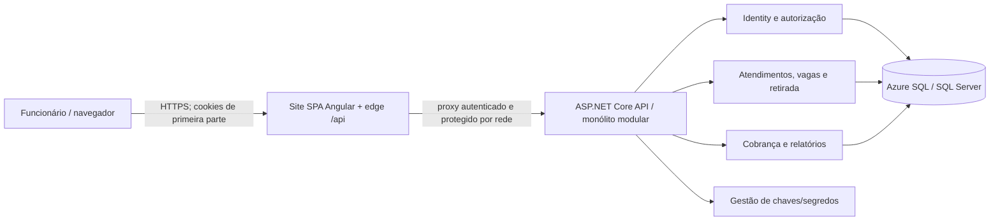
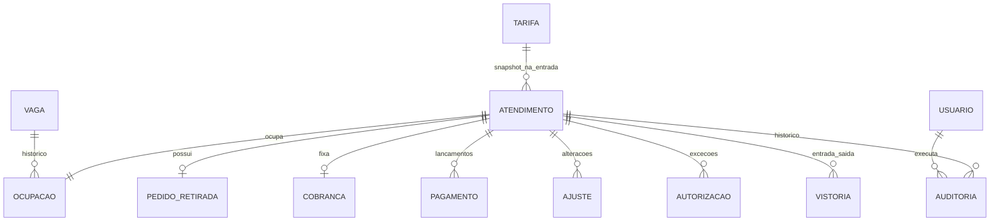
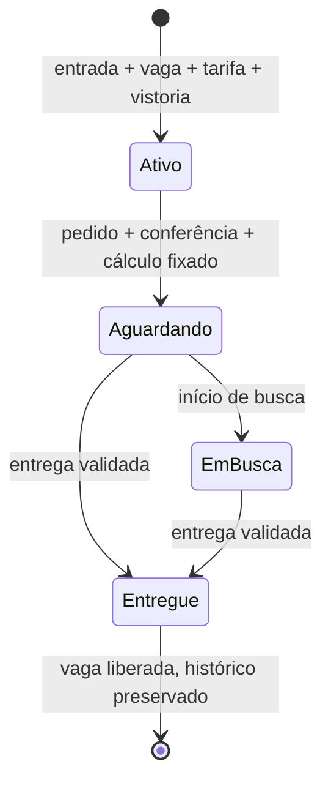

# TDD — Plataforma de Gestão de Estacionamento e Valet

**Status:** Aprovado para orientar o desenvolvimento do MVP; validações pré-produção pendentes

**Data:** 06/11/2026 (revisão do roadmap; versão original de 05/11/2026)

**Atualização documental:** 13/11/2026, revisão de coerência entre PRD, change OpenSpec, código e testes da Fase 2. Capacidades implementadas e lacunas de validação são descritas separadamente; preservadas as aprovações e pendências anteriores.

**Aprovação:** design original aprovado pelo solicitante em 05/11/2026; revisão do roadmap, com todo provisionamento e publicação Azure apenas na Fase 5, aprovada pelo solicitante em 06/11/2026. A aprovação do design não dispensa os bloqueios de produção e as verificações indicados neste documento e no PRD.

**Aprovação do detalhamento da Fase 2:** registrada pelo solicitante em 13/11/2026 no `proposal.md` da change [`fase-2-preparacao-entrada`](../openspec/changes/fase-2-preparacao-entrada/proposal.md), abrangendo proposta, sete specs delta, design D2-01–09 e tarefas, sem alterações. Autoriza somente implementação/verificação locais; não encerra o gate local, revisão de PR ou validações de implantação/produção.

**Escopo:** MVP de uma unidade; documento de design técnico, não plano de test-driven development.  
**Decisor técnico:** solicitante (decisões registradas na entrevista desta conversa); responsáveis por operação, privacidade e negócio ainda não designados.  
**Fontes:** [`docs/prd.md`](prd.md), aprovado para planejamento; `docs/entrevista.md`, entrevista fictícia; `README.md`, contexto e badges sugestivos, **não** aprovação de stack.  
**Divergências a resolver:** não há alteração pretendida nas regras aprovadas do PRD. As lacunas da revisão de 13/11/2026 V2-01–07 foram corrigidas e ganharam testes de regressão (§7.1); o solicitante confirmou conclusão/aprovação do roteiro manual local de acessibilidade, sem fornecer matriz de navegador/dispositivo/tecnologia assistiva. Avaliação formal de conformidade, políticas de privacidade/operação e validação Azure continuam pendentes. Para fases futuras, pagamento normal permanece integral (RF-08); entrega excepcional com saldo não habilita pagamento parcial normal. Regras comerciais de estorno/ajuste, retenção e verificação da arquitetura Azure continuam pendentes.

## 1. Resumo, objetivos e limites

Digitalizar entrada, ocupação de vaga, busca, retirada, cálculo, registro manual de pagamento, entrega e histórico auditável. Priorizar invariantes transacionais (RF-02, RF-08, RF-09; RNF-03), autorização no servidor (RF-10; RNF-01), proteção do documento e das vistorias (RNF-02) e rastreabilidade (RF-11). P1: relatórios sem comprometer as operações P0 (RF-12). Sem gateway, fotos, múltiplas unidades, emissão fiscal, app de cliente ou modo offline no MVP. A unidade, demanda, horário local, tarifa inicial, SLA e políticas de retenção/backup não são fatos conhecidos: são condições de implantação, não valores arbitrados aqui.

## 2. Registro central de decisões

**Origem:** “solicitante/inicial” = pedido desta conversa; “solicitante/entrevista” = respostas às perguntas técnicas; “PRD” = requisito aprovado. A combinação já implementada está registrada em §2.1; atualizações futuras exigem nova verificação, sem inferir aprovação dos badges do README.

| ID | Tema | Decisão e estado | Origem/decisor | Justificativa, alternativas e consequências |
| --- | --- | --- | --- | --- |
| DT-01 | Frontend | **Confirmada:** Angular **22**, TypeScript, componentes standalone, Zoneless, Signals e Signal Forms. | Solicitante/inicial e entrevista | Estado reativo sem ZoneJS; alternativa Reactive Forms. Verificar compatibilidade de cada dependência e testes com Angular 22; manter validação autoritativa no servidor. Zoneless é o padrão documentado desde Angular 21. |
| DT-02 | UI | **Confirmada:** Tailwind CSS e Lucide Icons; componentes e controles Angular nativos, sem Angular Material no MVP. | Solicitante/entrevista | Flexibilidade e menos dependências de componentes; exige cuidado explícito com teclado, foco, contraste e rótulos. Versões atuais registradas em §2.1. |
| DT-03 | Backend | **Confirmada:** C#/.NET **10**, ASP.NET Core Web API com controllers, solução `.slnx`, Clean Architecture e DDD pragmático. | Solicitante/inicial e entrevista | Casos de uso independentes de HTTP e EF; alternativa Minimal APIs. Evitar agregados artificiais e abstrações genéricas desnecessárias. |
| DT-04 | Topologia | **Confirmada:** monólito modular, uma API de negócio, módulos internos de Atendimento/Retirada, Vagas, Cobrança, Identidade e Relatórios. | Solicitante/entrevista | Uma transação relacional para invariantes; alternativa microsserviços exigiria coordenação distribuída. Módulos não significam deploys separados. |
| DT-05 | Persistência | **Confirmada:** SQL Server com Entity Framework Core, migrações versionadas; hospedagem alvo Azure SQL. | Solicitante/entrevista | Integridade e consultas transacionais; alternativa PostgreSQL. EF Core/provider atuais em §2.1, verificados com .NET 10; não inferir versão do badge do README. |
| DT-06 | Autenticação | **Confirmada:** ASP.NET Core Identity com sessão em cookie seguro, HttpOnly, de primeira parte; papéis fixos manobrista, caixa, administrador. | Solicitante/entrevista; RF-10 | Alternativas OIDC/tokens. Provisionamento administrativo, sem autorregistro; autorização por operação e projeção de leitura. |
| DT-07 | Publicação web | **Confirmada como arquitetura-alvo da Fase 5:** SPA e API hospedadas em **sites distintos** na Azure, mas navegador usa exclusivamente `/api` no site da SPA por meio de proxy reverso/BFF; API não recebe cookies cross-site diretamente do browser. Nas Fases 1–4, validar esse contrato com edge e API locais separados, sem declarar a fronteira de rede Azure testada. | Solicitante/entrevista, inclusive ajuste após identificar bloqueio de cookies de terceiros; faseamento confirmado em 06/11/2026 | Alternativas: mesma origem de hospedagem ou OIDC/tokens. O edge deve encaminhar cookies/headers e respostas de autenticação sem expor API pública ao navegador; controlar acesso direto à API, cabeçalhos e confiança entre edge/API. Não adicionar um segundo backend de domínio. |
| DT-08 | Atualização de operação | **Confirmada:** polling curto e configurável da fila/vagas, refetch após comando e ao recuperar foco; sem SignalR no MVP. | Solicitante/entrevista | Menos infraestrutura; atraso controlado, mas tela nunca é fonte de verdade para disponibilidade. Medir intervalo/carga no piloto (RNF-05). |
| DT-09 | Proteção sensível | **Confirmada como desenho inicial:** criptografia de campo para número de documento e textos de vistoria, menor privilégio e trilha de acessos relevantes. **Pendente para produção:** política de acesso, chaves, retenção e descarte aprovada por negócio/privacidade. | Solicitante/entrevista; RNF-02 | Complementa TLS e criptografia do banco; busca por placa/ID não requer decifrar documento. Evitar indexar texto confidencial; mascarar campos na UI e nos logs. |
| DT-10 | Testes | **Confirmada:** MSTest (.NET) para unidade/integração, SQL Server real nos testes de integração; Vitest (frontend), Playwright (E2E). | Solicitante/inicial e entrevista | SQLite/InMemory não reproduzem restrições SQL Server; E2E cobre fronteiras de perfil/sessão. Versões/runner atuais em §2.1, com cobertura e limites em §7.1. |
| DT-11 | Entrega | **Confirmada com faseamento revisado:** testes locais nas Fases 1–4; CI no GitHub Actions será detalhada em change própria, fora do escopo desta fundação; **somente na Fase 5**, provisionar recursos Azure, implantar pela primeira vez em homologação, executar validações reais e, após aprovações, publicar em produção com migração controlada/deploy. Sem fornecedor de pagamentos. | Solicitante/entrevista; PRD; adiamento confirmado em 06/11/2026 | Serviços gerenciados reduzem operação própria; escolha de SKU, rede, custos e serviços exatos condicionada à validação de operação e segurança. Testes locais não substituem gates de homologação Azure. |
| DT-12 | Consistência | **Definida neste TDD para cumprir PRD:** comandos atômicos com constraints SQL, `rowversion` quando há mutação concorrente, idempotência em comandos críticos e auditoria na mesma transação. | Derivada de RF-02, RF-08, RF-09, RF-11; RNF-03 | Alternativa bloqueios distribuídos é excessiva no monólito; conflitos resultam em resposta explícita e recarga, nunca sobreposição silenciosa. |
| DT-13 | Relatórios | **Definida neste TDD:** consultas somente leitura sobre dados operacionais e eventos imutáveis, sem banco analítico no MVP. | Derivada de RF-12 e DT-04 | Simples para uma unidade; agregar/materializar apenas se medições do piloto demonstrarem necessidade. |
| DT-14 | Tempo e valores | **Definida neste TDD:** instante UTC persistido, conversão para fuso configurado da unidade em exibição/agrupamento; dinheiro em decimal com precisão explícita no SQL; relógio do servidor é fonte de eventos. | Derivada de RF-06, RF-07, RF-12 | Evita depender do relógio do navegador e de horário de verão para períodos de 24 h. Fuso e moeda/regra de arredondamento final são dados de implantação a confirmar. |

### 2.1. Versões efetivamente registradas na implementação

O planejamento original previa fixação antes de implementar; essa etapa já tem artefatos concretos. Os manifests e lockfiles, e não números de badges, são a fonte de verdade:

| Base/dependência | Versão observada | Fonte |
| --- | --- | --- |
| SDK .NET | `10.0.114`, `rollForward=latestPatch` | `app/backend/global.json` |
| EF Core SQL Server/Design, Identity EF, Data Protection e OpenAPI | `10.0.14` | `app/backend/Directory.Packages.props` e `packages.lock.json` dos projetos |
| MSTest / Microsoft.NET.Test.Sdk / SqlClient | `4.5.2` / `18.11.0` / `6.1.7` | Mesmo gerenciamento central e lockfiles |
| Angular core / CLI | `22.2.4` / `22.2.6` resolvidos | `app/frontend/package-lock.json` |
| TypeScript / RxJS / Vitest | `6.0.3` / `7.8.2` / `5.1.0` resolvidos | Mesmo lockfile frontend |
| Tailwind / Lucide Angular | `4.3.5` / `1.70.0` | Manifest e lockfile frontend |
| Playwright Test | `1.65.0` | `app/frontend/e2e/package.json` e lockfile próprio |

Os manifests frontend ainda usam intervalos em diversas dependências; reprodutibilidade vem do lockfile com `npm ci`, não de afirmar que todos os intervalos são versões exatas. Testes locais verificam a combinação atual, não compatibilidade automática de futuras atualizações.

## 3. Arquitetura e organização



**Fronteira de confiança (DT-06/07):** este diagrama representa a **topologia-alvo para publicação na Fase 5**. Os sites de hospedagem são distintos, mas todas as requisições do browser, inclusive login, antiforgery e logout, atingem o edge na origem da SPA. A API é protegida contra bypass do proxy por restrição de ingress/rede e autenticação entre serviços; não aceitar cabeçalhos de identidade do cliente como prova de autenticação. O proxy preserva sem adulterar `Set-Cookie`/`Cookie`, caminho `/api`, cabeçalhos de CSRF e IP de origem por cadeia de proxies confiáveis. Cookies host-only do site da SPA; não configurar domínio de cookie no site da API. HTTPS obrigatório ponta a ponta. Nas Fases 1–4, usar SPA/edge e API locais separados e testes em navegador com origem local segura; isto verifica o comportamento lógico, **não** prova ingress restrito, proteção do tráfego entre sites nem cookies no domínio Azure. Na Fase 5, validar o fluxo em homologação Azure **antes da publicação em produção**: um proxy mal configurado inviabiliza a sessão. O edge encaminha, não executa regras de negócio.

Estrutura proposta (DT-01–05, DT-10):

```text
app/
  frontend/                       Angular 22
    src/app/core/                 sessão, transporte HTTP, erros, guards
    src/app/features/             check-in, vagas, retirada, cobrança, admin, relatórios
    src/app/shared/               componentes acessíveis, formatação, estados
    e2e/                         Playwright
  backend/
    Estacionamento.slnx
    src/Estacionamento.Api/       controllers, DTOs, políticas, middleware, composição
    src/Estacionamento.Application/ casos de uso, portas, projeções, autorizações de ação
    src/Estacionamento.Domain/    entidades, valores, regras e eventos de domínio
    src/Estacionamento.Infrastructure/ EF Core, Identity, criptografia, auditoria, consultas
    tests/Estacionamento.UnitTests/
    tests/Estacionamento.IntegrationTests/
```

Dependências: Api → Application e Infrastructure (composição); Infrastructure → Application/Domain; Application → Domain; Domain → nenhuma camada externa. Separar funcionalidades internamente por módulo/caso de uso, não por controllers inchados nem repositório genérico. DTOs nunca expõem entidades EF ou número de documento por padrão. Frontend por funcionalidade, com Signals para estado local/derivado e Signal Forms para entrada/validação; chamadas HTTP na camada de serviços; rotas/guards apenas complementam a autorização da API. Polling pausa em aba inativa, usa cancelamento e evita requisições sobrepostas; mutation sempre força releitura (DT-08).

**Concretização da Fase 2 (D2-01):** Domain contém valores/regras de Parking e Billing; Application contém casos de uso, portas específicas e autorização por ação; Infrastructure implementa persistência, Identity e proteção; API compõe controllers finos. O `IdentityDbContext` scoped foi ampliado com mapeamentos operacionais separados, preservando nome técnico legado, conexão `Identity` e histórico de migrações. Identity e operações compartilham a fronteira relacional/transacional, sem segundo banco/contexto de domínio. A árvore acima é orientação, não descrição literal dos caminhos atuais: `core/auth` e `core/pages` contêm sessão/shell; `core/admin`, `core/check-in` e `core/attendances` contêm as telas funcionais. `AdminApiService` concentra também transporte de check-in/busca, apesar do nome administrativo. Não há reorganização concluída para `features/` nem componentes compartilhados de feedback/paginação em todas as telas, conforme o alvo D2-08.

## 4. Modelo de dados, estados e concorrência



**Entidades e invariantes (DT-05/12/14):** `Atendimento` tem ID interno e identificador público único, placa normalizada (não única historicamente), modelo, titular, documento criptografado, tarifa capturada na entrada, operador, horários e estado; `Vaga` tem código único e status derivável da ocupação aberta; `Ocupacao` guarda início/fim e responsável. `Vistoria` textual, tipo entrada/saída e autor; `PedidoRetirada` tem verificação presencial (resultado, operador, horário), hora fixadora de cobrança e estados; `Cobranca` preserva base original (tempo em segundos, diárias, tarifa e total); `Ajuste`/`Pagamento`/`Autorizacao` são lançamentos não apagáveis; `Auditoria` referencia ator, ação, atendimento, horário e metadados mínimos. `Tarifa` é versionada; editar tarifa cria nova vigência e não altera snapshots. Usuários Identity e perfis são separados dos registros históricos; desativar funcionário não apaga autoria.

Restrições SQL: identificador único; código de vaga único; índice único **filtrado** em `Ocupacao(vaga_id)` onde `fim IS NULL`; índice único de pedido por atendimento (um pedido no ciclo do MVP); referências obrigatórias; índices em placa normalizada+horário, identificador, estado/horário de pedido e eventos de ocupação/horários. Índice filtrado e/ou constraint impedem dupla ocupação mesmo quando duas leituras veem a vaga livre; erro vira conflito HTTP, não erro genérico. Marcar entidades mutáveis de atendimento/vaga com `rowversion`; entregar somente se a ocupação aberta referenciar o atendimento correto. Eventos financeiros e trilha não sofrem `UPDATE`/`DELETE` por operações normais. Criptografia de campo deve preservar acesso ao documento para conferência autorizada; não registrar documento puro em auditoria, telemetria ou índices. Chaves versionadas permitem rotação sem perda de leitura do histórico; procedimentos de recuperação dessas chaves acompanham backup.



Fila: `aguardando → em busca → entregue`; a passagem direta de aguardando para entregue permite operação rápida sem inventar etapa obrigatória de busca, mas sempre exige pedido prévio. Conferência divergente é registrada no pedido e bloqueia **entrega normal** até autorização de administrador; não apaga o pedido nem refaz o cálculo. No instante transacional do pedido, `diárias = max(1, teto((pedido_utc - entrada_utc)/24h))`; exatas 24 h = 1, 24 h + 1 segundo = 2. Total inicial = diárias × tarifa snapshot; tempo e valor ficam imutáveis. Aplicar ajustes posteriores como lançamentos justificados de administrador, preservando base e histórico. Pagamento normal deve ser integral do saldo exigível; tentativa parcial é recusada. Estorno compensatório reabre saldo se cabível; entrega com saldo somente mediante autorização específica, nunca por pagamento parcial implícito. Cobrado, pago e saldo são calculados com ajustes/lancamentos, inclusive depois de atendimento encerrado, sem editar lançamentos anteriores. Detalhes comerciais de desconto/estorno e efeitos de eventual pagamento posterior são pendência de negócio antes da implementação financeira final.

**Transações:** check-in insere atendimento, snapshot de tarifa, vistoria, ocupação e auditoria atomicamente; pedido cria verificação, cobrança e evento; pagamento cria lançamento/quitação; entrega valida autorização vigente, vistoria, cobrança, ocupação, encerra pedido/atendimento/ocupação e grava auditoria na **mesma transação**. Em conflito de `rowversion` ou unicidade, rollback e `409` com estado recarregável. Para erro transitório de Azure SQL na Fase 5, retry só da unidade transacional inteira e com idempotência; não repetir cegamente operações de escrita após timeout de resultado desconhecido. Migrações EF Core versionadas e exercitadas em SQL Server local/CI nas Fases 1–4; revisar/aprovar sua aplicação em homologação e produção na Fase 5 antes de liberar tráfego; migrations destrutivas exigem estratégia compatível/backup e janela de mudança.

### 4.1. Persistência implementada para preparação e entrada

O modelo completo acima permanece alvo das fases seguintes. Na Fase 2, a migração aditiva `20261113142753_AddOperationalModules` sucede as migrações de Identity: vagas com código único e `rowversion`; versões de tarifa `decimal(18,2)`; configuração singleton da tarifa com versão-base e sem valor comercial inicial; atendimento ativo com documento cifrado, versão/valor snapshot e `rowversion`; vistoria de entrada cifrada; ocupação; eventos append-only; resultados idempotentes e controle técnico de acessos. Não implementa tabelas/fluxos de retirada, cobrança final, pagamentos ou entrega. FKs não apagam histórico em cascata, e ocupação aberta tem índice único filtrado por vaga e unicidade por atendimento.

No check-in, o caso de uso reautoriza o ator, normaliza a entrada e consulta repetição antes de reavaliar vaga/tarifa. Reserva a chave na mesma transação; coordena leitura da tarifa vigente e publicação com bloqueio transacional; disputa a vaga por `rowversion` e índice filtrado; grava entrada, vistoria, ocupação, eventos e resultado mínimo. Conflitos conhecidos causam rollback; disputa da mesma chave pode reler resultado confirmado em contexto novo. Não há retry cego de escrita nem liberação manual de vaga nesta fase (D2-02–04).

`Idempotency-Key` é UUID por ação, com unicidade por ator/operação/chave. O conteúdo canônico normalizado usa HMAC-SHA-256 versionado com segredo externo; não se persiste o corpo de entrada. Resultado guardado contém identificador/ID, vaga, estado e horário, sem documento, vistoria ou tarifa. Repetição reautoriza e devolve o resultado original; conteúdo diferente conflita. Versões de segredo necessárias à comparação devem ser preservadas. TTL/limpeza não foram implementados nem definidos; não confundir ausência de TTL com política de retenção aprovada.

Limites técnicos aprovados em D2-02: código de vaga de 1–32 caracteres após trim/maiúsculas; placa de 1–16 alfanuméricos após remover espaços/hífens e converter caixa, sem exigir padrão brasileiro; modelo/nome até 120/200, documento até 80 e vistoria até 4000 caracteres, obrigatórios após trim. Paginação inicia em 1, padrão 20 e máximo 100. Valores com precisão excedente são rejeitados, não arredondados silenciosamente. Não há unicidade de placa ativa/histórica nem edição/exclusão de vaga, atendimento ou vistoria nesta fatia.

**Apresentação observada versus DT-14/D2-08:** a API persiste/retorna UTC; check-in e atendimentos mostram os instantes ISO recebidos. A tela de tarifa usa `DatePipe` sem timezone explícito e, portanto, depende do fuso do navegador; valores usam `DecimalPipe` sem moeda comercial definida. Não existe configuração implementada do fuso/moeda da unidade. Isso continua uma diferença para o alvo, não uma escolha comercial aprovada. O formulário de check-in aceita até 80 caracteres brutos de placa; a regra de 16 alfanuméricos normalizados é aplicada pelo servidor.

## 5. Interfaces, autorização e sequências

API HTTP JSON versionada em `/api/v1`, contrato OpenAPI gerado dos endpoints e exemplos de erros versionados. Endpoints **propostos para revisão de contrato**, sem impor nomes de DTOs: login/logout/estado da sessão e antiforgery; usuários/perfis; vagas; tarifas; atendimentos (criar, buscar, detalhar); pedidos de retirada (criar, listar, iniciar busca); cobrança, ajustes, pagamentos, autorizações; entrega; auditoria; relatórios. Busca por placa retorna lista paginada e distingue visitas por identificador/entrada; lista de vagas/fila é paginável/filtrável. Servidor valida formato, tamanho, transições, direitos e invariantes; hora e valores enviados pelo cliente não prevalecem sobre cálculo do servidor. Não expor dados financeiros nas projeções do manobrista nem número de documento em listagens; caixa/admin recebem apenas dados necessários à conferência presencial, com leitura auditável. Autenticar e autorizar cada operação no servidor; matriz base:

O inventário completo acima é arquitetura-alvo. Os contratos concretos já presentes na Fase 2 estão na seção 5.1; retirada, caixa, entrega e relatórios não são endpoints implementados por esta change.

| Operação | Manobrista | Caixa | Admin |
| --- | --- | --- | --- |
| Consultar veículo/vaga/fila; vistoria e início de busca | Sim, sem finanças/documento completo | Sim | Sim |
| Check-in, pedido, cobrança e pagamento, entrega normal | Não | Sim | Sim |
| Tarifa, acessos, ajustes, exceções, relatórios financeiros | Não | Não | Sim |
| Consultar histórico financeiro/documento para conferência | Não | Somente se necessário à operação | Sim, com trilha |

**Sessão/CSRF (DT-06/07):** Identity autentica funcionários previamente provisionados. Cookie de sessão HttpOnly, Secure, SameSite adequado à navegação de primeira parte, duração/expiração e bloqueio de login configuráveis antes da produção. Endpoint de emissão de token antiforgery pela origem `/api`; token de requisição apresentado pela SPA em cabeçalho para **todas** as operações mutáveis (inclusive login/logout); servidor valida token e origem esperada. Não confiar somente em SameSite ou em guard Angular. Proxy não deve cachear respostas privadas nem encaminhar cookies a destinos arbitrários; controles de rate limit em login, política de senhas, rotação de segredos e proteção contra enumeração. APIs externas diretas não recebem sessão do browser; restringir ingress da API ao proxy/rede autorizada **na Fase 5**. Testar `Set-Cookie`, expiração, CSRF e logout com navegador real localmente desde a Fase 1 e repetir em homologação Azure na Fase 5.

**Erros e idempotência:** `400` dados inválidos, `401` sem sessão, `403` sem permissão, `404` recurso inexistente ou não revelável, `409` conflito de estado/ocupação/pedido repetido, `422` regra de domínio não satisfeita (p.ex. entrega sem vistoria); `5xx` falha inesperada com ID de correlação, nunca stack trace/dados sensíveis. Comandos de check-in, pedido, pagamento e entrega levam chave de idempotência gerada por ação do cliente; persistir chave+ator+operação+hash canônico do pedido+resultado em transação, com restrição única. Mesma chave/mesmo conteúdo retorna resultado original; mesma chave/conteúdo diferente é conflito. Não liberar vaga duas vezes nem lançar pagamento duas vezes se navegador repetir/timeout. TTL de chaves a definir conforme janela operacional e retenção; registros de negócio não são apagados pelo TTL. Sem token ou chave, um retry automático de escrita não é seguro. Leituras GET podem ser repetidas; políticas de cache evitam dados pessoais persistidos em proxies.

```mermaid
sequenceDiagram
  actor Caixa
  participant UI as SPA / proxy
  participant API as API / casos de uso
  participant SQL as SQL Server
  Caixa->>UI: solicita retirada e informa conferência presencial
  UI->>API: POST pedido (cookie, CSRF, chave idempotente)
  API->>SQL: transação: verificar ativo/sem pedido, fixar hora/diárias/total, auditar
  SQL-->>API: commit ou conflito
  API-->>UI: identificador, estado, cobrança ou erro
  UI->>API: GET fila (polling)
  Caixa->>UI: registra pagamento integral e entrega
  UI->>API: comandos com novas chaves e CSRF
  API->>SQL: validar saldo/conferência ou autorização; gravar vistoria/entrega/liberação/auditoria
  SQL-->>API: commit único ou rollback
  API-->>UI: estado final ou conflito com recarga
```

Falha de rede antes de saber se houve commit: repetir **a mesma chave** e consultar estado, nunca iniciar novo pagamento com outra chave sem verificar o lançamento anterior. Divergência documental exige exceção registrada e autorizada pelo admin; saldo pendente exige autorização independente, vinculada ao atendimento, tipo de exceção, justificativa, autor e horário. Resposta de autorização não substitui pagamento ou conferência; vale apenas para a entrega correspondente. Sem integrações externas de pagamento, tickets ou fiscal no MVP (PRD §10).

### 5.1. Contratos e projeções da Fase 2 (D2-05–07)

Todos os caminhos abaixo têm prefixo `/api/v1`; sessão mantém o contrato existente em `/session`.

| Endpoints presentes no código | Autorização e contrato |
| --- | --- |
| `GET/POST /employees` | Admin; listagem paginada e criação com e-mail, senha inicial e conjunto não vazio de perfis fixos; senha não é retornada. |
| `PUT /employees/{id}/access` | Admin; estado ativo, perfis e token de concorrência da conta; preserva autoria e impede remover o último administrador ativo. |
| `GET /spaces?code=&status=&page=&pageSize=`; `POST /spaces` | Consulta pelos três perfis, cadastro apenas admin; disponibilidade derivada de ocupação, código único e versão. |
| `GET /daily-rates`; `GET /daily-rates/current`; `POST /daily-rates` | Admin; histórico, configuração corrente com versão-base (inclusive sem tarifa) e publicação de nova versão. |
| `POST /attendances` | Caixa/admin; campos de entrada e vaga, `Idempotency-Key` obrigatório; `201` com `Location` e resultado mínimo, inclusive replay. Propriedades inesperadas como tarifa, horário e operador são rejeitadas. |
| `GET /attendances?plate=&identifier=&page=&pageSize=` | Três perfis; exige exatamente um filtro, busca exata normalizada, não lista tudo por omissão. Retorna visitas distintas em ordem estável por entrada e ID. |
| `GET /attendances/{id}`; `GET /attendances/{id}/history` | Três perfis; DTOs projetados, histórico paginado/filtrado por perfil; sem serializar entidades ou metadados internos irrestritos. |
| `GET /attendances/{id}/document` | Caixa/admin; leitura explícita com auditoria confirmada antes da resposta. |
| `GET /attendances/{id}/entry-inspection` | Três perfis; leitura explícita com a mesma exigência de auditoria. |

Listas usam `{items,page,pageSize,total}` e omitem documento e vistoria. Detalhe comum também não os inclui; `DailyRateId`/`DailyRateSnapshot` são omitidos do JSON do manobrista, não apenas escondidos na tela. Histórico exclui eventos/campos financeiros proibidos ao perfil. Leituras sensíveis decifram pelo propósito correto e registram ator, alvo e UTC, sem conteúdo sensível; falha de decifragem/auditoria impede retorno do conteúdo. Não há endpoints de escrita da trilha.

Os controllers declaram respostas e geram OpenAPI com `Microsoft.AspNetCore.OpenApi` e `Microsoft.Extensions.ApiDescription.Server`, versões fixadas centralmente e em lockfiles. A geração em build usa modo design-time, sem bootstrap/migração/provisionamento operacional. A exposição HTTP só é habilitada por `OpenApi:Expose` em `Development` e exige admin; não há Swagger UI público por padrão.

**Erros operacionais e contrato OpenAPI (V2-06):** respostas de ação com falha são convertidas para `application/problem+json` com `status`, `title`, `type`, `instance`, `code` e `correlationId`; validação automática preserva `errors`. Negações/erros vazios fora de `/api/v1/session` recebem Problem Details; endpoints de sessão preservam seus contratos anteriores. O filtro não serializa corpo arbitrário de erro (evita refletir PII). O transformer OpenAPI declara somente `application/problem+json` para respostas operacionais 4xx/5xx e documenta `code`/`correlationId` como strings e `errors` como mapa de arrays de strings, mantendo extensões opcionais e contratos de sessão intactos. `OpenApiErrorContractTests` verifica o documento gerado no build; testes HTTP confirmam o runtime e a sexta tentativa de login valida 429, corpo/correlação e ausência de senha.

O login limita 5 solicitações/minuto, fila zero e status de rejeição explícito 429, com corpo RFC 9457 e correlação. A janela continua compartilhada pela política, sem particionamento por funcionário/IP; a escolha do modelo de mitigação de abuso permanece risco operacional a avaliar, sem alterar limite nesta correção.

### 5.2. Sessão e shell Angular da Fase 2 (D2-05/08)

A administração compartilha transação com Identity/auditoria, atualiza security stamp em alterações de acesso e serializa a proteção do último administrador ativo por linha de controle. O cookie revalida conta ativa/stamp em toda requisição protegida; a revogação vale para a próxima requisição após commit, não cancela uma já autenticada. O bootstrap sintético cria defaults apenas para contas novas, sem restaurar perfis, estado ou senha de contas administradas.

O shell implementado usa Router, Signals e guards de sessão/perfil. Rotas atuais: `/dashboard` (qualquer sessão autenticada), `/employees` e `/daily-rates` (admin), `/spaces` e `/attendances` (três perfis), `/check-in` (caixa/admin), além de `/login` e `/forbidden`. `/dashboard` é área de trabalho, não relatório financeiro. O guard de sessão resolve o estado antes da navegação e encaminha não autenticados a login; o guard de perfil encaminha à área de acesso negado. API e casos de uso continuam autoritativos.

O interceptor centraliza credenciais de primeira parte e inclusão de antiforgery nas mutações `/api/`. `401` limpa sessão em memória e conduz à reautenticação; `403` sinaliza acesso negado sem tratá-lo como logout. Não há storage persistente de sessão na SPA. `AuthService` descarta o token antiforgery em memória após login/logout e quando um `401` invalida a sessão; mutações subsequentes obtêm um token novo. Vitest verifica o fluxo token→login→novo token→logout, revogação da sessão e ausência de storage. A autenticação continua baseada no cookie HttpOnly; nem token antiforgery nem sessão são persistidos em storage do navegador.

**Administração:** funcionários, vagas e tarifas usam Signal Forms, serviços HTTP e guards. A conta expõe `concurrencyStamp` opaco para atualização concorrente, distinto do security stamp de autenticação. Formulários inválidos expõem mensagem textual e resumo focado; inputs inválidos recebem `aria-invalid` e associação ao resumo. Testes verificam mensagens/foco e ausência de chamada inválida; a avaliação manual por teclado/tecnologia assistiva continua pendente.

**Disponibilidade:** `SpacesPage` faz polling configurável (15 segundos por padrão), pausa novos disparos com aba oculta, consulta no foco/visibilidade e após cadastro, usa `exhaustMap` para não sobrepor leituras e encerra a inscrição ao sair. Ao ocultar a aba, uma requisição já ativa pode concluir; não confundir pausa dos disparos com cancelamento imediato dessa requisição. Filtros/paginação são informativos e não reservam vaga. O seletor separado de `CheckInPage` oferece páginas de 100 vagas livres e atualização manual; não faz polling independente. Se a lista estiver incompleta, a seleção/validação final continua sujeita à transação do servidor. A tela de tarifa oferece páginas de 20 versões, recarga explícita e preserva estado em falha de carga. Tamanhos não são limites comerciais.

**Check-in:** formulário coleta dados, envia UUID em `Idempotency-Key`, bloqueia submissão duplicada enquanto ocupado, apresenta resposta mínima e limpa modelo após sucesso. Caixa trata `422 daily_rate_not_configured` sem consultar endpoint administrativo de tarifa. `pendingAttempt` cobre o POST inicial; navegação da rota e logout são bloqueados enquanto pendente, e `beforeunload` solicita confirmação durante POST e resultado incerto. Em status `0`/`408`/`5xx` ou rejeição não classificada, conteúdo/chave permanecem em `unknownAttempt` em memória; replay é explícito e reutiliza mesmos bytes/chave. `400 invalid_check_in`, `404 space_not_found`, `409 space_occupied` e `422 daily_rate_not_configured` conhecidos encerram a incerteza, preservam campos e liberam correção, sem gerar chave/reenvio automático. Antiforgery 400 sem código de negócio continua conservadoramente incerto. Destruição limpa estado local e callbacks tardios não restauram PII. Um usuário ainda pode confirmar saída/reload no diálogo nativo e perder estado em memória; não se persistiu no navegador conforme decisão anterior.

**Busca/detalhe:** busca exata por um critério, paginação, detalhe e histórico estão presentes. Documento/vistoria são requisitados por ação explícita; finanças são omitidas do DTO do manobrista e a ação documental é negada também no servidor. Revisões monotônicas descartam respostas atrasadas de busca, detalhe/histórico e leituras sensíveis ao trocar/fechar detalhe ou destruir a tela; testes controlam ordem A/B, incluindo documento e vistoria, sem associar conteúdo à seleção errada. Requisições podem terminar no transporte, mas seus resultados já não alteram estado destruído/obsoleto.

**Acessibilidade observada:** controles nativos com labels/fieldsets, foco CSS e estados textuais; resumo com foco e `aria-invalid` em check-in/busca e formulários administrativos. Vitest verifica mensagens/foco locais e Playwright aciona detalhe por teclado. O roteiro manual está documentado, não executado como avaliação formal; não afirmar conformidade normativa ou testes com usuários.

## 6. Segurança, operação e implantação

**Ameaças e controles (DT-06/07/09/12):** acesso indevido de manobrista a finanças/documento; CSRF e roubo de sessão; tentativa de entrega fraudulenta; dupla ocupação/cobrança; logs vazando PII; backup sem chaves. Aplicar autorização por ação e por campo no servidor, conferência presencial com número/documento de foto, justificativa para exceção, TLS, criptografia do banco e campos sensíveis, segregação de contas de serviço, armazenamento gerenciado de segredos/chaves, rotação testada, proteção da cadeia proxy/API e auditoria append-only protegida contra edição por perfis comuns. Política de leitura do número completo e retenção/descarte depende de responsável de privacidade; **não lançar produção com essa política indefinida**. Vistorias são somente texto (PRD), sem anexos.

**Proteção local concretizada (D2-06):** Data Protection protege documento e vistoria em envelopes versionados, com propósitos distintos vinculados ao atendimento/campo; reutiliza key ring local persistente com acesso restrito, sem proteção temporal. Preservar chaves históricas para leitura após rotação/reinício; perda de chave deve falhar controladamente, nunca substituir o dado por vazio. Auditoria administrativa e de entrada é append-only na aplicação e transacional; leituras sensíveis também geram evento antes da resposta. `PrivateResponseMiddleware` aplica `private, no-store, no-cache, max-age=0` às respostas `/api`, inclusive negações/erros, e falhas genéricas não expõem stack trace. Logs não devem guardar corpos, placa, nome, documento, vistoria, senha ou cookies. Isso não prova imutabilidade contra DBA privilegiado nem aprova gestão/backup/retenção de chaves para produção.

**Observabilidade (RNF-05–07):** logs estruturados com correlation ID, ator interno pseudonimizado quando possível, ação, resultado, latência e conflito; métricas de logins falhos, erros HTTP, fila/polling, indisponibilidade SQL, colisões de vaga, pagamentos e exceções; trilha de negócio na transação, separada de logs técnicos. Não incluir documento, vistoria, cookie nem payload financeiro sensível em logs/traces. Alertas e retenção operacional a aprovar com administrador. UTC para eventos; fuso da unidade para períodos de relatório. Receita por período = pagamentos registrados no período; cobrado = cobranças/ajustes com recorte definido em relatório; saldos pendentes incluem entregas excepcionais. Documentar definição de cada métrica para evitar somas de bases temporais diferentes; validar com financeiro no piloto.

**Desenvolvimento local da Fase 1 (DT-10/11):** SQL Server real isolado, SPA/edge e API em processos separados, origem segura de teste, segredos fora do repositório e key ring de teste persistente entre reinícios locais. CI não integra esta change; sua especificação e implementação ficam para change própria. Nas fases locais, não criar nem provisionar recursos Azure, não publicar em homologação/produção e não executar CD ou migrations em banco Azure. A infraestrutura local é equivalente apenas para testar comportamento, nunca prova restrição de rede entre sites publicados ou recuperação gerenciada.

**Bootstrap local revisado em 06/11/2026 (solicitante):** exclusivamente quando o ambiente da API for `Development`, criar escopo de DI no `Program.cs`, executar `Database.MigrateAsync()` do `IdentityDbContext` e em seguida `SyntheticAccountProvisioner.ProvisionAsync(...)` antes de `Run()`. Falha de conexão, migração ou ausência de qualquer senha sintética impede que a API aceite tráfego; reinícios não duplicam dados nem redefinem senhas. Configuração vem de User Secrets/ambiente, sem senha versionada. O comando de provisionamento legado pode permanecer para uso explícito apenas local. Testes de integração usam ambiente `Testing` e banco dedicado, sem carregar User Secrets locais nem executar bootstrap da API; scripts E2E locais em `Development` precisam fornecer as três senhas ao processo. Este atalho é estritamente local: homologação e produção preservam revisão e aplicação separadas de migrações, sem seed automático.

**Azure e publicação na Fase 5 (DT-07/11):** definir com operação/infra serviços/SKUs, domínios, rede e custos; provisionar primeiro o ambiente de homologação, com edge HTTPS no site da SPA e proxy `/api`, API hospedada separadamente com ingress restrito e autenticação entre serviços, Azure SQL gerenciado, segredos/chaves gerenciados e armazenamento durável do key ring Data Protection. Implantar **primeiro em homologação**, com dados sintéticos e migrações revisadas/aprovadas; validar no navegador real cookies, CSRF, logout, headers, origens, acesso direto à API negado, jornadas completas, métricas e backups. Somente após esses testes e as aprovações de negócio, privacidade e operação, provisionar produção isolada e configurar CD com credenciais de curta duração, aprovação e migração controlada para publicar; smoke tests de login/check-in/pedido/entrega e monitoramento após o deploy. Rollback do aplicativo para versão compatível com esquema anterior; migrações preferencialmente aditivas/expand-contract. Restore do SQL **e** das chaves de campo/Data Protection deve ser exercitado antes de produção; RPO/RTO, retenção, disponibilidade e contingência para rede indisponível são bloqueios de produção a validar com operação. Sem prometer operação offline ou ausência absoluta de perda em falhas de infraestrutura; transações confirmadas devem sobreviver ao processo e restore deve cumprir metas aprovadas.

## 7. Qualidade e verificação

A matriz abaixo é o **plano de verificação do MVP completo**, não inventário de testes já implementados. Resultados efetivamente observados na fatia de entrada e suas lacunas constam em §7.1; retirada, cobrança, pagamento, entrega e relatórios continuam futuros.

| Nível | Verificações mínimas e rastreabilidade |
| --- | --- |
| Unidade — MSTest | Máquina de estados, tarifação em 0/24/24h+1s/48h, snapshot de tarifa, saldo e autorização, permissões de caso de uso (RF-04–10). |
| Integração — MSTest + SQL Server real | Migrações, índices filtrados, EF `rowversion`, transações/auditoria, criptografia/rotação e múltiplos escritores concorrentes sobre a mesma vaga, pedido, pagamento e entrega; retry/idempotência após timeout (RF-01/02/08/09/11; RNF-03). |
| Contrato/API | OpenAPI e testes HTTP de projeções por perfil, erros, paginação, sessão, CSRF, autenticação e negação mesmo com cabeçalhos de identidade falsificados em testes locais; bloqueio de ingress direto verificado adicionalmente na Azure somente na Fase 5 (RF-03/10; RNF-01/02). |
| UI — Vitest | Signal Forms, validações e estados textuais, polling sem requisição sobreposta, expiração de sessão e feedback de conflitos; testes com configuração Zoneless coerente (RNF-04/05). |
| E2E — Playwright | Jornadas de check-in até entrega, ticket extraviado, documentos divergentes, exceções, tarifa alterada, relatórios restritos, cookies/CSRF via edge local nas Fases 1–4 e repetição no domínio publicado em homologação na Fase 5, repetição de comando e teclado (RF-01–12; RNF-01/04). |
| Não funcionais | Auditoria de vazamento de PII em logs/respostas e revisão local de acesso desde as fases de construção; testes de carga/piloto, isolamento Azure, restore de SQL/chaves, rollback e verificação de acessibilidade com equipe antes de publicar em produção na Fase 5 (RNF-02/04/05/06/07). |

Critérios técnicos de gate: nenhuma dupla ocupação ou liberação/pagamento duplicado em testes concorrentes; nenhum fluxo não autorizado alcança dados financeiros/documentais; snapshot e valores originais preservados; relatórios reconciliam lançamentos, inclusive saldo após entrega. Testes locais autorizam avanço entre as Fases 1–4, **não** publicação. Na Fase 5, resultado de restore e métricas de latência devem ser confrontados com metas **a aprovar** antes de produção; validar também a fronteira real edge/API. Critério normativo/nível de acessibilidade ainda depende de produto/design; navegação por teclado e rótulos textuais são obrigatórios desde o MVP.

### 7.1. Revisão de coerência e lacunas da implementação — 13/11/2026

**Método e resultado:** confronto dos artefatos aprovados com código, lockfiles e testes; reprodução inicial de corridas e repetição dos gates; correções V2-01–07; testes permanentes adicionados e executados. Os requisitos aprovados foram preservados.

| ID / prioridade | Constatação verificável | Referência / correção e validação necessárias |
| --- | --- | --- |
| V2-01 — Alta, corrigida | Respostas fora de ordem podiam associar documento de A ao detalhe B, e sobrescrever seleção em detalhe/histórico. | RF-03, RNF-02, D2-06/08; versões monotônicas invalidadas ao trocar/fechar/destruir. Vitest reproduz A/B para detalhe, histórico, documento e vistoria e confirma descarte; busca antiga também não substitui resultado novo. |
| V2-02 — Alta, corrigida | Guard/logout não cobriam POST inicial ainda sem `unknownAttempt`, com risco de perder conteúdo/chave. | RF-01, RNF-03, D2-04/08; estado `pendingAttempt` protege rota/logout e beforeunload mostra confirmação. Vitest cobre POST pendente, saída de rota/logout e callback após destruição. Confirmação explícita de reload pode perder estado em memória; storage continua proibido. |
| V2-03 — Média, corrigida | Rejeição de negócio conhecida após replay podia deixar estado incerto/formulário bloqueado. | D2-08; transição agora classifica códigos definitivos 400/404/409/422, mantém conteúdo para correção e não reenvia/gera chave automaticamente. Vitest exercita todos os quatro e antiforgery 400 conservadoramente incerta. |
| V2-04 — Média, corrigida | Formulários administrativos impediam API mas sem orientação local acessível. | RNF-04/D2-08; resumo textual focado, `aria-invalid` e associação ao resumo nas telas de funcionário/vaga/tarifa. Vitest verifica mensagens, foco e ausência de chamada; roteiro manual formal continua pendente. |
| V2-05 — Média, corrigida | Seletor de entrada consultava só 100 vagas e tarifa exibia só 20 versões sem paginação/recarga. | RF-02/07, D2-07/08; navegação por páginas de 100/20, recarga explícita e retenção do formulário. Vitest cobre 101 vagas, 45 tarifas e recovery após falha inicial. Os tamanhos são técnicos, não comerciais. |
| V2-06 — Média, corrigida | Respostas operacionais não tinham schema uniforme; limiter de login retornava default diferente do 429 declarado. | D2-07; filtro/middleware retornam Problem Details com code/correlação e errors de validação; sessão excluída da transformação. Testes diretos verificam contrato, errors de campo e sessão; teste de integração valida sexta tentativa 429, media type, correlation ID e ausência de senha. |
| V2-07 — Segurança de teste, mitigada | Factory e alguns testes provisionavam usando conexão configurada sem validar sempre destino/catalog. | D2-09; guard sem conexão valida prefixo dedicado e recusa system DB, development/local/prod e catalog vazio na factory, provisionamento e migração. Testes negativos e execução 54/54 em bases `EstacionamentoReview_*`/`EstacionamentoReviewMigration_*`; Playwright 4/4 em base `EstacionamentoE2E*`. Guard lexical não substitui segregação de infraestrutura/credenciais. |

As lacunas de diretórios/componentes compartilhados e de fuso/moeda estão descritas em §3/§4.1, sem afirmar implementação do alvo. A validação estrita do OpenSpec verifica estrutura/coerência formal dos artefatos, **não** execução correta de todos os cenários. Os achados iniciais não foram tratados como aceitação: regressões foram adicionadas e executadas; gates não substituem auditoria manual de acessibilidade ou homologação.

**Gates após correções:** restore `--locked-mode`, build backend/OpenAPI (0 avisos/erros), `dotnet format whitespace --verify-no-changes`, backend 71/71 (12 unidade, 55 integração SQL Server, 4 arquitetura), Vitest 44/44, build frontend, tipagem E2E e Playwright 4/4 em catálogo novo `EstacionamentoE2E*`. O gate completo dos 54 testes de integração passou e o 55.º, de preservação de errors de validação Problem Details, passou isoladamente após ele. Segredos somente no ambiente. Cobertura de testes não significa “todas as funcionalidades do MVP validadas”; fases futuras e gates operacionais permanecem. Comandos/base e limitações em [`fase-2-preparacao-entrada-evidencias.md`](fase-2-preparacao-entrada-evidencias.md).

## 8. Roadmap de implementação (sem implementação neste documento)

### Acompanhamento da change Fase 2 — 13/11/2026

O checklist de [`tasks.md`](../openspec/changes/fase-2-preparacao-entrada/tasks.md) é 49/50 com 10.5 aberta (revisão final e commits). A implementação adiciona preparação, disponibilidade paginada, check-in atômico/idempotente, busca/histórico e leitura sensível protegida; V2-01–07 têm correções e evidências (§7.1). **Isso não conclui PR, revisão ou integração:** nenhum commit, push, PR, aprovação, merge, sincronização ou arquivamento ocorreu. A tarefa 10.5 permanece pendente por exigência de revisão/commits, segundo orientação de não commitar. Fases 3–5 seguem futuras; sem retirada, caixa, entrega, relatórios, CI ou Azure.

Fases sequenciais por dependência, **sem prazos ou estimativas assumidos**. As Fases 1–4 executam localmente; CI será introduzida por change própria, sem provisionamento Azure, publicação em homologação/produção ou CD. Cada fase entrega uma fatia verificável e só libera a próxima quando seu critério de saída local for atendido. A Fase 5 concentra provisionamento Azure, primeira publicação em homologação, piloto e, apenas com gates cumpridos, publicação em produção. A conclusão do P0 não implica autorização para publicar.

Referências a CI no desenho/roadmap são condicionais à change própria: não indicam workflow existente nem exigem implementá-lo na Fase 2. Seu gate atual usa execução automatizada local com SQL Server real e edge HTTPS local.

| Fase | Escopo e entregáveis | Dependência / critério de saída |
| --- | --- | --- |
| **1 — Fundação e infraestrutura local** | Registrar fuso, moeda, volumes, topologia-alvo edge/API e política de dados como decisões/pendências, sem inventar valores; criar solução `.slnx`, Angular, SQL Server de teste, configuração de segredos locais e proxy `/api`; estabelecer sessão, autorização básica e antiforgery. CI, Azure, IaC e CD ficam fora desta change. | **Início do projeto.** Navegador real em origem local segura demonstra login/logout, cookie de primeira parte e CSRF; testes automatizados locais e migração Identity em SQL Server local passam, versões são fixadas e verificadas (DT-01/05–07/10/11; RF-10; RNF-01/02). Ingress restrito na Azure e pendências de privacidade permanecem explicitamente **não validados**. |
| **2 — Preparação e entrada (P0)** | Identity e perfis, cadastro de vagas e tarifa versionada, migrações/constraints, check-in com snapshot, vistoria de entrada e busca por placa/ID; auditoria e idempotência do check-in, sempre com SQL Server local/CI e edge local. | **Após fase 1.** Testes de integração com SQL Server real comprovam autorização por perfil, entrada atômica e impossibilidade de dupla ocupação sob concorrência; jornada de entrada demonstrável **localmente**, sem publicação (RF-01–03/07/10/11; RNF-03). |
| **3 — Retirada e caixa (P0)** | Pedido e conferência presencial, fila/polling, cobrança fixada em diárias, pagamento integral, ajustes/estornos compensatórios e autorizações de exceção auditadas, com testes locais/CI. | **Após fase 2.** Negócio/financeiro aprova regras ainda pendentes de ajustes/estornos e acerto de saldo **antes da implementação financeira final**. Testes locais cobrem limites de 24 h, snapshot, perfis, pedido/pagamento repetidos e timeout com mesma chave idempotente (RF-04–08/10/11). |
| **4 — Entrega e operação completa (P0)** | Vistoria de saída, entrega e liberação transacionais, histórico, logs e alertas sem PII; jornadas E2E locais de perfis, divergências e saldo excepcional. | **Fase futura, após fase 3.** Entrega normal só conclui com conferência e quitação; exceções exigem autorização específica. Ao implementar, testes concorrentes e E2E locais devem provar ausência de liberação/pagamento duplicado, preservação da auditoria e reconciliação de saldos (RF-09–11; RNF-01–03/07). **Somente ao cumprir esse critério será possível declarar P0 funcional concluído localmente; isso não homologa Azure nem autoriza produção.** |
| **5 — Relatórios (P1), Azure, piloto e liberação** | Concluir relatórios por período, receita e saldos e verificar recortes no CI local; definir com operação/infra topologia/SKUs/domínios/rede; **provisionar pela primeira vez** o ambiente Azure de homologação (edge, API, SQL, segredos e chaves). Implantar **primeiro em homologação** com dados sintéticos e migrações controladas; repetir E2E de P0/P1 no domínio real, validar ingress restrito, cookies/CSRF, desempenho, acessibilidade, monitoramento, restore e rollback. Depois das aprovações e gates, provisionar produção isolada e publicar com CD controlado, smoke e acompanhamento do piloto. | **Após fase 4.** Financeiro valida recortes e reconciliação (RF-12); infra/segurança validam edge/API e isolamento real (DT-07/11); operação/privacidade aprovam acesso, retenção/descarte, chaves, SLAs, RPO/RTO e contingência (RNF-02/04–07). Exercitar restore de SQL **e** chaves, rollback e gates do PRD §12 em homologação **antes** de autorizar produção. Falha em qualquer gate impede publicação em produção, sem presumir aprovação pela conclusão local. |

Migração inicial cria esquema vazio em SQL Server local na Fase 1; não há importação automática no MVP. **Somente na Fase 5**, aplicar migrações revisadas em Azure SQL: rollout primeiro em homologação com dados sintéticos, validar operações e infraestrutura, depois cadastrar vagas/usuários/tarifa reais em produção antes do primeiro check-in. Rollback de release conserva registros e usa versão anterior compatível; jamais apagar lançamentos confirmados para reverter deploy. Não há piloto operacional com dados reais antes da publicação autorizada na Fase 5. Bloqueios de negócio e privacidade não podem ser contornados antecipando uma fase.

## 9. Riscos, alternativas e pendências

| Item | Situação/risco e encaminhamento |
| --- | --- |
| Edge em site diferente da API | **Decisão confirmada para a Fase 5**, porém risco de cookie/CSRF/proxy incorretos não se encerra com testes locais das Fases 1–4. Repetir E2E no domínio Azure real e verificar ingress restrito e autenticação entre serviços em homologação antes de publicar em produção; alternativa se inviável: rever sites e autenticação com solicitante (DT-06/07). |
| Publicação concentrada na última fase | Integração de infraestrutura e risco de implantação são descobertos tardiamente. Mitigar com edge/API locais separados e testes de navegador desde a Fase 1; planejar CI em change própria e reservar tempo de revisão infra/segurança, homologação Azure e correções na Fase 5, sem encurtar seus gates (DT-07/11). |
| Concorrência/latência | Polling e snapshots podem ficar defasados; constraints e transações são autoridade. Medir pico/rede, ajustar intervalo e índices com operação (DT-08/12). |
| Políticas comerciais | **Pendente:** regras exatas de desconto/estorno, acerto de saldo após entrega e definição de fechamento/recortes financeiros. Negócio/financeiro aprova exemplos e reconciliação antes do fluxo financeiro final; não criar estorno silencioso. |
| Privacidade | **Bloqueio de produção:** acesso autorizado ao documento, retenção/descarte, rotação/recuperação de chaves e retirada por terceiro. Administrador/privacidade valida procedimento (DT-09). |
| Disponibilidade e backup | **Bloqueio de produção:** RPO/RTO, política de backup/restore, plano de falha de rede e escala. Administrador/operação define após piloto e ensaio (RNF-05/06). |
| Implantação | **Pendente para a Fase 5:** tarifa inicial, mapa de vagas, usuários, fuso, moeda, volumes, domínios, serviço/SKU Azure e metas. Negócio/operação/infra confirmam antes do provisionamento/publicação conforme aplicável; stack geral já está decidida. |
| Bibliotecas e versões | Versões da implementação atual estão registradas em §2.1 e lockfiles, com gates locais executados. Atualizações futuras exigem novo restore/build/test; Signal Forms e cancelamento precisam continuar coerentes com Angular 22, sem inferir compatibilidade só do intervalo do manifest. |

### Mapa de rastreabilidade

| Requisitos PRD | Componentes | Decisões | Verificação |
| --- | --- | --- | --- |
| RF-01–03, RNF-03 | Atendimento, Vagas, SQL, UI | DT-01/03/05/12/14 | Unitários, integração concorrente, E2E entrada/busca |
| RF-04–06 | Retirada, Cobrança, fila | DT-04/08/12/14 | Limites de 24 h, pedido duplicado, transições, polling |
| RF-07–09 | Tarifa, Pagamento, Autorização, Entrega | DT-05/12/14 | Snapshot, transação, idempotência, exceções e saldo |
| RF-10, RNF-01/02 | Identity, edge, API, projeções | DT-06/07/09 | Matriz HTTP de perfis, CSRF, dados mascarados, E2E |
| RF-11, RNF-07 | Auditoria, logs | DT-09/12 | Autoria/timestamp em toda ação crítica; sem PII em logs |
| RF-12, RNF-05 | Relatórios, SQL | DT-08/13/14 | Reconciliação por período, pendência pós-entrega, piloto de carga |
| RNF-04/06 | UI, pipeline, infraestrutura | DT-01/02/10/11 | Teclado, revisão de acessibilidade, restore e rollback |
| RNF-01/02/06/07 | Edge, API e Azure SQL na publicação | DT-07/09/11 | Fase 1: testes locais; CI será detalhada separadamente; Fases 2–4: CI/E2E locais; Fase 5: homologação real, ingress restrito, sessão/CSRF no domínio publicado, restore e aprovação antes de produção |

**Referências técnicas consultadas:** [Angular Signal Forms](https://angular.dev/guide/forms/signals/overview), [Angular Zoneless](https://angular.dev/guide/zoneless), [ASP.NET Core antiforgery](https://learn.microsoft.com/aspnet/core/security/anti-request-forgery), [EF Core concurrency](https://learn.microsoft.com/ef/core/saving/concurrency), [EF Core connection resiliency](https://learn.microsoft.com/ef/core/miscellaneous/connection-resiliency) e [MSTest](https://github.com/microsoft/testfx). As versões de dependências não confirmadas aqui não são inferidas dessas referências.
